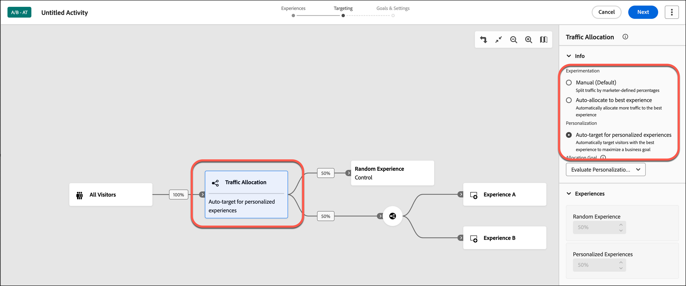

# Panoramica di [!UICONTROL Targeting automatico] {#auto-target-overview}

>[!BEGINSHADEBOX]

**In questa pagina:** Scopri in che modo un&#39;attività di **[!UICONTROL Targeting automatico]** fornisce l&#39;esperienza più personalizzata a ogni visitatore, come funziona, come scegliere l&#39;allocazione del traffico e come si confronta con **[!UICONTROL Automated Personalization]**.

>[!ENDSHADEBOX]

Le attività di **[!UICONTROL Targeting automatico]** in [!DNL Adobe Target] utilizzano l&#39;apprendimento automatico avanzato per scegliere tra più esperienze ad alte prestazioni definite dall&#39;addetto al marketing per personalizzare i contenuti e favorire le conversioni. **[!UICONTROL Targeting automatico]** fornisce l&#39;esperienza più personalizzata a ogni visitatore in base al suo profilo cliente individuale e al comportamento dei visitatori precedenti con profili simili.

>[!NOTE]
>
>* **[!UICONTROL Targeting automatico]** è disponibile come parte della soluzione [!DNL Target Premium]. Questa funzione non è disponibile in [!DNL Target Standard] senza una licenza [!DNL Target Premium]. Per ulteriori informazioni sulle funzioni avanzate fornite da questa licenza, consulta [Target Premium](/help/main/c-intro/intro.md).
>
>* **[!UICONTROL Analytics for Target]** (A4T) supporta **[!UICONTROL le attività Targeting automatico]**. Per ulteriori informazioni, consulta [Supporto A4T per attività di allocazione automatica e targeting automatico](/help/main/c-integrating-target-with-mac/a4t/a4t-at-aa.md).

Quando [crei un&#39;attività A/B](/help/main/c-activities/t-test-ab/t-test-create-ab/test-create-ab.md) con il flusso di lavoro guidato in tre passaggi, scegli l&#39;opzione **[!UICONTROL Targeting automatico per esperienze personalizzate]** nella pagina **[!UICONTROL Targeting]** (passaggio 2). Per i passaggi, consulta [Creare un&#39;attività di Targeting automatico](/help/main/c-activities/auto-target/create-auto-target.md).

Questa opzione all’interno del flusso di attività A/B ti consente di utilizzare l’apprendimento automatico per personalizzare il contenuto in base a una serie di esperienze definite dall’addetto al marketing con un clic. **[!UICONTROL Targeting automatico]** è progettato per fornire la massima ottimizzazione, rispetto ai tradizionali test A/B o **[!UICONTROL Allocazione automatica]**, determinando quale esperienza visualizzare per ogni visitatore. A differenza di un&#39;attività A/B, in cui l&#39;obiettivo è quello di trovare un singolo vincitore, **[!UICONTROL Targeting automatico]** determina automaticamente la migliore esperienza per un visitatore specifico. La migliore esperienza si basa sul profilo del visitatore e su altre informazioni contestuali.

Analogamente a **[!UICONTROL Automated Personalization]**, **[!UICONTROL Targeting automatico]** utilizza un algoritmo [Foresta casuale](/help/main/c-activities/t-automated-personalization/algo-random-forest.md), uno dei principali metodi di raccolta di dati scientifici, per determinare l&#39;esperienza migliore da mostrare a un visitatore. **[!UICONTROL Il Targeting automatico]** può adattarsi ai cambiamenti nel comportamento del visitatore, quindi può essere eseguito perennemente per fornire un incremento. Questo metodo è talvolta indicato come modalità &quot;sempre attiva&quot;.

A differenza di un&#39;attività A/B, in cui l&#39;allocazione dell&#39;esperienza per un determinato visitatore è definitiva, il **[!UICONTROL Targeting automatico]** ottimizza l&#39;obiettivo di business specificato su ogni visita. Come in **[!UICONTROL Automated Personalization]**, **[!UICONTROL Targeting automatico]** riserva parte del traffico dell&#39;attività come gruppo di controllo per impostazione predefinita, per misurare l&#39;incremento. Ai visitatori del gruppo di controllo viene messa a disposizione un&#39;esperienza casuale nell&#39;attività.

## Considerazioni {#considerations}

Tieni presente i seguenti punti quando utilizzi **[!UICONTROL Targeting automatico]**:

* Prestare attenzione alla forma attività. Le prestazioni dipendono più dal numero di posizioni × offerte che dal conteggio delle esperienze non elaborate. Le grandi combinazioni cartesiane possono rallentare il caricamento e la modifica nel **[!UICONTROL Compositore esperienza visivo]**, anche al di sotto dei limiti di esperienza documentati.

  Come best practice, mantieni **[!UICONTROL le attività Targeting automatico]** e **[!UICONTROL Automated Personalization]** in 4-6 posizioni con 4-6 offerte per posizione. Configurazioni più grandi non sono consigliate. Queste attività vengono create direttamente nel passaggio **[!UICONTROL Esperienze]**, pertanto l&#39;interfaccia utente [!DNL Target] potrebbe visualizzare avvisi in linea o bloccare il salvataggio quando la configurazione supera le soglie supportate.

* Non puoi cambiare un&#39;attività specifica da **[!UICONTROL Targeting automatico]** a **[!UICONTROL Automated Personalization]**, o viceversa.
* Non puoi passare dall&#39;allocazione del traffico **[!UICONTROL Manuale]** (test **[!UICONTROL A/B tradizionale]**) a **[!UICONTROL Targeting automatico]**, o viceversa, dopo che un&#39;attività è stata salvata come bozza.
* Un modello è progettato per identificare le prestazioni della strategia personalizzata rispetto al traffico servito in modo casuale rispetto all’invio di tutto il traffico all’esperienza vincente complessiva. Questo modello considera gli hit e le conversioni solo nell’ambiente predefinito.

  Un secondo set di modelli viene creato per ogni gruppo di modellazione (AP) o esperienza (AT). Per ciascuno di questi modelli, vengono considerati gli hit e le conversioni in tutti gli ambienti.

  Le richieste vengono gestite con lo stesso modello, indipendentemente dall’ambiente. Tuttavia, la pluralità di traffico deve provenire dall’ambiente predefinito per garantire che l’esperienza vincente complessiva identificata sia coerente con il comportamento reale.

* Utilizza almeno due esperienze.

## Terminologia {#section_A309B7E0B258467789A5CACDC1D923F3}

I seguenti termini sono utili quando si parla di **[!UICONTROL Targeting automatico]**:

| Termine | Definizione |
|---|---|
| [Slot machine](https://en.wikipedia.org/wiki/Multi-armed_bandit){target=_blank} | Un approccio slot machine per l&#39;ottimizzazione equilibra l&#39;apprendimento esplorativo e lo sfruttamento di tale apprendimento. |
| [Foresta casuale](/help/main/c-activities/t-automated-personalization/algo-random-forest.md) | Foresta casuale è uno dei principali metodi di apprendimento automatico. In termini di scienza dei dati, si tratta di una classificazione di insieme, o metodo di regressione, che funziona costruendo molti alberi decisionali in base agli attributi del visitatore e della visita. In [!DNL Target], Foresta casuale viene utilizzato per determinare quale esperienza dovrebbe avere la più alta probabilità di conversione (o il più alto ricavo per visita) per ogni visitatore specifico. |
| [Campionamento Thompson](https://en.wikipedia.org/wiki/Thompson_sampling){target=_blank} | L’obiettivo del campionamento di Thompson è determinare quale esperienza è la migliore complessivamente (non personalizzata), riducendo al minimo il &quot;costo&quot; della ricerca di tale esperienza. Il campionamento di Thompson sceglie sempre un vincitore, anche se non c’è differenza statistica tra due esperienze. |

## Funzionamento di [!UICONTROL Targeting automatico] {#section_77240E2DEB7D4CD89F52BE0A85E20136}

Nelle pagine seguenti vengono descritti i dati e gli algoritmi sottostanti **[!UICONTROL Targeting automatico]** e **[!UICONTROL Automated Personalization]**:

| Argomento | Dettagli |
|--- |--- |
| [Algoritmo Foresta casuale](/help/main/c-activities/t-automated-personalization/algo-random-forest.md) | L&#39;algoritmo di personalizzazione principale di [!DNL Target], utilizzato in **[!UICONTROL Targeting automatico]** e **[!UICONTROL Automated Personalization]**, è Foresta casuale. I metodi di raggruppamento, come Foresta casuale, utilizzano più algoritmi di apprendimento per ottenere prestazioni predittive migliori rispetto a quelle ottenibili da uno qualsiasi degli algoritmi di apprendimento costituenti. L&#39;algoritmo Foresta casuale nelle attività **[!UICONTROL Automated Personalization]** e **[!UICONTROL Targeting automatico]** è una classificazione, o metodo di regressione, che funziona costruendo una moltitudine di alberi decisionali al momento della formazione. |
| [Caricamento Dati Per [!DNL Target] Algoritmi Personalization](/help/main/c-activities/t-automated-personalization/uploading-data-for-the-target-personalization-algorithms.md) | Esistono diversi modi per immettere dati per i modelli **[!UICONTROL Targeting automatico]** e **[!UICONTROL Automated Personalization]**. |
| [Raccolta dati per [!DNL Target] Algoritmi Personalization](/help/main/c-activities/t-automated-personalization/ap-data.md) | Gli algoritmi di personalizzazione di [!DNL Target] raccolgono automaticamente vari dati. |

## Determinare l’allocazione del traffico {#section_AB3656F71D2D4C67A55A24B38092958F}

A seconda dell’obiettivo dell’attività, puoi scegliere una diversa allocazione del traffico tra il controllo e le esperienze personalizzate. Una buona pratica è di determinare questo obiettivo prima di attivare l&#39;attività.

L’elenco a discesa **[!UICONTROL Personalizza allocazione]** consente di scegliere tra le seguenti opzioni:

* **[!UICONTROL Valuta algoritmo Personalization (50/50)]**
* **[!UICONTROL Massimizza traffico Personalization (90/10)]**
* **[!UICONTROL Personalizza allocazione]**

Nella tabella seguente vengono illustrate le tre opzioni disponibili:

| Obiettivo dell’attività | Allocazione del traffico consigliata | Compromessi |
|--- |--- |--- |
| **[!UICONTROL Valuta algoritmo di personalizzazione (50/50)]**: se l’obiettivo è quello di testare l’algoritmo, assegna il 50% dei visitatori all’algoritmo di controllo e l’altro 50% a quello di destinazione. Questa suddivisione fornisce la stima più accurata dell’incremento. Consigliato per l’utilizzo con &quot;esperienze casuali&quot; come controllo. | 50% al controllo / 50% all’esperienza personalizzata. | <ul><li>Massimizza la precisione dell&#39;incremento tra controllo e personalizzazione</li><li>Un numero relativamente basso di visitatori ha un’esperienza personalizzata</li></ul> |
| **[!UICONTROL Massimizza traffico Personalization (90/10)]**: se il tuo obiettivo è invece quello di creare un&#39;attività &quot;sempre attiva&quot;, inserisci il 10% dei visitatori nel controllo affinché ci siano abbastanza dati per consentire agli algoritmi di continuare a imparare nel tempo. In questo caso, il compromesso è che, in cambio della personalizzazione di una proporzione maggiore del traffico, si ha meno precisione in cosa sia l’incremento esatto. Indipendentemente dall’obiettivo, questa è la suddivisione del traffico consigliata quando si utilizza come controllo un’esperienza specifica. | Una buona pratica è quella di allocare 10%-30% al controllo / 70%-90% all’esperienza personalizzata | <ul><li>Massimizza il numero di visitatori che hanno un’esperienza personalizzata</li><li>Massimizza l&#39;incremento</li><li>Meno precisione nel determinare l&#39;incremento per l&#39;attività</li></ul> |
| **[!UICONTROL Personalizza allocazione]** | Suddividi manualmente la percentuale come desiderato. | <ul><li>Potresti non ottenere i risultati desiderati. Se non sei sicuro, segui i suggerimenti per una delle opzioni precedenti</li></ul> |

Per regolare la percentuale di **[!UICONTROL controllo]**, fai clic su **[!UICONTROL Esperienze]** nel riquadro **[!UICONTROL Allocazione traffico]**, quindi regola le percentuali come desiderato. Non è possibile ridurre il gruppo di controllo sotto il 10%.

È possibile [selezionare un&#39;esperienza specifica da usare come controllo](/help/main/c-activities/t-automated-personalization/experience-as-control.md) oppure utilizzare l&#39;opzione **[!UICONTROL Esperienza casuale]**.

## Confronta [!UICONTROL Targeting automatico] e [!UICONTROL Automated Personalization] {#compare-at-ap}

**[!UICONTROL Targeting automatico]** e **[!UICONTROL Automated Personalization]** condividono lo stesso algoritmo e gli stessi dati, ma differiscono per quanto riguarda la modalità di creazione delle esperienze e il traffico necessario per i modelli.

### Cosa hanno in comune i due tipi di attività {#section_2A601F482F9A44E38D4B694668711319}

* **Ottimizzazione per ogni visita.** L’algoritmo prevede la propensione di un visitatore a convertire (o i ricavi stimati dalla conversione) per fornire l’esperienza migliore. Un visitatore è idoneo per una nuova esperienza al termine di una sessione esistente. L’eccezione è un visitatore nel gruppo di controllo che mantiene l’esperienza assegnata alla prima visita. All’interno di una sessione, la previsione non cambia, per mantenere la coerenza visiva.
* **Adattamento ai cambiamenti nel comportamento del visitatore.** La slot machine &quot;spende&quot; sempre una piccola frazione di traffico per continuare a imparare per tutta la vita dell&#39;attività e per prevenire lo sfruttamento eccessivo delle tendenze apprese in precedenza. I modelli sottostanti vengono ricreati ogni 24 ore utilizzando i dati di comportamento dei visitatori più recenti. Se l&#39;algoritmo non è in grado di determinare le esperienze vincenti per i singoli utenti, visualizza automaticamente l&#39;esperienza con le prestazioni migliori complessiva, trovata con il [Campionamento di Thompson](https://en.wikipedia.org/wiki/Thompson_sampling), mentre continua a cercare vincitori personalizzati.
* **Una singola metrica di obiettivo.** L&#39;algoritmo esegue l&#39;ottimizzazione continua per una metrica, che può essere basata sulla conversione o sui ricavi (nello specifico, **[!UICONTROL Ricavo per visita]**).
* **Raccolta dati automatica.** [!DNL Target] raccoglie automaticamente informazioni sui visitatori per generare i modelli di personalizzazione. Per ulteriori informazioni sui parametri utilizzati, vedere [Raccolta dati di Automated Personalization](/help/main/c-activities/t-automated-personalization/ap-data.md).
* **Pubblico condiviso.** [!DNL Target] utilizza automaticamente tutti i [!DNL Adobe Experience Cloud] tipi di pubblico condivisi per generare i modelli di personalizzazione. Non è necessario eseguire alcuna operazione specifica per aggiungere tipi di pubblico al modello. Per informazioni sull’utilizzo di [!DNL Experience Cloud Audiences] con [!DNL Target], consulta [Audience di Experience Cloud](/help/main/c-integrating-target-with-mac/mmp.md).
* **Dati personalizzati.** Gli addetti al marketing possono caricare dati offline, punteggi di propensione o altri dati personalizzati per creare modelli di personalizzazione. Ulteriori informazioni sul [caricamento di dati per Targeting automatico e Automated Personalization](/help/main/c-activities/t-automated-personalization/uploading-data-for-the-target-personalization-algorithms.md).

### Differenze tra i due tipi di attività {#section_BA4D83BE40F14A96BE7CBC7C7CF2A8FB}

Considera **[!UICONTROL Targeting automatico]** invece di **[!UICONTROL Automated Personalization]** quando desideri definire l&#39;intera esperienza, utilizzare il set completo di **[!UICONTROL funzioni del Compositore esperienza visivo]** o apportare modifiche strutturali alla pagina.

| | [!UICONTROL Targeting automatico] | [!UICONTROL Personalizzazione automatizzata] |
|---|---|---|
| **Definizione esperienza** | Puoi definire l’intera esperienza, che può contenere più modifiche. | Le singole offerte vengono combinate automaticamente per formare un’esperienza. |
| **[!UICONTROL Funzionalità del Compositore esperienza visivo]** | **[!UICONTROL Il Targeting automatico]** è incorporato nel flusso di lavoro di attività A/B, quindi beneficia di un Compositore esperienza visivo più maturo e completo. Puoi anche utilizzare [collegamenti di controllo qualità](/help/main/c-activities/c-activity-qa/activity-qa.md). | L’editor di codice personalizzato, più tipi di pubblico e altre funzioni non sono supportati. |
| **Modifiche strutturali apportate alla pagina** | Più appropriato. Ad esempio, puoi ridisporre gli elementi nella home page. | Meno appropriato. |
| **Numero di esperienze** | Di solito meno, perché un’esperienza può contenere più modifiche. | Di solito di più, perché le esperienze sono tutte combinazioni di offerte e posizioni. |
| **Traffico necessario per generare i modelli** | Frequentemente meno in totale. | Di solito più in totale. |

La quantità di traffico *per esperienza* necessaria per generare i modelli è la stessa per entrambi i tipi di attività. **[!UICONTROL Il Targeting automatico]** richiede spesso meno traffico totale perché in genere presenta meno esperienze.

Ad esempio, in un&#39;attività **[!UICONTROL Automated Personalization]** con due offerte per posizione e due posizioni, ci sono quattro (2 × 2 = 4) esperienze totali nell&#39;attività (senza esclusioni). In **[!UICONTROL Targeting automatico]**, è possibile impostare l&#39;esperienza 1 per includere l&#39;offerta 1 in posizione 1 e l&#39;offerta 2 in posizione 2 e l&#39;esperienza 2 per includere l&#39;offerta 2 in posizione 1 e l&#39;offerta 1 in posizione 2. **[!UICONTROL Targeting automatico]** consente più modifiche all&#39;interno di un&#39;esperienza, in modo da poter ridurre il numero totale di esperienze nell&#39;attività.

### Requisiti di traffico per [!UICONTROL Targeting automatico] {#traffic-requirements}

Le seguenti regole generali aiutano a comprendere i requisiti del traffico:

* **Quando [!UICONTROL Conversione] è la metrica di successo:** 1.000 visite e almeno 50 conversioni al giorno per esperienza. Inoltre, l’attività deve avere almeno 7.000 visite e 350 conversioni.
* **Quando [!UICONTROL Ricavo per visita] è la metrica di successo:** 1.000 visite e almeno 50 conversioni al giorno per esperienza. Inoltre, l’attività deve avere almeno 1.000 conversioni per esperienza. **[!UICONTROL Il ricavo per visita]** in genere richiede più dati per generare modelli, perché la varianza nei ricavi di visita è in genere più elevata rispetto al tasso di conversione.

**[!UICONTROL Targeting automatico]** fornisce anche un ampio framework di test online. La slot machine fa parte di un framework di test online più ampio che consente a [!DNL Adobe] data scientist e ricercatori di comprendere i vantaggi dei loro continui miglioramenti nelle condizioni reali. In futuro, questo banco di prova consentirà a [!DNL Adobe] di aprire la propria piattaforma di machine learning ai client esperti in materia di dati, in modo che possano inserire i propri modelli per migliorare i modelli [!DNL Target].

Per ulteriori informazioni sul reporting, vedere [Reporting and Auto-Target](/help/main/c-activities/auto-target/reporting-and-auto-target.md).
