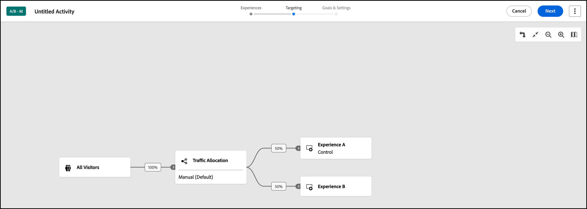

# Crea un&#39;attività [!UICONTROL Targeting automatico] {#create-auto-target-activity}

>[!BEGINSHADEBOX]

**In questa pagina:** Scopri come creare un&#39;attività **[!UICONTROL Targeting automatico]** nel **[!UICONTROL Compositore esperienza visivo]**. Puoi creare le tue esperienze, impostare il targeting e scegliere il metodo di allocazione del traffico di Targeting automatico, quindi configurare obiettivi e impostazioni.

>[!ENDSHADEBOX]

Utilizza il **[!UICONTROL Compositore esperienza visivo]** (VEC) in [!DNL Adobe Target] per creare l&#39;attività **[!UICONTROL Targeting automatico]** **[!UICONTROL Test A/B]** direttamente su una pagina abilitata per [!DNL Target] e per modificare parti della pagina in [!DNL Target].

>[!NOTE]
>
>**[!UICONTROL Targeting automatico]** è disponibile come parte della soluzione [!DNL Target Premium]. Questa funzione non è disponibile in [!DNL Target Standard] senza una licenza [!DNL Target Premium]. Per ulteriori informazioni sulle funzioni avanzate fornite da questa licenza, consulta [Target Premium](/help/main/c-intro/intro.md).

L’attività segue il flusso di lavoro guidato in tre passaggi nel Compositore esperienza visivo:

1. [Creare esperienze](#build-experiences)
1. [Imposta targeting e allocazione traffico](#set-targeting)
1. [Configurare obiettivi e impostazioni](#configure-goals-and-settings)

## Passaggio 1: creare esperienze {#build-experiences}

Crea l’attività, quindi progetta le esperienze alternative da testare rispetto al controllo.

### Creare l’attività {#create-activity}

Aprire la pagina che si desidera verificare nel **[!UICONTROL Compositore esperienza visivo]** e denominare l&#39;attività.

1. Dall&#39;elenco **[!UICONTROL Attività]**, fare clic su **[!UICONTROL Crea attività]** > **[!UICONTROL Test A/B]**.

   

1. Dalla finestra di dialogo **[!UICONTROL Crea attività test A/B]**, scegli il Compositore esperienza:

   * **[!UICONTROL Visivo]**.
   * **[!UICONTROL Compositore esperienza basato su moduli]**, consulta [Compositore esperienza basato su moduli](/help/main/c-experiences/form-experience-composer.md) per ulteriori informazioni.

   >[!NOTE]
   >
   >Oltre al Compositore esperienza visivo e al Compositore esperienza basato su moduli **[!UICONTROL 1}, [!DNL Target] offre il Compositore esperienza visivo**[!UICONTROL  Applicazione a pagina singola ]**.]** Per ulteriori informazioni sui vari moduli di composizione, consulta [Esperienze e offerte](/help/main/c-experiences/experiences.md).
   >
   >Per informazioni sulla risoluzione dei problemi relativi al Compositore esperienza visivo, vedere [Risoluzione dei problemi relativi al Compositore esperienza visivo](/help/main/c-experiences/c-visual-experience-composer/r-troubleshoot-composer/troubleshoot-composer.md).

1. (Condizionale) Se sei un [cliente Target Premium](/help/main/c-intro/intro.md#premium), dall&#39;elenco a discesa **[!UICONTROL Scegli Workspace]** scegli un [area di lavoro](/help/main/administrating-target/c-user-management/property-channel/property-channel.md).

1. Nella casella **[!UICONTROL Immetti URL attività]**, specifica l&#39;[URL attività](/help/main/c-activities/t-test-ab/t-test-create-ab/ab-activity-url.md).

   Se l’account è [configurato con un URL predefinito](/help/main/administrating-target/visual-experience-composer-set-up.md), questo verrà visualizzato come impostazione predefinita. Se necessario, puoi passare dall’URL predefinito a un altro.

1. Fai clic su **[!UICONTROL Crea]**. Verrà aperto il **[!UICONTROL Compositore esperienza visivo]**, con la pagina specificata nell&#39;URL.

1. Per assegnare un nome all&#39;attività, fare clic sull&#39;icona **[!UICONTROL Modifica]** (  ) e specificare un nome descrittivo per l&#39;attività, quindi fare clic su **[!UICONTROL Salva]**.

   {{activity-name-rules}}

   

### Progettare le esperienze {#design-experiences}

Crea nuove esperienze modificando gli elementi nella pagina.

Dopo aver creato una nuova attività, il **[!UICONTROL Compositore esperienza visivo]** visualizza due schede a sinistra: Esperienza A ed Esperienza B.

* **Esperienza A** è l&#39;esperienza di controllo. È possibile eliminarla se non si desidera includere come opzione un&#39;esperienza del sito predefinita.
* **Esperienza B** è l&#39;esperienza alternativa aggiunta al test. Questa scheda consente di apportare le modifiche desiderate.

Per aggiungere altre esperienze al test, fai clic sull&#39;icona **[!UICONTROL Aggiungi]** (  ).

Per ulteriori informazioni sull&#39;aggiunta e la modifica delle esperienze nel **[!UICONTROL Compositore esperienza visivo]**, vedere [Aggiungi esperienza](/help/main/c-activities/t-test-ab/t-test-create-ab/ab-add-experience.md#ab-add-experience).

## Passaggio 2: impostare il targeting e l’allocazione del traffico {#set-targeting}

Dopo aver effettuato l&#39;accesso al menu **[!UICONTROL Targeting]**, viene aperto il diagramma di flusso.

Il diagramma di flusso ti guida attraverso l’assegnazione di un pubblico e della relativa percentuale di traffico, la selezione del metodo di allocazione del traffico e la specifica dell’allocazione del traffico per ogni esperienza nell’attività.

1. (Condizionale) Fai clic sul controllo **[!UICONTROL Tutti i visitatori]** per selezionare un altro pubblico per l&#39;attività.

   Il pubblico **[!UICONTROL Tutti i visitatori]** è impostato come predefinito. Se selezioni un altro pubblico, il suo nome viene visualizzato nel controllo più a sinistra. Ad esempio, puoi limitare l’accesso al 50% di tutti i visitatori o 45% del pubblico “Californians”.

   +++ Passaggi per selezionare un pubblico diverso

   Viene visualizzato il frame a destra, che consente di aggiungere o eliminare un pubblico e di assegnare la percentuale di visitatori per l’attività.

   1. Per cambiare il pubblico, fai clic sull&#39;icona **[!UICONTROL Sostituisci]** (  ) nel riquadro a destra.
   1. Nella finestra di dialogo **[!UICONTROL Aggiungi pubblico]**, [seleziona il pubblico desiderato](/help/main/c-activities/t-test-ab/t-test-create-ab/ab-audience.md), quindi fai clic su **[!UICONTROL Assegna pubblico]**.

      Per creare un pubblico che combina più tipi di pubblico, fare clic su **[!UICONTROL Combina tipi di pubblico]**. Per ulteriori dettagli, vedere [Combinare più tipi di pubblico](/help/main/c-target/combining-multiple-audiences.md).

      Per creare un nuovo pubblico che non sia già presente nella **[!UICONTROL Libreria pubblico]**, fai clic su **[!UICONTROL Crea pubblico]**. Nel flusso di lavoro [create-audience](/help/main/c-target/c-audiences/audiences.md), scegli una delle seguenti opzioni:

      * **[!UICONTROL Libreria tipi di pubblico]**: crea un pubblico on-demand salvato nella **[!UICONTROL Libreria tipi di pubblico]** e riutilizzabile in altre attività.
      * **[!UICONTROL Solo per questa attività]**: crea un [pubblico specifico per l&#39;attività](/help/main/c-target/creating-activity-only-audience.md) che non viene salvato nella **[!UICONTROL Libreria tipi di pubblico]** e che può essere utilizzato solo nell&#39;attività corrente.

   1. Fai clic su **[!UICONTROL Percentuale visitatori]** nel frame a destra, quindi scegli la percentuale di visitatori idonei che desideri inserire nell&#39;attività.

   +++

1. Fai clic sul controllo **[!UICONTROL Allocazione traffico]**, quindi scegli il metodo di allocazione del traffico desiderato nel riquadro a destra. In questo scenario, fai clic su **[!UICONTROL Targeting automatico per esperienze personalizzate]**.

   

   +++ Metodi di allocazione del traffico

   | Metodo | Funzionamento |
   |---|---|
   | **[!UICONTROL Manuale (predefinito)]** | Specifica la percentuale di partecipanti che dovranno visualizzare ogni esperienza. Puoi suddividere le percentuali in modo uniforme tra tutte le esperienze, oppure specificare percentuali maggiori o minori per ogni esperienza. Il totale per tutte le esperienze deve essere uguale al 100%. |
   | **[!UICONTROL Allocazione automatica all&#39;esperienza migliore]** | La maggior parte dei partecipanti all’attività viene automaticamente indirizzata alle esperienze con prestazioni migliori. Alcuni visitatori sono assegnati a tutte le esperienze, per mantenere l’esplorazione delle esperienze e riconoscere eventuali cambiamenti nelle tendenze prestazionali. Per ulteriori informazioni, vedere [**[!UICONTROL Cenni preliminari sull&#39;allocazione automatica ]**](/help/main/c-activities/automated-traffic-allocation/automated-traffic-allocation.md#concept_A1407678796B4C569E94CBA8A9F7F5D4). |
   | **[!UICONTROL Targeting automatico per esperienze personalizzate]** | [!DNL Target] utilizza l&#39;apprendimento automatico avanzato per personalizzare i contenuti e favorire le conversioni identificando più esperienze ad alte prestazioni definite dall&#39;addetto al marketing e fornendo l&#39;esperienza più adatta ai visitatori in base ai loro profili cliente individuali e ai comportamenti passati di visitatori simili. Per ulteriori informazioni, consulta [Panoramica sul Targeting automatico](/help/main/c-activities/auto-target/auto-target-to-optimize.md). |

   +++

1. Fai clic su **[!UICONTROL Esperienze]** nel riquadro a destra, quindi specifica l&#39;allocazione del traffico desiderata per ogni esperienza.

1. Quando sei soddisfatto delle scelte relative a pubblico, esperienza e allocazione del traffico, fai clic su **[!UICONTROL Avanti]** per passare al terzo passaggio del flusso di lavoro guidato in tre passaggi.

## Passaggio 3: configurare obiettivi e impostazioni {#configure-goals-and-settings}

Nella pagina **[!UICONTROL Obiettivi e impostazioni]**, indica a [!DNL Target] come misurare l&#39;attività. Le impostazioni disponibili dipendono dall&#39;utilizzo di [!DNL Target] o [Analytics come origine per la generazione di rapporti](/help/main/c-integrating-target-with-mac/a4t/a4t.md).

1. Specifica [obiettivi e impostazioni](/help/main/c-activities/t-test-ab/t-test-create-ab/ab-goals-and-settings.md) per l’attività. Rivedi le sezioni della pagina e imposta ciò che ti serve.

   | Sezione | Impostazioni |
   |---|---|
   | **[!UICONTROL Impostazioni attività]** | Obiettivo facoltativo: **[!UICONTROL Priorità]** (utilizzata quando più attività condividono una posizione e un pubblico) e **[!UICONTROL Durata]** (date di inizio e fine). |
   | **[!UICONTROL Impostazioni reporting]** | L&#39;origine per la generazione di rapporti, la metrica di obiettivo (ad esempio, una metrica di **[!UICONTROL conversione]**), metriche aggiuntive, tipi di pubblico per la generazione di rapporti e la metodologia statistica. |
   | **[!UICONTROL Impostazioni avanzate]** | Dipendenze tra le metriche di successo, cosa accade dopo che un visitatore ha raggiunto la metrica di obiettivo e come viene incrementato il conteggio. |
   | **[!UICONTROL Altri metadati]** | Note sull’attività utili per te o per altri membri del gruppo. |

   >[!NOTE]
   >
   >Se desideri utilizzare [Analytics for Target](/help/main/c-integrating-target-with-mac/a4t/a4t.md) (A4T) con questa attività, consulta le informazioni importanti in [Supporto A4T per le attività di allocazione automatica e targeting automatico](/help/main/c-integrating-target-with-mac/a4t/a4t-at-aa.md).

1. Fai clic su **[!UICONTROL Salva e chiudi]** o **[!UICONTROL Salva]**.

Dopo aver creato l&#39;attività, nella scheda **[!UICONTROL Panoramica]** vengono visualizzate informazioni sull&#39;attività, incluso un diagramma.
