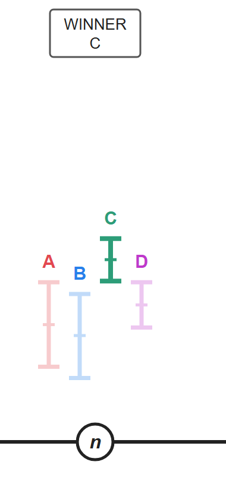

# Introduzione a [!UICONTROL Allocazione automatica] {#auto-allocate-overview}

>[!BEGINSHADEBOX]

**In questa pagina:** Scopri come un&#39;attività di **[!UICONTROL Allocazione automatica]** identifica un&#39;esperienza vincente e ridistribuisce il traffico, quando utilizzarla, come funziona l&#39;algoritmo e cosa considerare prima di utilizzarlo.

>[!ENDSHADEBOX]

Un&#39;attività di **[!UICONTROL Allocazione automatica]** in [!DNL Adobe Target] identifica un vincitore tra due o più esperienze e ridistribuisce automaticamente più traffico per aumentare le conversioni, mentre il test continua a essere eseguito e ad apprendere.

Crea un&#39;attività **[!UICONTROL Allocazione automatica]** con il flusso di lavoro guidato in tre passaggi di un&#39;attività A/B: scegli l&#39;opzione **[!UICONTROL Allocazione automatica all&#39;esperienza migliore]** nella pagina **[!UICONTROL Targeting]** (passaggio 2). Per i passaggi, consulta [Creare un&#39;attività di allocazione automatica](/help/main/c-activities/automated-traffic-allocation/create-auto-allocate-activity.md).

## Perché utilizzare [!UICONTROL Allocazione automatica] {#why-auto-allocate}

I test A/B standard hanno un costo intrinseco. Devi investire del traffico per misurare le prestazioni di ogni esperienza e la distribuzione del traffico rimane fissa anche dopo che alcune esperienze hanno prestazioni migliori di altre. La dimensione del campione è complicata da determinare, l’attività deve eseguire l’intero corso prima di poter agire su un vincitore e c’è ancora una possibilità che il vincitore identificato non sia un vero vincitore.

Un&#39;attività di **[!UICONTROL allocazione automatica]** riduce il costo e il sovraccarico:

* Monitora le prestazioni della metrica obiettivo di tutte le esperienze e invia in proporzione più nuovi partecipanti alle esperienze con prestazioni migliori. Per l’esplorazione delle altre esperienze viene riservata una quantità adeguata di traffico.
* L’ottimizzazione si verifica in parallelo con l’apprendimento, in modo da poter vedere i vantaggi nei risultati mentre l’attività è ancora in esecuzione.
* I visitatori passano gradualmente alle esperienze vincenti, quindi non devi aspettare il termine dell’attività. L’incremento è più rapido perché i partecipanti all’attività che sarebbero stati inviati a esperienze di minore successo ricevono esperienze vincenti potenziali.

Vantaggi principali:

* Mantiene la rigidità di un test A/B.
* Trova un vincitore statisticamente significativo più rapidamente di un test A/B manuale.
* Fornisce un incremento medio della campagna maggiore rispetto a un test A/B manuale.

### Come [!UICONTROL Allocazione automatica] identifica un vincitore {#true-winner}

Un normale test A/B in [!DNL Target] confronta ogni sfidante solo con il controllo. Ad esempio, se un’attività presenta le esperienze A, B, C e D, dove A è il controllo, il test confronta A con B, A con C e A con D. La maggior parte dei prodotti, tra cui [!DNL Target], utilizza un test t di [Welch](https://en.wikipedia.org/wiki/Welch%27s_t-test){target=_blank} per questi confronti per produrre un&#39;affidabilità basata sul valore p. Tuttavia, [!DNL Target] non esegue automaticamente i confronti impliciti (B con C, B con D e C con D) necessari per trovare l&#39;esperienza &quot;migliore&quot;, pertanto è necessario analizzare i risultati manualmente.

**[!UICONTROL Allocazione automatica]** rimuove questo passaggio manuale:

* Esegue tutti i confronti impliciti tra le esperienze e produce un vincitore &quot;vero&quot;. Non vi è alcuna nozione di esperienza di “controllo” nel test.
* Assegna nuovi visitatori alle esperienze fino a quando l’intervallo di affidabilità della migliore esperienza non si sovrappone all’intervallo di affidabilità di qualsiasi altra esperienza.
* Utilizza intervalli di affidabilità basati sulla [disuguaglianza di Bernstein](https://en.wikipedia.org/wiki/Bernstein_inequalities_%28probability_theory%29){target=_blank}, che compensa le valutazioni ripetute che normalmente produrrebbero falsi positivi.
* Quando si ferma, purché non vi sia una dipendenza temporale sostanziale dai visitatori che arrivano alla pagina, c’è almeno un 95% di possibilità che restituisca un’esperienza la cui vera risposta non sia peggiore dell’1% (relativo) rispetto alla vera risposta dell’esperienza vincente.

## Quando utilizzare [!UICONTROL Allocazione automatica] {#when-to-use}

Scegli tra le **[!UICONTROL attività Allocazione automatica]**, **[!UICONTROL Test A/B]** e **[!UICONTROL attività Automated Personalization]** in base all&#39;obiettivo:

| Attività | Utilizzala quando | Differenze |
|---|---|---|
| **[!UICONTROL Allocazione automatica]** | Desideri ottimizzare l’attività fin dall’inizio e identificare le esperienze vincenti il più rapidamente possibile. | Rendendo più frequenti le esperienze ad alte prestazioni, le prestazioni complessive dell’attività aumentano. |
| [**[!UICONTROL Test A/B]**](/help/main/c-activities/t-test-ab/test-ab.md#test-ab) | Desideri caratterizzare le prestazioni di tutte le esperienze prima di ottimizzare il sito. | Un test A/B consente di classificare tutte le esperienze, mentre l&#39;**[!UICONTROL allocazione automatica]** trova le prestazioni migliori ma non garantisce la differenziazione tra le prestazioni più basse. |
| [**[!UICONTROL Personalizzazione automatizzata]**](/help/main/c-activities/t-automated-personalization/automated-personalization.md#automated-personalization-overview) | Desideri algoritmi di ottimizzazione della complessità più elevata, ad esempio modelli di apprendimento automatico che generano previsioni basate su attributi di profilo individuali. | **[!UICONTROL Allocazione automatica]** esamina il comportamento aggregato delle esperienze (proprio come i test A/B standard) e non distingue tra i visitatori. |

## Funzionamento dell’algoritmo {#how-it-works}

L&#39;algoritmo di **[!UICONTROL Allocazione automatica]** è un approccio all&#39;ottimizzazione di [slot multi-armed bandit](https://en.wikipedia.org/wiki/Multi-armed_bandit){target=_blank}, che bilancia l&#39;apprendimento esplorativo e il suo sfruttamento. Esso incorpora sia le prestazioni misurate (come il tasso di conversione) sia gli intervalli di affidabilità dei dati cumulativi. A differenza di un test A/B standard, in cui il traffico viene suddiviso in modo uniforme tra le esperienze, **[!UICONTROL Allocazione automatica]** modifica l&#39;allocazione del traffico tra le esperienze:

* L’80% dei visitatori viene allocato utilizzando la logica descritta in questa sezione.
* Il 20% dei visitatori viene assegnato in modo casuale in tutte le esperienze per adattarsi al cambiamento del comportamento del visitatore.

L’approccio slot machine consente di liberare parte del traffico per l’esplorazione, sfruttando al contempo le esperienze che danno buoni risultati. Un numero maggiore di nuovi visitatori viene indirizzato verso esperienze con prestazioni migliori, mantenendo al tempo stesso la capacità di reagire a condizioni mutevoli. I modelli vengono aggiornati almeno una volta all’ora per garantire che reagiscano ai dati più recenti.

Man mano che più visitatori accedono all’attività, alcune esperienze hanno maggiore successo e ricevono più traffico. Il 20% del traffico continua a contribuire casualmente all’esplorazione di tutte le esperienze. Se una delle esperienze dalle prestazioni peggiori inizia a ottenere risultati migliori, le viene allocato più traffico. Se il successo di un’esperienza con prestazioni migliori diminuisce, le viene assegnato meno traffico. Questo può accadere, ad esempio, quando un evento induce i visitatori a cercare diverse informazioni sul sito multimediale o quando le vendite nel weekend sul sito di vendita al dettaglio forniscono risultati diversi.

L’illustrazione seguente rappresenta il comportamento dell’algoritmo durante un test con quattro esperienze (fai clic per espandere l’illustrazione):

{width="600" zoomable="yes"}

L&#39;illustrazione mostra come il traffico assegnato a ogni esperienza progredisca nell&#39;acro di parecchi turni della durata dell&#39;attività, finché non sia possibile determinare un chiaro vincitore.

| Arrotondamento | Descrizione |
|--- |--- |
| {width="200" zoomable="yes"} | **Turno di riscaldamento (0)**: ogni esperienza ottiene pari traffico fino a quando ogni esperienza nell&#39;attività ha un minimo di 1.000 visitatori e 50 conversioni.<ul><li>Esperienza A=25%</li><li>Esperienza B=25%</li><li>Esperienza C=25%</li><li>Esperienza D=25%</li></ul>Quando ogni esperienza raggiunge i 1.000 visitatori e 50 conversioni, [!DNL Target] avvia l&#39;allocazione automatica del traffico. Tutte le allocazioni avvengono in turni e vengono selezionate due esperienze per ogni turno. Solo due esperienze proseguono al prossimo turno: D e C.<ul><li>Progredire significa che alle due esperienze è assegnato l’80% del traffico in parti uguali.</li><li>Le altre due esperienze continuano a partecipare, ma vengono gestite solo come parte dell’allocazione casuale del 20% del traffico generato da nuovi visitatori che accedono all’attività.</li><li>Tutte le allocazioni vengono aggiornate ogni ora (mostrato dagli arrotondamenti lungo l&#39;asse x qui sopra). Dopo ogni turno, i dati cumulativi vengono confrontati.</li></ul> |
| {width="200" zoomable="yes"} | **Turno 1**: l&#39;80% del traffico è assegnato alle esperienze C e D (40% ciascuna). Il 20% del traffico viene assegnato in modo casuale alle esperienze A, B, C e D (5% ciascuna). Durante questo turno, l&#39;esperienza A registra buoni risultati.<ul><li>L&#39;algoritmo sceglie l&#39;esperienza D per passare al turno successivo perché ha il più alto tasso di conversione (come indicato dalla scala verticale di ogni attività).</li><li>L&#39;algoritmo sceglie anche l&#39;esperienza A per proseguire perché, tra le esperienze rimanenti, ha il limite superiore più alto dell&#39;intervallo di affidabilità Bernstein al 95%.</li></ul>Le esperienze D e A proseguono. |
| {width="200" zoomable="yes"} | **Turno 2**: l&#39;80% del traffico è assegnato alle esperienze A e D (40% ciascuna). Il 20% del traffico è allocato in modo casuale, pertanto le esperienze A, B, C e D ricevono ciascuna il 5% del traffico. Durante questo turno, l’esperienza B registra buoni risultati.<ul><li>L&#39;algoritmo sceglie l&#39;esperienza D per passare al turno successivo perché ha il più alto tasso di conversione (come indicato dalla scala verticale di ogni attività).</li><li>L&#39;algoritmo sceglie anche l&#39;esperienza B per proseguire perché, tra le esperienze rimanenti, ha il limite superiore più alto dell&#39;intervallo di affidabilità Bernstein al 95%.</li></ul>Le esperienze D e B proseguono. |
| {width="200" zoomable="yes"} | **Turno 3**: l&#39;80% del traffico è assegnato alle esperienze B e D (40% ciascuna). Il 20% del traffico è allocato in modo casuale, pertanto le esperienze A, B, C e D ricevono ciascuna il 5% del traffico. Durante questo turno, l&#39;esperienza D continua a fornire buoni risultati, così come l&#39;esperienza C.<ul><li>L&#39;algoritmo sceglie l&#39;esperienza D per passare al turno successivo perché ha il più alto tasso di conversione (come indicato dalla scala verticale di ogni attività).</li><li>L&#39;algoritmo sceglie anche l&#39;esperienza C per proseguire perché, tra le esperienze rimanenti, ha il limite superiore più alto dell&#39;intervallo di affidabilità Bernstein al 95%.</li></ul>Le esperienze D e C proseguono. |
| {width="200" zoomable="yes"} | **Turno 4**: l&#39;80% del traffico è assegnato alle esperienze C e D (40% ciascuna). Il 20% del traffico è allocato in modo casuale, pertanto le esperienze A, B, C e D ricevono ciascuna il 5% del traffico. Durante questo turno, l&#39;esperienza C risulta avere buone prestazioni.<ul><li>L&#39;algoritmo sceglie l&#39;esperienza C per passare al turno successivo perché ha il più alto tasso di conversione (come indicato dalla scala verticale di ogni attività).</li><li>L&#39;algoritmo sceglie anche l&#39;esperienza D per proseguire perché, tra le esperienze rimanenti, ha il limite superiore più alto dell&#39;intervallo di affidabilità Bernstein al 95%.</li></ul>Le esperienze C e D proseguono. |
| {width="200" zoomable="yes"} | **Turno *n***: mentre l&#39;attività progredisce, inizia a emergere un&#39;esperienza con prestazioni elevate e il processo continua fino a quando non si verifica un&#39;esperienza vincente. Quando l’intervallo di affidabilità dell’esperienza con il tasso di conversione più alto non si sovrappone all’intervallo di affidabilità di qualsiasi altra esperienza, viene etichettato come vincitore. Un distintivo [viene visualizzato nella pagina dell&#39;attività vincente](/help/main/c-activities/automated-traffic-allocation/determine-winner.md) e nell&#39;elenco&#x200B;**[!UICONTROL &#x200B; Attività&#x200B;]**.<ul><li>L&#39;algoritmo sceglie l’esperienza C come chiaro vincitore.</li></ul>A questo punto, l’algoritmo indirizza l’80% del traffico all’esperienza C, mentre il 20% del traffico continua a essere indirizzato casualmente a tutte le esperienze (A, B, C e D). In totale, C ottiene l’85% del traffico. Nel caso improbabile che l&#39;intervallo di affidabilità del vincitore inizi a sovrapporsi nuovamente, l&#39;algoritmo torna al comportamento del turno 4. **Importante**: se hai scelto manualmente un vincitore in una fase precedente del processo, sarebbe facile scegliere l&#39;esperienza sbagliata. Per questo motivo, è consigliabile attendere che l’algoritmo determini l’esperienza vincente. |

>[!NOTE]
>
>Se un&#39;attività ha solo due esperienze, entrambe ottengono la stessa quantità di traffico fino a quando [!DNL Target] trova un&#39;esperienza vincente con il 75% di affidabilità. A quel punto, due terzi del traffico vengono assegnati al vincitore e un terzo al perdente. Successivamente, quando un’esperienza raggiunge il 95% di affidabilità, il 90% del traffico viene assegnato al vincitore e il 10% al perdente. [!DNL Target] invia sempre del traffico all&#39;esperienza &quot;perdente&quot; per evitare falsi positivi alla fine (ovvero, per mantenere un po&#39; di esplorazione).

Dopo l&#39;attivazione di un&#39;attività **[!UICONTROL Allocazione automatica]**, le operazioni seguenti non sono consentite nell&#39;interfaccia utente [!DNL Target]:

* Passaggio della modalità **[!UICONTROL Allocazione traffico]** a **[!UICONTROL Manuale]**.
* Modifica del tipo di metrica per obiettivo.
* Modifica delle opzioni nel pannello **[!UICONTROL Impostazioni avanzate]**.

Per ulteriori informazioni, vedere [Le prestazioni dell&#39;allocazione automatica sono superiori a quelle di un test manuale](/help/main/c-activities/automated-traffic-allocation/faster-results-higher-revenue.md).

## Avvertenze {#caveats}

Considera le seguenti informazioni quando lavori con **[!UICONTROL Allocazione automatica]**.

### È supportata una sola impostazione di metrica avanzata

La funzionalità **[!UICONTROL Allocazione automatica]** funziona con una sola impostazione di metrica avanzata: **[!UICONTROL Incrementa il conteggio e mantieni l&#39;utente in attività]**. Le seguenti impostazioni di metrica avanzate non sono supportate: **[!UICONTROL Incrementa il conteggio]**, **[!UICONTROL Rilascia l&#39;utente]**, **[!UICONTROL Consenti il reinserimento e incrementa il conteggio]** e **[!UICONTROL Rilascia l&#39;utente e impedisci il reinserimento]**.

### I visitatori di ritorno frequenti possono gonfiare i tassi di conversione {#return-visitors}

Se un visitatore che vede l’esperienza A torna spesso e la sua conversione si verifica più volte, il tasso di conversione (CR) dell’esperienza A viene aumentato artificialmente. Confronta questo risultato con l’esperienza B, dove i visitatori si convertono ma non tornano spesso. Di conseguenza, il CR dell’esperienza A ha un aspetto migliore del CR dell’esperienza B, pertanto è più probabile che i nuovi visitatori vengano assegnati ad A che a B. Se scegli di contare una volta per partecipante, il CR di A e il CR di B potrebbero essere identici.

La logica favorisce i visitatori che si convertono rapidamente o che visitano più spesso, perché tali visitatori aumentano temporaneamente il tasso di conversione complessivo dell’esperienza a cui appartengono. L’algoritmo si regola frequentemente, quindi l’aumento del tasso di conversione viene amplificato in ogni istantanea.

Se i visitatori di ritorno sono distribuiti in modo casuale, è più probabile che il loro effetto sui tassi di conversione venga mitigato. Per attenuare questo effetto, è consigliabile modificare il metodo di conteggio della metrica obiettivo per conteggiare ogni partecipante una sola volta.

### La differenziazione è tra i più performanti, non tra i meno performanti

**[!UICONTROL Allocazione automatica]** è in grado di distinguere tra esperienze dalle prestazioni migliori (e trovare un vincitore). In alcuni casi potrebbe non esserci una sufficiente differenziazione tra le esperienze meno performanti.

Se desideri produrre una differenziazione statisticamente significativa tra tutte le esperienze, considera l’utilizzo della modalità di allocazione manuale del traffico.

### I tassi di conversione correlati al tempo possono distorcere l’allocazione

Alcuni fattori che possono essere ignorati durante un test A/B standard, perché influiscono su tutte le esperienze in modo uniforme, non possono essere ignorati in un&#39;attività **[!UICONTROL Allocazione automatica]**. L&#39;algoritmo è sensibile ai tassi di conversione osservati. I seguenti fattori possono influenzare le prestazioni dell’esperienza in modo diseguale:

* Esperienze con diversa rilevanza contestuale (tempo, posizione, genere e così via).

  Ad esempio:

  * &quot;Grazie a Dio è venerdì&quot; ha fatto aumentare le conversioni di venerdì.
  * &quot;Jump-start your Monday&quot; ha una conversione più alta il lunedì.
  * &quot;Prepararsi per un inverno della costa orientale&quot; fornisce una maggiore conversione nelle zone della costa orientale o in quelle afflitte dall&#39;inverno.

  L&#39;utilizzo di esperienze con rilevanza contestuale variabile può distorcere i risultati in un test **[!UICONTROL Allocazione automatica]** più che in un test A/B, perché il test A/B analizza i risultati su un periodo più lungo.

* Esperienze con ritardi diversi nella conversione possono essere dovute all’urgenza del messaggio.

  Ad esempio, &quot;Il 30% della vendita termina oggi&quot; indica al visitatore di convertirsi oggi, ma &quot;Il 50% di sconto sul primo acquisto&quot; non crea lo stesso senso di urgenza.

## Domande frequenti {#faq}

Quando lavori con **[!UICONTROL attività di allocazione automatica]**, consulta le domande e le risposte seguenti.

+++ [!UICONTROL Analytics for Target] (A4T) supporta [!UICONTROL le attività Allocazione automatica]?

Sì. Per ulteriori informazioni, consulta [Supporto A4T per attività di allocazione automatica e targeting automatico](/help/main/c-integrating-target-with-mac/a4t/a4t-at-aa.md).

+++

+++ I visitatori di ritorno vengono riallocati automaticamente alle esperienze con prestazioni elevate?

No. Solo i nuovi visitatori vengono allocati automaticamente. I visitatori di ritorno continuano a vedere la loro esperienza originale per proteggere la validità del test A/B.

+++

+++ In che modo l’algoritmo tratta i falsi positivi?

L’algoritmo garantisce un’affidabilità del 95% o un tasso di falso positivo del 5% se attendi che venga visualizzato il badge del vincitore.

+++

+++ Quando [!UICONTROL Allocazione automatica] inizia ad allocare il traffico?

L’algoritmo inizia a funzionare dopo che tutte le esperienze nell’attività hanno un minimo di 1.000 visitatori e 50 conversioni.

+++

+++ Quanto aggressivamente viene applicato l’algoritmo?

L&#39;80% del traffico viene gestito con **[!UICONTROL Allocazione automatica]** e il 20% del traffico viene gestito in modo casuale. Quando viene identificato un vincitore, l&#39;80% del traffico viene indirizzato a tale vincitore, mentre tutte le esperienze continuano a ricevere una parte del traffico come parte del 20%, inclusa l&#39;esperienza vincente.

+++

+++ Le esperienze perdenti vengono mostrate?

Sì. Con un approccio di tipo slot machine, almeno il 20% del traffico è riservato all’esplorazione di modifiche nei pattern o nei tassi di conversione in tutte le esperienze.

+++

+++ Cosa succede alle attività con tempi di conversione lunghi?

Finché tutte le esperienze ottimizzate avranno ritardi simili, il comportamento sarà lo stesso di un’attività con un ciclo di conversione più veloce. Tuttavia, il raggiungimento della soglia di conversione di 50 richiede più tempo prima dell’inizio del processo di allocazione del traffico.

+++

+++ Differenze tra [!UICONTROL Allocazione automatica] e [!UICONTROL Automated Personalization]

**[!UICONTROL Automated Personalization]** utilizza gli attributi del profilo di ogni visitatore per determinare l&#39;esperienza migliore. In questo modo, non solo ottimizza ma personalizza anche l’attività per quel visitatore.

**[!UICONTROL Allocazione automatica]**, invece, è un test A/B che produce un vincitore aggregato (l&#39;esperienza più popolare, ma non necessariamente la più efficace per ogni visitatore).

+++

+++ I visitatori di ritorno gonfiano il tasso di conversione della metrica di successo?

Sì. Consulta [I visitatori di ritorno frequenti possono gonfiare i tassi di conversione](#return-visitors) per la spiegazione e il modo per mitigare questo effetto.

+++

+++ Posso usare il Calcolatore dimensione campione con [!UICONTROL Allocazione automatica] per stimare il tempo necessario all&#39;attività per identificare il vincitore?

È possibile utilizzare il [!DNL Adobe Target] [Calcolatore dimensioni campione](/help/main/c-activities/t-test-ab/sample-size-determination.md#section_6B8725BD704C4AFE939EF2A6B6E834E6) esistente per ottenere una stima della durata di esecuzione del test. Come per i tradizionali test A/B, applica la correzione Bonferroni se stai sottoponendo a test più di due offerte o più di una metrica di conversione o ipotesi. Questo calcolatore è progettato per il tradizionale test A/B a orizzonte fisso e fornisce solo una stima. L&#39;utilizzo del calcolatore per un&#39;attività di **[!UICONTROL Allocazione automatica]** è facoltativo, perché **[!UICONTROL Allocazione automatica]** dichiara un vincitore. Non è necessario scegliere un punto fisso nel tempo per esaminare i risultati del test. I valori forniti sono sempre statisticamente validi.

[!DNL Adobe] esperimenti interni hanno rilevato quanto segue:

* Quando si esegue il test esattamente di due esperienze, **[!UICONTROL Allocazione automatica]** trova un vincitore più rapidamente del test a orizzonte fisso (ovvero, l&#39;intervallo di tempo suggerito dal calcolatore delle dimensioni del campione) quando la differenza di prestazioni tra le esperienze è grande. Tuttavia, **[!UICONTROL Allocazione automatica]** potrebbe richiedere più tempo per identificare un vincitore quando la differenza di prestazioni tra le esperienze è ridotta. In questi casi, i test a orizzonte fisso si sarebbero in genere conclusi senza un risultato statisticamente significativo.
* Quando si sottopongono a test più di due esperienze, **[!UICONTROL Allocazione automatica]** trova un vincitore più rapidamente del test a orizzonte fisso (ovvero, l&#39;intervallo di tempo suggerito dal calcolatore delle dimensioni del campione) quando una singola esperienza supera nettamente tutte le altre esperienze. Quando due o più esperienze sono entrambe &quot;vincenti&quot; rispetto ad altre ma sono strettamente correlate tra loro, **[!UICONTROL Allocazione automatica]** potrebbe richiedere più tempo per determinare quale sia superiore. In questi casi, i test a orizzonte fisso in genere si sarebbero conclusi concludendo che le esperienze &quot;vincenti&quot; erano migliori rispetto a quelle con prestazioni inferiori, ma non avrebbero identificato quale era superiore.

+++

+++ È necessario rimuovere un&#39;esperienza insoddisfacente da un&#39;attività [!UICONTROL Allocazione automatica] per velocizzare il processo di determinazione di un vincitore?

Non esiste alcun motivo reale per rimuovere un’esperienza insoddisfacente. **[!UICONTROL Allocazione automatica]** fornisce automaticamente esperienze con prestazioni elevate più spesso e con prestazioni meno frequenti. Lasciare un’esperienza insoddisfacente nell’attività non influisce in modo significativo sulla velocità di determinazione di un vincitore.

Il 20% dei visitatori viene assegnato in modo casuale attraverso tutte le esperienze. La quantità di traffico utilizzata per un’esperienza insoddisfacente è minima (20% diviso per il numero di esperienze).

+++

+++ Posso cambiare la metrica obiettivo a metà strada attraverso un&#39;attività [!UICONTROL Allocazione automatica]?

[!DNL Adobe] non consiglia di modificare la metrica obiettivo a metà strada in un&#39;attività. Anche se è possibile modificare la metrica dell&#39;obiettivo durante un&#39;attività nell&#39;interfaccia utente [!DNL Target], è sempre necessario avviare una nuova attività. [!DNL Adobe] non garantisce ciò che accade se si modifica la metrica obiettivo in un&#39;attività dopo che è in esecuzione.

Questo consiglio si applica alle attività **[!UICONTROL Allocazione automatica]**, **[!UICONTROL Targeting automatico]** e **[!UICONTROL Automated Personalization]** che utilizzano [!DNL Target] o [!DNL Analytics] (A4T) come origine per la generazione di rapporti.

+++

+++ Posso cambiare l&#39;origine per la generazione di rapporti nel corso di un&#39;attività [!UICONTROL Allocazione automatica]?

[!DNL Adobe] non consiglia di cambiare l&#39;origine per la generazione di rapporti a metà strada attraverso un&#39;attività. Anche se è possibile modificare l&#39;origine per la generazione di rapporti (da [!DNL Target] a A4T o in modo opposto) durante un&#39;attività nell&#39;interfaccia utente di [!DNL Target], è sempre necessario avviare una nuova attività. [!DNL Adobe] non garantisce ciò che accade se si modifica l&#39;origine per la generazione di rapporti in un&#39;attività dopo che è in esecuzione.

Questo consiglio si applica alle attività **[!UICONTROL Allocazione automatica]**, **[!UICONTROL Targeting automatico]** e **[!UICONTROL Automated Personalization]** che utilizzano [!DNL Target] o [!DNL Analytics] (A4T) come origine per la generazione di rapporti.

+++

+++ È possibile utilizzare l&#39;opzione [!UICONTROL Ripristina dati report] durante l&#39;esecuzione di un&#39;attività [!UICONTROL Allocazione automatica]?

L&#39;utilizzo dell&#39;opzione **[!UICONTROL Ripristina dati report]** per le attività **[!UICONTROL Allocazione automatica]** non è consigliato. Anche se rimuove i dati di reporting visibili, questa opzione non rimuove tutti i record di formazione dal modello **[!UICONTROL Allocazione automatica]**. Invece di utilizzare l&#39;opzione **[!UICONTROL Ripristina dati report]**, crea una nuova attività e disattiva l&#39;attività originale. Questa guida si applica anche alle attività **[!UICONTROL Targeting automatico]** e **[!UICONTROL Automated Personalization]**.

+++

+++ In che modo [!UICONTROL Allocazione automatica] genera modelli in relazione agli ambienti?

**[!UICONTROL Allocazione automatica]** crea modelli in base al comportamento di traffico e conversione registrato solo nell&#39;ambiente predefinito. Per impostazione predefinita, **[!UICONTROL Produzione]** è l&#39;ambiente predefinito, ma l&#39;ambiente predefinito può essere modificato in [!DNL Target] ([Amministrazione > Ambienti](/help/main/administrating-target/environments.md)).

Se un hit si verifica in un altro ambiente (non predefinito), il traffico viene distribuito in base al comportamento di conversione osservato nell’ambiente predefinito. Il risultato di tale hit (conversione o non conversione) viene registrato a scopo di reporting ma non viene considerato nel modello **[!UICONTROL Allocazione automatica]**.

Quando selezioni un altro ambiente, il rapporto mostra il traffico e le conversioni per tale ambiente. L’ambiente predefinito selezionato per un rapporto è l’ambiente predefinito a livello di account. L’ambiente predefinito non può essere impostato in base alle singole attività.

+++

+++ Un&#39;attività [!UICONTROL Allocazione automatica] può modificare l&#39;intervallo di lookback nel corso di un test per considerare la possibilità di modificare le tendenze nel tempo?

Ad esempio, l’attività può considerare il mese di dicembre per decidere come allocare il traffico, anziché esaminare i dati dei visitatori di settembre (quando è iniziato il test)?

No. **[!UICONTROL Allocazione automatica]** considera le prestazioni dell&#39;intera attività.

+++

+++ [!UICONTROL Allocazione automatica] mostra un&#39;esperienza vincente a un visitatore che ritorna, se l&#39;esperienza vincente è diversa da quella che ha visto quando si è qualificato per l&#39;attività?

**[!UICONTROL Allocazione automatica]** utilizza le decisioni permanenti per gli stessi motivi per cui le attività **[!UICONTROL Test A/B]** sono permanenti. L’allocazione del traffico funziona solo per i nuovi visitatori.

+++

## Video di formazione {#section_893E5B36DC4A415C9B1D287F51FCCB83}

I video seguenti contengono ulteriori informazioni sui concetti descritti in questo articolo.

### Flusso di lavoro attività - Targeting (2:14) 

Questo video include informazioni su come impostare l&#39;allocazione del traffico.

* Assegnare un pubblico all’attività
* Limitare il traffico verso l’alto o il basso
* Selezionare il metodo di allocazione del traffico
* Allocare il traffico tra diverse esperienze

>[!VIDEO](https://video.tv.adobe.com/v/3507595?captions=ita)

### Creazione di test A/B (8:36) 

In questo video viene illustrato come creare un test A/A utilizzando il flusso di lavoro guidato in tre passaggi di Target. **[!UICONTROL Allocazione automatica]** è discusso a partire dal minuto 4:45.

* Crea un&#39;attività A/B in [!DNL Adobe Target]
* Allocare il traffico con suddivisione manuale o automatica del traffico

>[!VIDEO](https://video.tv.adobe.com/v/36325?captions=ita)
