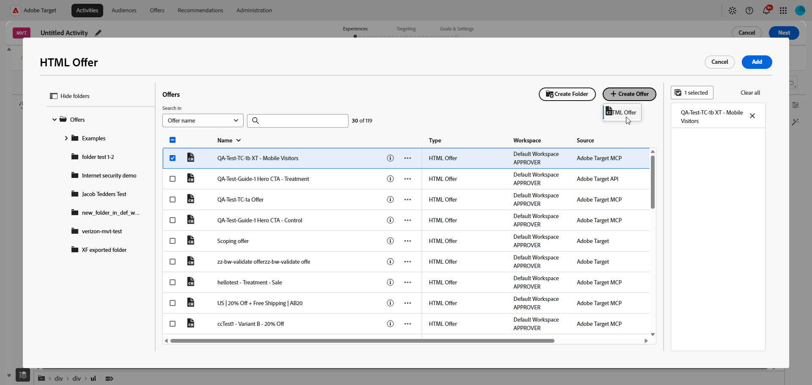

# Creare combinazioni {#create-combinations}

>[!BEGINSHADEBOX]

**In questa pagina:** Scopri come creare l&#39;immagine e le offerte HTML che costituiscono le combinazioni di un **[!UICONTROL test multivariato]**.

>[!ENDSHADEBOX]

In un **[!UICONTROL test multivariato]** (MVT), ogni posizione contiene diverse offerte e ogni combinazione di offerte nelle posizioni è un&#39;esperienza. Utilizza il **[!UICONTROL Compositore esperienza visivo]** (VEC) in [!DNL Adobe Target] per creare le offerte da includere nel test.

Per ulteriori informazioni sull’utilizzo del Compositore esperienza visivo per creare e modificare le offerte, consulta [Opzioni del Compositore esperienza visivo](/help/main/c-experiences/c-visual-experience-composer/viztarget-options.md).

>[!NOTE]
>
>È possibile fare clic su **[!UICONTROL Espandi selezione]** quando si selezionano oggetti nella pagina per selezionare l&#39;elemento padre in aggiunta all&#39;elemento selezionato originariamente. Quando selezioni un elemento principale, tutti i relativi elementi secondari vengono selezionati automaticamente. Puoi espandere la selezione più volte.
>
>Per navigare tra gli elementi puoi anche usare il [percorso DOM](/help/main/c-experiences/c-visual-experience-composer/viztarget-options.md#dom-path).

## Offerte immagine {#image-offers}

Sottoponi a test offerte immagine multiple all&#39;interno di una posizione per determinare quale immagine sia più efficace.

1. Fai clic su un&#39;immagine nella pagina e seleziona **[!UICONTROL Modifica offerta immagine]**.

   

1. Dalla finestra di dialogo **[!UICONTROL Offerta immagine]**, seleziona tutte le immagini che desideri includere nel test, quindi fai clic su **[!UICONTROL Aggiungi]**.

   

Ogni immagine diventa un&#39;esperienza separata nella posizione in questione.

## Offerte HTML {#html-offers}

Sottoponi a test offerte HTML multiple all&#39;interno di una posizione per determinare quale sia più efficace.

1. Fai clic su un&#39;offerta HTML nella tua pagina, quindi fai clic su **[!UICONTROL Modifica offerta HTML]**.

   

1. Scegli la tua offerta HTML e fai clic su **[!UICONTROL Crea offerta]** e quindi su **[!UICONTROL Offerta HTML]**.

   

1. Assegna un nome all&#39;offerta, digita o incolla il codice per l&#39;offerta HTML, quindi fai clic su **[!UICONTROL Crea]**.

   Ripeti l’operazione per eventuali altre offerte HTML da includere.

1. Fai clic su **[!UICONTROL Salva]**.

Ogni offerta HTML diventa un&#39;esperienza separata nella posizione in questione.

Per raccomandazioni su quante combinazioni includere e su come rivederle prima di avviare il test, consulta [Best practice per i test multivariati](/help/main/c-activities/c-multivariate-testing/best-practices.md#create).
