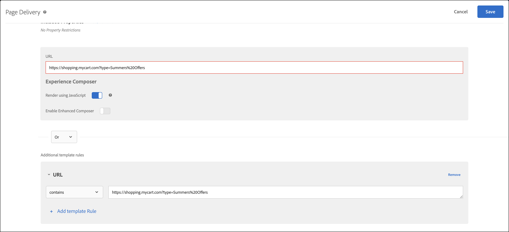
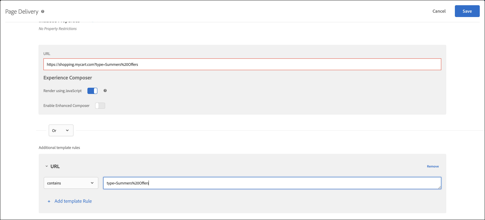
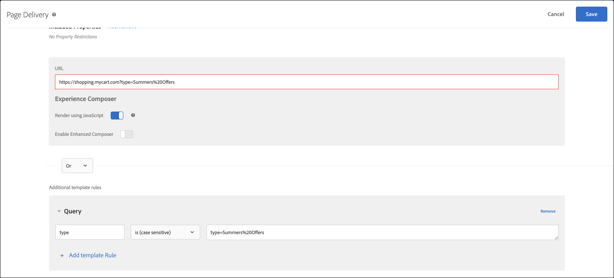

# Risolvere i problemi relativi alla distribuzione dei contenuti {#content-trouble}

>[!BEGINSHADEBOX]

**In questa pagina:** Scopri come eseguire il debug della consegna dei contenuti in [!DNL Adobe Target] quando nella pagina non viene visualizzato il contenuto previsto.

>[!ENDSHADEBOX]

Quando in una pagina non viene visualizzato il contenuto previsto, la causa può essere un errore nel codice dell&#39;attività, una richiesta [!DNL Target] mancante o spostata in modo errato o un conflitto con un&#39;altra attività. Controlla attentamente il codice dell’attività o della campagna, perché un errore di battitura o di altro tipo può impedire la visualizzazione del contenuto previsto. Quindi utilizza mboxTrace, mboxDebug o il debugger di Adobe Experience Cloud per esaminare la richiesta [!DNL Target].

**mboxDebug** è particolarmente utile quando imposti [!DNL Target] sulla pagina, per assicurarti che la richiesta [!DNL Target] venga attivata e che il cookie sia impostato. Tuttavia, non approfondisce i dettagli utili per il debug della distribuzione dei contenuti. Se l’attività non viene visualizzata nella pagina o un contenuto indesiderato viene visualizzato, esamina ed esegui il debug della pagina nel dettaglio tramite mboxTrace.

## Strumenti di debug {#debugging-tools}

### Recuperare il token di autorizzazione {#section_BED130298E794D1FA229DB7C3358BA54}

mboxTrace e mboxDebug possono esporre i dati della campagna e del profilo a parti esterne, per cui è necessario un token di autorizzazione. Il token di autorizzazione può essere recuperato nell’interfaccia utente di [!DNL Target]. Il token è valido per sei ore.

Per generare un token di autenticazione, è necessario disporre di una delle seguenti autorizzazioni utente:

* Almeno **[!UICONTROL autorizzazione Editor]** (o **[!UICONTROL Approvatore]**)

  Per ulteriori informazioni per i clienti [!DNL Target Standard], consulta [Specificare ruoli e autorizzazioni](/help/main/administrating-target/c-user-management/c-user-management/user-management.md#roles-permissions) in *Utenti*. Per ulteriori informazioni per i clienti [!DNL Target Premium], consulta [Configurare le autorizzazioni aziendali](/help/main/administrating-target/c-user-management/property-channel/properties-overview.md).

* Ruolo amministratore a livello di area di lavoro/profilo di prodotto

  Le aree di lavoro sono disponibili solo per i clienti [!DNL Target Premium]. Per ulteriori informazioni, consulta [Configurare le autorizzazioni aziendali](/help/main/administrating-target/c-user-management/property-channel/properties-overview.md).

* Diritti di amministrazione (autorizzazione Sysadmin) a livello di prodotto [!DNL Adobe Target]

Per recuperare il token di autorizzazione:

1. Accedi a **[!UICONTROL Amministrazione]** > **[!UICONTROL Implementazione]**.
1. Dalla sezione Strumenti di debug, fare clic su **[!UICONTROL Genera nuovo token di autenticazione]**.

   

1. Aggiungi il token generato come parametro nell’URL per abilitare uno degli strumenti di debug avanzati.

   

### mboxTrace {#section_256FCF7C14BB435BA2C68049EF0BA99E}

mboxTrace consente di ricevere informazioni di trace collegate alle risposte di [!DNL Target]. Le informazioni di trace riflettono il risultato di una chiamata [!DNL Target] (ad esempio, una conversione o un’impression) ed eventuali dati ulteriori che possono aiutare a determinare perché sia stato ottenuto questo particolare risultato, ad esempio un insieme di rami disponibili tra i quali è stata effettuata la selezione in una campagna. Esegui il debug della distribuzione dei contenuti con queste informazioni.

Sono disponibili i seguenti parametri:

| Opzioni mboxTrace | Risultato |
|--- |--- |
| `?mboxTrace=console` | Visualizzazione nel registro della console come oggetti.<br>Per at.js, invece di aprire una nuova finestra del browser o di eseguire l’output sulla console come in mbox.js, sarà necessario controllare la richiesta di rete e guardare in Anteprima (Chrome) o Risposta (Firefox). |
| `?mboxTrace=json` | Visualizzazione nel registro della console come stringa letterale JSON |
| `?mboxTrace=window` | Visualizzazione in una finestra popup come stringa JSON |
| `?mboxTrace=disable` | Disattiva la modalità di sessione di tracciamento |

**Esempio di chiamata mboxTrace**

`https://www.mysite.com/page.html?mboxTrace=window&authorization=f543abf-0111-4061-9619-d41d665c59a6`

L’output mostra informazioni dettagliate sul contenuto. mboxTrace mostra i dettagli della campagna o dell’attività e del profilo. Inoltre, fornisce un’istantanea del profilo prima dell’esecuzione e di ciò che è cambiato dopo l’esecuzione. In aggiunta, mostra quali campagne o attività sono state valutate per ogni posizione.

Alcune delle informazioni includono ID di destinazione e di segmento associati e non associati:

* **SegmentId**: ID dei segmenti, dalla libreria di segmenti riutilizzabili o anonimi, creati per la campagna specifica.
* **TargetId**: ID delle destinazione, dalla libreria delle espressioni di destinazione o da destinazioni anonime, per tutti i segmenti della campagna.
* **Unmatched** (nessuna corrispondenza): in questa chiamata la richiesta non era qualificata per i segmenti o le destinazioni specificati.
* **Matched** (con corrispondenza): la richiesta era qualificata per i segmenti o le destinazioni specificati.

**Utilizzo di mboxTrace su le pagine di consigli**: l’aggiunta di mboxTrace come parametro di query nelle pagine con i consigli sostituisce la progettazione dei consigli nella pagina con una finestra dei dettagli mboxTrace, che visualizza informazioni approfondite sui consigli, tra cui:

* Consigli restituiti e consigli richiesti
* Chiave utilizzata, e se sta generando consigli
* Consigli generati da criteri e consigli di backup
* Configurazione dei criteri
* Esclusioni e inclusioni applicate
* Regole di raccolta

Non è necessario includere `=console`, `=json` o `=window` nel parametro di query. Una volta completati i dettagli mboxTrace, aggiungere `=disable` e premere **[!UICONTROL Invio]** per tornare alla modalità di visualizzazione normale.

mboxTrace non influenza il normale funzionamento e aspetto del tuo sito. I visitatori vedranno la solita struttura dei consigli.

### mboxDebug {#mboxdebug}

Per utilizzare mboxDebug, aggiungi un parametro mboxDebug alla fine dell’URL. Nella tabella seguente sono incluse informazioni sui parametri URL relativi a risposte di [!DNL Target].

Alcuni parametri mboxDebug sono disponibili con o senza autenticazione.

| Parametri URL | Finalità |
|--- |--- |
| `mboxDebug=1` | Debugger<br>L’aggiunta di questo parametro a qualsiasi URL in cui sono definite delle richieste di Target determina l’apertura di una finestra a comparsa con dettagli utili al debug. Vengono inserite informazioni sui cookie, valori PCid e ID di sessione e sono visibili tutti gli URL. Fai clic su un URL con richiesta di Target per visualizzarne la risposta di [!DNL Target]. Maggiori dettagli sono disponibili in [mbox_debug.pdf](/help/main/assets/mbox_debug.pdf). |
| `mboxDisable=1` | Disattiva le mbox sulla pagina |
| `mboxOverride.browserIp=<Insert IP address>` | Testa geotargeting<br>Testa il geotargeting con questo parametro URL. Digitare un indirizzo IP come valore per questo attributo e il geotargeting [!DNL Target] valuta l&#39;indirizzo IP in base a qualsiasi geotargeting o segmentazione impostata in una campagna. |

>[!NOTE]
>
>Assicurati che il frammento URL sia dopo i parametri della stringa di query. Qualsiasi elemento dopo il primo `#` è un identificatore di frammento e causa il mancato funzionamento dei parametri di debug.

### Adobe Experience Cloud Debugger {#section_A2798ED3A431409690A4BE08A1BFCF17}

Adobe Experience Cloud Debugger ti aiuta a comprendere l&#39;implementazione di [!DNL Target]. Puoi visualizzare la configurazione della libreria, verificare che i parametri personalizzati siano passati correttamente, attivare la registrazione della console e disabilitare tutte le [!DNL Target] richieste. Dopo l’autenticazione in Experience Cloud, puoi utilizzare mboxTrace per controllare le attività, i requisiti del pubblico e il profilo visitatore.

Per ulteriori informazioni, consulta i [video di formazione](#training-videos) alla fine di questa pagina e [Eseguire il debug di at.js utilizzando il debugger di Adobe Experience Cloud](https://experienceleague.adobe.com/docs/target-dev/developer/client-side/at-js-implementation/functions-overview/target-debugging-atjs.html){target=_blank}.

## Problemi comuni {#common-problems}

+++ Gli articoli più venduti non compaiono nei consigli

Impossibile utilizzare la chiamata *`SiteCatalyst: purchase`* per i dati del traffico algoritmo di acquisto. Utilizza al suo posto la chiamata *`orderConfirmPage`*.

+++

</br>

+++ Le attività basate su moduli si scontrano con le attività di Target Classic

Le attività basate su moduli create con [!DNL Target Standard/Premium] potrebbero entrare in conflitto con le attività create nell’interfaccia utente di [!DNL Target Classic] che hanno la stessa priorità e utilizzano la stessa richiesta di [!DNL Target]. Per ulteriori informazioni, vedere [Priorità attività](/help/main/c-activities/priority.md).

+++

</br>

+++ Il cookie [!DNL Target] non viene impostato

Se nel sito è presente un sottodominio, ad esempio [!DNL us.domain.com], ma è necessario impostare il cookie [!DNL Target] su [!DNL domain.com] (anziché [!DNL us.domain.com]), è necessario ignorare l&#39;impostazione `cookieDomain`. Per ulteriori informazioni, consulta [targetGlobalSettings()](https://experienceleague.adobe.com/docs/target-dev/developer/client-side/at-js-implementation/functions-overview/targetglobalsettings.html?lang=it){target=_blank}.

+++

</br>

+++ Il contenuto viene visualizzato momentaneamente o non viene visualizzato quando un elemento fa anche parte della personalizzazione Adobe Experience Manager

Se un elemento DOM fa parte del targeting di personalizzazione di Adobe Experience Manager (AEM) e di un&#39;attività [!DNL Target], il contenuto di [!DNL Target] potrebbe essere visualizzato momentaneamente o non essere visualizzato.

Per risolvere questo problema, è possibile disabilitare la personalizzazione AEM nelle pagine in cui è in esecuzione [!DNL Target].

+++

</br>

+++ Impossibile reindirizzare offerte remote e di reindirizzamento a causa di un URL non valido

Se l’offerta di reindirizzamento o l’offerta remota utilizza un URL non valido, la sua consegna potrebbe non riuscire.

* Per le offerte di reindirizzamento, la risposta [!DNL Target] può contenere `/* invalid redirect offer URL */`.
* Per le offerte remote, la risposta [!DNL Target] può contenere `/* invalid remote offer URL */`.

Puoi controllare la risposta [!DNL Target] nel browser o utilizzando mboxTrace. Per ulteriori informazioni sugli URL validi, consulta [https://tools.ietf.org/html/std66](https://tools.ietf.org/html/std66).

+++

</br>

+++ [!DNL Target] richieste non si attivano sul sito

at.js non attiva [!DNL Target] richieste se si utilizza un doctype non valido. at.js richiede il doctype HTML5.

+++

## Attività con parametri di stringa di query nell’URL {#query-strings}

L&#39;**[!UICONTROL URL attività]** determina la pagina che qualifica i visitatori per l&#39;attività ed esegue il rendering delle esperienze di attività per gli utenti. Quando viene richiesto durante la creazione dell’attività, la digitazione dell’URL completo non sempre assicura che il contenuto venga distribuito sulla pagina del sito, in particolare con gli URL che contengono parametri della stringa di query.

Per impostazione predefinita, il [!UICONTROL Compositore esperienza visivo] (VEC) apre la pagina specificata nelle [impostazioni del Compositore esperienza visivo](/help/main/administrating-target/visual-experience-composer-set-up.md). È anche possibile specificare una pagina diversa durante la creazione dell’attività.

Per visualizzare una pagina diversa dopo l&#39;apertura del Compositore esperienza visivo, fai clic su **[!UICONTROL Configura icona ingranaggio]** > seleziona **[!UICONTROL Consegna pagine]** > quindi specifica l&#39;URL desiderato nel campo **[!UICONTROL URL attività]**.


Se l’URL contiene parametri della stringa di query, la pagina potrebbe non essere idonea per l’attività o potrebbe non visualizzare il contenuto personalizzato. Indipendentemente dal pubblico di destinazione, puoi includere regole di modello oltre all’URL di base per definire i parametri di query.

Per includere regole di modello aggiuntive, è possibile utilizzare le seguenti opzioni:

* **Opzione 1:** Replica l&#39;URL e mantienilo nella regola del modello con l&#39;opzione &quot;contiene&quot;

  +++ Visualizzare l’impostazione della regola del modello

  Questa opzione assicura che l’URL sia idoneo per l’attività. Tuttavia esistono casi limite ad esso associati che possono influenzare i dati di reporting con record aggiuntivi per gli URL che contengono l’URL di base.

  In questo caso, l’URL è `https://shopping.mycart.com?type=Summers%20Offers` e regole di modello aggiuntive “contiene” lo stesso URL, separate da un operatore OR:

  

  +++

* **Opzione 2:** Limita la condizione URL &quot;contiene&quot; solo alla stringa di query

  +++ Visualizzare l’impostazione della regola del modello

  Il caso limite discusso nell’opzione precedente viene applicato in questa opzione, ma qui l’impostazione condizionale è limitata solo alla stringa di query.

  In questo caso, l’URL è `https://shopping.mycart.com?type=Summers%20Offers` e regole di modello aggiuntive “contiene” solo la stringa di query, separate da un operatore OR:

  

  +++

* **Opzione 3:** Invece di eseguire il targeting dell&#39;URL completo, sfrutta una parte specifica dell&#39;URL

  +++ Visualizzare l’impostazione della regola del modello

  In questo caso, l&#39;URL è `https://shopping.mycart.com?type=Summers%20Offers` e regole di modello aggiuntive specificano una **[!UICONTROL Query]** con **[!UICONTROL type]** > **[!UICONTROL is (distinzione maiuscole/minuscole)]** > type=Summers%20Offers, separati da un operatore OR:

  

  +++

## Esclusione delle virgolette doppie nei valori degli attributi del profilo {#escape}

Quando si inviano valori contenenti virgolette doppie in un attributo di profilo [!DNL Target], è necessario eseguire un doppio escape come illustrato di seguito.

```
adobe.target.trackEvent({
    "mbox": "data-collection",
    "params":    {
        "profile.tagLine": "Escape \\\"Double Quotes\\\" like this."
    }
});
```

## Video di formazione {#training-videos}

I video seguenti contengono ulteriori informazioni sui concetti descritti in questo articolo.

### Aggiungi estensione 

>[!VIDEO](https://video.tv.adobe.com/v/23114t2/)

### Debug di base per Adobe Target 

>[!VIDEO](https://video.tv.adobe.com/v/23115t2/)

### Mbox Trace 

>[!VIDEO](https://video.tv.adobe.com/v/23113t2/)
