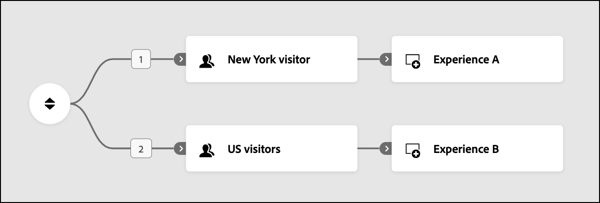
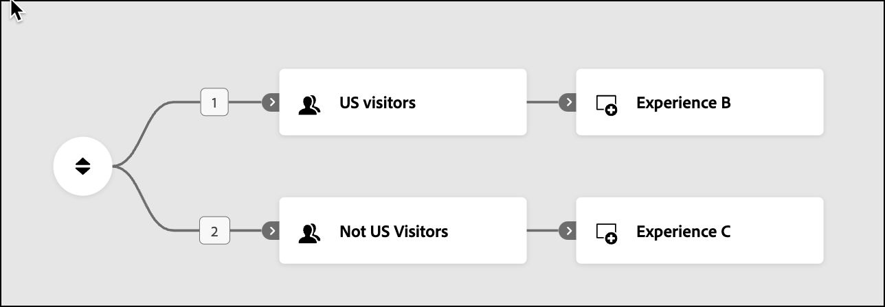
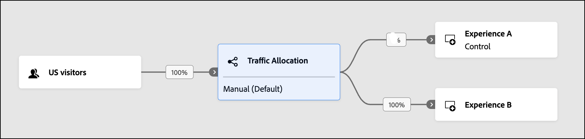

# Passare ad altre esperienze in [!UICONTROL Targeting esperienze] {#switching-experiences}

>[!BEGINSHADEBOX]

**In questa pagina:** Scopri come funziona la priorità in un&#39;attività **[!UICONTROL Targeting esperienza]** e quando i visitatori passano da un&#39;esperienza all&#39;altra con l&#39;evolversi dei loro profili.

>[!ENDSHADEBOX]

Con **[!UICONTROL Targeting esperienza]**, puoi controllare quali esperienze i visitatori visualizzano mentre i loro profili evolvono. Il profilo di un visitatore può cambiare in diversi modi e potresti voler presentare contenuti diversi in base a tali modifiche. Nella tabella seguente sono elencati alcuni esempi:

| Scenario | Dettagli |
|--- |--- |
| Posizione geografica | Quando un visitatore si sposta per lavoro o per piacere, può accedere al sito web o all’app mobile da posizioni geografiche diverse. |
| Stato del cliente | Il visitatore può essere considerato potenziale cliente prima di creare un account o acquistare un prodotto. |
| Affinità tra categorie | La funzionalità [affinità tra categorie](/help/main/c-target/c-visitor-profile/category-affinity.md) in [!DNL Target] acquisisce automaticamente le categorie visualizzate dai visitatori e quindi calcola l&#39;affinità dei visitatori per ogni categoria a scopo di targeting. Ad esempio, ai visitatori che hanno visualizzato diversi articoli sul tuo sito web su un particolare argomento viene presentato un contenuto relativo a tale argomento. |
| Giorno della settimana | All’avvicinarsi del fine settimana, potresti mostrare ai visitatori contenuti su film, ristoranti o altre forme di intrattenimento. |

Per utilizzare queste funzionalità in [!DNL Target], è importante comprendere le seguenti informazioni mentre si lavora con **[!UICONTROL attività Targeting esperienza]**.

## Come vengono serviti i visitatori {#how-visitors-are-served}

L&#39;ordine delle esperienze nell&#39;interfaccia utente di [!DNL Target], dall&#39;alto verso il basso, ne controlla la priorità; pertanto, definisci l&#39;esperienza più mirata prima di quella più ampia. La tabella seguente riepiloga ciò che i visitatori vedono in ogni situazione.

| Situazione | Cosa vede il visitatore |
|--- |--- |
| Il visitatore è idoneo per più di un pubblico. | Contenuto dell’esperienza con priorità più elevata. |
| Il visitatore inizia a qualificarsi per il pubblico di un’esperienza a priorità più alta. | Il visitatore passa all’esperienza con priorità più alta. |
| Il visitatore non si qualifica più per il pubblico corrente, ma inizia a qualificarsi per un’esperienza a priorità inferiore. | Il visitatore passa all’esperienza con priorità inferiore. |
| Il visitatore cessa di qualificarsi per l’esperienza corrente e non per un’altra esperienza. | Contenuto predefinito. |
| Il visitatore non è qualificato per nessun’altra esperienza e l’ultima esperienza è destinata a &quot;Tutti i visitatori&quot;. | L’esperienza &quot;Tutti i visitatori&quot;. Questa esperienza &quot;cattura&quot; i visitatori che non si sono qualificati per nessun’altra esperienza. |
| Un’esperienza rivolta a &quot;Tutti i visitatori&quot; non è l’ultima dell’ordine. | Le esperienze mirate elencate di seguito rispetto all’esperienza &quot;Tutti i visitatori&quot; vengono ancora valutate. |
| L’attività ha un’unica esperienza e il visitatore non è più idoneo per il proprio pubblico. | Il visitatore rimane nell&#39;esperienza. |

## Esempi {#examples}

Gli esempi seguenti illustrano queste situazioni.

### Priorità: New York e Stati Uniti

Se hai due esperienze, una rivolta agli &quot;Stati Uniti&quot; e una rivolta a &quot;New York&quot;, un visitatore che si trova a New York si qualifica per entrambi i tipi di pubblico. È quindi necessario definire l&#39;esperienza &quot;New York&quot; prima dell&#39;esperienza &quot;Stati Uniti&quot; nell&#39;interfaccia utente [!DNL Target]. Questa pratica assicura che l’esperienza di &quot;New York&quot; più mirata abbia la priorità più elevata, come illustrato nell’esempio seguente:

### Passaggio a un’esperienza con priorità più elevata: Stati Uniti e Germania

Nella seguente configurazione attività, un visitatore ha visitato il tuo sito web dagli Stati Uniti e poi si è recato in Germania, dove ha visitato il tuo sito web una seconda volta. Durante la prima visita, questo visitatore si è qualificato per l’Esperienza A (visitatori negli Stati Uniti). Dopo aver visitato il tuo sito web dalla Germania, lo stesso visitatore è passato all’Esperienza B (visitatore dalla Germania).

### Uscita dal pubblico: Stati Uniti e Francia

Nella seguente configurazione attività, un visitatore ha visitato il tuo sito web dagli Stati Uniti e poi si è recato in Francia, dove ha visitato il tuo sito web una seconda volta. Durante la prima visita, questo visitatore si è qualificato per l’Esperienza A (visitatori negli Stati Uniti). Dopo aver visitato il tuo sito web dalla Francia, questo visitatore rimane nell’esperienza originale.

### Esperienza rivolta a tutti i visitatori

Nella seguente configurazione attività, un visitatore ha visitato il tuo sito web dagli Stati Uniti e poi si è recato in Germania, dove ha visitato il tuo sito web una seconda volta. Durante la prima visita, questo visitatore si è qualificato per l’Esperienza A (visitatori negli Stati Uniti). Dopo aver visitato il tuo sito web dalla Germania, questo visitatore rimane nell’esperienza A (visitatori dagli Stati Uniti).

Se preferisci evitare questa situazione, puoi creare un nuovo pubblico definito esplicitamente come l’inverso del pubblico di destinazione, come illustrato di seguito:

### Attività con una sola esperienza

Con un&#39;attività **[!UICONTROL Targeting esperienza]** per esperienza singola, i visitatori rimangono in un&#39;esperienza anche se non si qualificano più per il pubblico che li ha portati in tale esperienza. Se preferisci evitare questa situazione, puoi creare un’altra esperienza rivolta al pubblico inverso (ad esempio, &quot;Non Stati Uniti&quot; in contrapposizione a &quot;Stati Uniti&quot;). In alternativa, puoi creare un&#39;attività **[!UICONTROL Test A/B]** destinata al pubblico desiderato con un&#39;allocazione del traffico del 100%, come illustrato nell&#39;esempio seguente:

