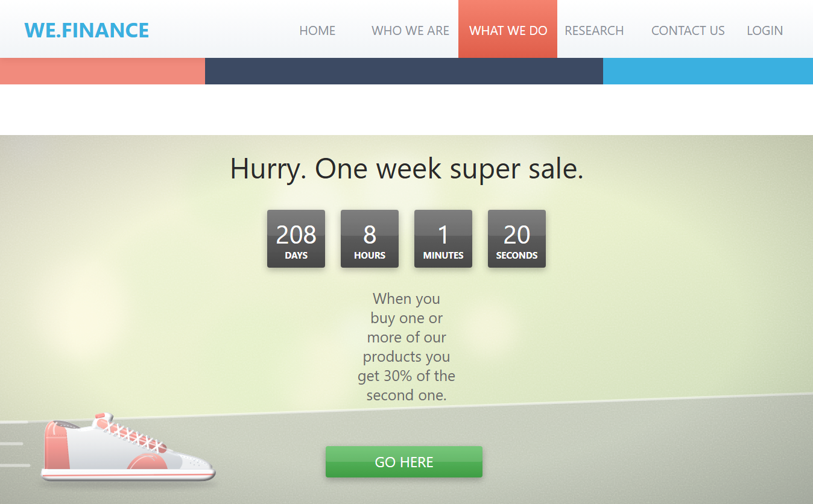

# Modelli di esperienza {#experience-templates}

>[!BEGINSHADEBOX]

**In questa pagina:** Trova i [!DNL Adobe Target] modelli di esperienza disponibili per l&#39;utilizzo nel codice personalizzato e per i quali viene comunemente utilizzato ciascun modello.

>[!ENDSHADEBOX]

I modelli di esperienza [!DNL Adobe Target] sono esempi precodificati con input configurabili, utilizzati per eseguire casi comuni di utilizzo di addetti al marketing. Vengono forniti gratuitamente agli sviluppatori e agli addetti al marketing come punto di partenza per eseguire casi d’uso comuni, tramite il Compositore esperienza visivo o il Compositore esperienza basato su moduli.

I seguenti modelli sono attualmente disponibili in Adobe Marketing Cloud GitHub: [Target-Experience-Templates](https://github.com/Adobe-Marketing-Cloud/target-experience-templates).

## Carosello banner con miniature {#banner-carousel-thumbnails}

Il [modello di esperienza Carosello banner con miniature](https://github.com/Adobe-Marketing-Cloud/target-experience-templates/tree/master/banner-carousel-thumbnails) è un carosello rotante, di solito utilizzato nelle home page e nelle pagine di destinazione o in altre pagine di accesso dal volume elevato. Questo carosello non ruota automaticamente tra le immagini. Può interagire direttamente con esso facendo clic sulle immagini più piccole sotto l&#39;immagine primaria.

## Carosello banner {#banner-carousel}

Il [modello di esperienza Carosello banner](https://github.com/Adobe-Marketing-Cloud/target-experience-templates/tree/master/banner-carousel) è un carosello rotante, di solito utilizzato nelle home page e nelle pagine di destinazione o in altre pagine di accesso dal volume elevato. Questo carosello non ruota automaticamente tra le immagini. Può interagire direttamente con facendo clic sulle frecce sinistra e destra.

## Conto alla rovescia banner {#banner-countdown}

Il [modello di esperienza Conto alla rovescia banner](https://github.com/Adobe-Marketing-Cloud/target-experience-templates/tree/master/banner-countdown) è un banner di grandi dimensioni con un conto alla rovescia centrale, di solito utilizzato nelle home page e nelle pagine di destinazione o in altre pagine di accesso dal volume elevato.

## Generatore di pulsanti {#button-builder}

Il [modello di esperienza Generatore di pulsanti](https://github.com/Adobe-Marketing-Cloud/target-experience-templates/tree/master/button) è un piccolo pulsante con una chiamata all&#39;azione sotto forma di testo. Il pulsante è configurabile. Può essere posizionato in qualsiasi punto della pagina per aggiungere un nuovo call to action o per sostituire un pulsante esistente con un’alternativa più configurabile.

## Lightbox con conto alla rovescia {#lightbox-countdown}

Il [modello di esperienza Lightbox con conto alla rovescia](https://github.com/Adobe-Marketing-Cloud/target-experience-templates/tree/master/lightbox-countdown) è una finestra a comparsa di sovrapposizione lightbox con un conto alla rovescia centrale, di solito utilizzata nelle home page e nelle pagine di destinazione o in altre pagine di accesso dal volume elevato.

## Lightbox con intento di uscita {#lightbox-exit-intent}

Il modello di esperienza [Lightbox con intento di uscita](https://github.com/Adobe-Marketing-Cloud/target-experience-templates/tree/master/lightbox-exit-intent) è una finestra a comparsa di sovrapposizione lightbox attivata in caso di intento di uscita (spostando il mouse in alto a destra dello schermo). Può essere implementato su qualsiasi proprietà web per cui è richiesta un’ultima possibilità di catturare l’attenzione.

## Lightbox {#lightbox}

Il [modello di esperienza Lightbox](https://github.com/Adobe-Marketing-Cloud/target-experience-templates) è una finestra a comparsa di sovrapposizione lightbox con un ritardo integrato, di solito utilizzata nelle pagine principali e nelle pagine di destinazione o in altre pagine di accesso dal volume elevato.

## Barra multifunzione {#ribbon}

Il [modello di esperienza Barra multifunzione](https://github.com/Adobe-Marketing-Cloud/target-experience-templates/tree/master/ribbon) è una barra multifunzione di larghezza 100% inserita nella parte superiore della pagina Web. In genere viene utilizzato per indicare una vendita flash, spedizione gratuita, un evento di sicurezza o meteo o un altro annuncio importante.

