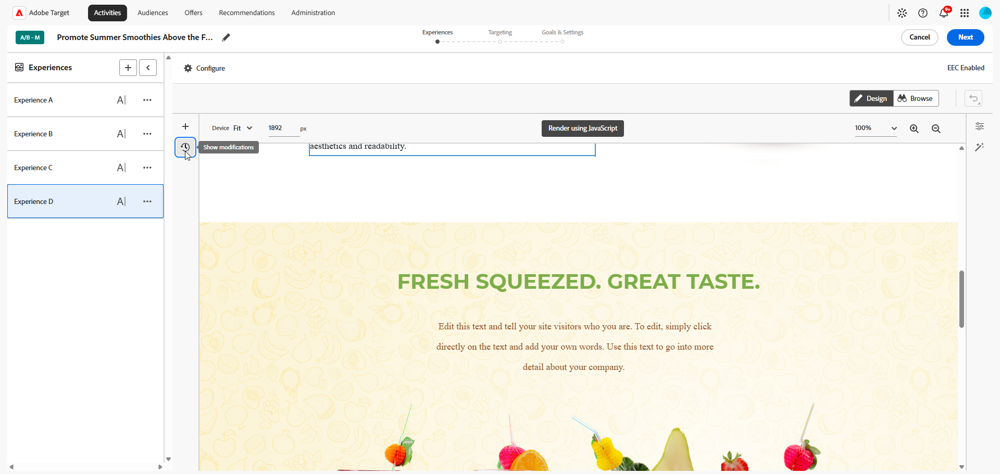

# Introduzione alle modifiche {#vec-code-editor}

>[!BEGINSHADEBOX]

**In questa pagina:** Scopri come visualizzare, modificare, eliminare e aggiungere modifiche nel pannello **[!UICONTROL Modifiche]** del [!UICONTROL Compositore esperienza visivo] e come utilizzare il codice personalizzato.

>[!ENDSHADEBOX]

Il pannello **[!UICONTROL Modifiche]** in [!DNL Adobe Target] mostra tutte le modifiche apportate alla pagina nel [!UICONTROL Compositore esperienza visivo] e consente ulteriori modifiche facendo clic su ogni elemento della pagina e [selezionando un&#39;azione](/help/main/c-experiences/c-visual-experience-composer/viztarget-options.md). Ogni modifica viene visualizzata come un&#39;azione o un elemento separato nell&#39;elenco **[!UICONTROL Modifiche]**. È inoltre possibile aggiungere direttamente modifiche dei seguenti tipi: Selettore CSS, Mbox e Codice personalizzato.

## Panoramica sulle modifiche {#modifications-overview}

La pagina **[!UICONTROL Modifiche]** apporta piccole modifiche al selettore scelto da [!DNL Target] quando il Compositore esperienza visivo configura la modalità di distribuzione del contenuto. È possibile modificare il contenuto o un attributo di HTML. È inoltre possibile modificare il codice per creare l’equivalente di un’offerta HTML all’interno di una mbox.


La pagina **[!UICONTROL Modifiche]** può essere utilizzata per:

* Visualizzare un&#39;azione intrapresa nel compositore visivo.

  

* Modificare un&#39;azione esistente. Accedi al menu avanzato e seleziona **[!UICONTROL Modifica]**.

  

  Apporta le modifiche.

  

* Elimina un&#39;azione esistente. Accedi al menu avanzato e seleziona **[!UICONTROL Elimina modifica]**.

  

* Aggiungi una nuova modifica. Accedi al menu avanzato **[!UICONTROL Modifiche]** e seleziona **[!UICONTROL Aggiungi una modifica]**, quindi specifica le modifiche come descritto in [Aggiungi modifiche](#add-modifications).

  

## Aggiungi modifiche {#add-modifications}

Le modifiche vengono aggiunte dal pannello **[!UICONTROL Modifiche]** per l&#39;esperienza selezionata nel Compositore esperienza visivo.

1. Per visualizzare le **[!UICONTROL modifiche]**, fai clic su **[!UICONTROL Mostra modifiche]**.

   

   Per aprire il pannello **[!UICONTROL Modifiche]** nel Compositore esperienza basato su moduli, crea o modifica un&#39;offerta HTML. Per ulteriori informazioni, consulta [Compositore esperienza basato su moduli](/help/main/c-experiences/form-experience-composer.md).

1. Per aggiungere una modifica:

   * Se non è stata apportata alcuna modifica precedente, fai clic su **[!UICONTROL Aggiungi modifica]** nel pannello **[!UICONTROL Modifiche]**.
   * Se sono presenti modifiche precedenti per l&#39;esperienza, accedi al menu avanzato **[!UICONTROL Modifiche]** e seleziona **[!UICONTROL Aggiungi una modifica]**.

   Il pannello **[!UICONTROL Modifiche]** visualizza:

   

1. Dall&#39;elenco a discesa **[!UICONTROL Tipo di modifica]**, scegliere il tipo desiderato:

   | Tipo di modifica | Dettagli |
   |--- |--- |
   | Selettore CSS | Nella casella **[!UICONTROL Selettore elemento CSS]**, specifica l&#39;elemento CSS da modificare, seleziona un tipo di azione (**[!UICONTROL Imposta contenuto]** o **[!UICONTROL Imposta attributo]**), quindi compila le informazioni richieste e il contenuto desiderato. |
   | Mbox | Specifica il nome mbox e il contenuto desiderato. |
   | Codice personalizzato | Specificare un nome facoltativo, selezionare o deselezionare **[!UICONTROL Aggiungi codice nella sezione `<HEAD>`]**, quindi aggiungere il codice personalizzato. Per ulteriori informazioni, vedere [Codice personalizzato](#custom-code). |

   >[!NOTE]
   >
   >Le mbox non sono più supportate nel Compositore esperienza visivo nelle pagine che utilizzano at.js 2.*x*. Come soluzioni alternative:
   >
   >* Se utilizzi at.js 2.*x*, aggiungi una modifica del selettore CSS invece di una modifica Mbox e aggiungi il contenuto al selettore che la mbox stava utilizzando.
   >* Utilizza le attività basate su moduli (funziona con mbox e at.js 1.*x* e at.js 2.*x*).
   >* Utilizza at.js 1.*x* nel Compositore esperienza visivo.

1. Aggiungi ulteriori modifiche in base alle esigenze.

## Codice personalizzato {#custom-code}

Il codice personalizzato fornisce un&#39;interfaccia non visiva per visualizzare, modificare e aggiungere nuove azioni nel Compositore esperienza visivo, nel Compositore esperienza basato su moduli e nell&#39;editor di offerte HTML. Il pannello fornisce una visualizzazione del codice di un’esperienza, utili per creare esperienze più complesse, perfezionare quelle esistenti e risolvere eventuali problemi.

Il codice personalizzato è destinato agli utenti avanzati che hanno dimestichezza con HTML, JavaScript e CSS. La vista Codice può essere utile per modificare o perfezionare le modifiche o risolvere i problemi del selettore. Può inoltre essere utilizzato per aggiungere nuove azioni e un codice personalizzato. È possibile aggiungere più codici personalizzati e, facoltativamente, denominarli ciascuno.


Il codice personalizzato si comporta come segue:

* Quando **[!UICONTROL Aggiungi codice nella sezione `<HEAD>`]** è selezionato, il codice personalizzato viene aggiunto alla sezione `<head>` e l&#39;esecuzione non attende il corpo o eventi di caricamento della pagina. Aggiungi solo gli elementi `<script>` e `<style>`. L&#39;aggiunta di `<div>` tag e di altri elementi potrebbe causare la comparsa di `<head>` elementi rimanenti in `<body>`. Se si utilizza at.js, tutte le offerte vengono consegnate in modo asincrono.
* Quando **[!UICONTROL Aggiungi codice nella sezione `<HEAD>`]** è deselezionato, il codice personalizzato viene eseguito subito dopo il tag `<body>`. Racchiudi tutto il codice in un singolo `<div>` per mantenere la struttura DOM. Se si utilizza at.js, tutte le offerte vengono consegnate in modo asincrono.
* Se il HTML per `<BODY>` contiene `<SCRIPT>` e `<DIV>`, `<DIV>` viene aggiunto a `<BODY>` e `<SCRIPT>` viene eseguito in `<HEAD>`. A `<HEAD>` viene aggiunto anche un `<SCRIPT>` che carica un file esterno.
* Gli script vengono eseguiti in modo asincrono. Ciò significa che non è possibile utilizzare `document.write` e metodi di script simili.
* Il codice personalizzato è attualmente disponibile solo per attività A/B e per l’esperienza di targeting (XT). Il codice personalizzato è disabilitato in caso di sovrapposizione e se viene applicata un&#39;offerta di reindirizzamento.

Il codice personalizzato supporta i seguenti casi di utilizzo:

* Aggiungi JavaScript, HTML o CSS personalizzato da eseguire nella parte superiore della pagina
* Visualizza o modifica il codice generato dal Compositore esperienza visivo dopo aver apportato modifiche
* Impostazione del contenuto HTML per un selettore (solo selettore CSS)
* Impostazione di un attributo su un elemento HTML
* Aggiunta di contenuto dell&#39;offerta da consegnare in una mbox regionale
* Scambio su DOM-ready, utilizzando jQuery
* Scambio su DOM-ready, non jQuery (non supporta Internet Explorer 8)
* Scambia con il polling DOM tramite il plug-in &quot;elementOnLoad&quot;
* Reindirizzamento personalizzato

Il codice personalizzato fornisce:

* Numeri di linea per un migliore uso.
* Evidenziazione della sintassi per evitare errori di sintassi nelle offerte HTML.
* La possibilità di creare più codici personalizzati e fornire un nome facoltativo per ciascuno di essi. La creazione di più codici personalizzati semplifica il debug futuro. Ad esempio, invece di creare un singolo codice personalizzato per eseguire diverse modifiche, è possibile creare un codice personalizzato separato per ogni modifica, con un nome descrittivo. I codici personalizzati separati rendono le modifiche più modulari e gestibili. L’esecuzione di più codici personalizzati in un’attività non è garantita nella sequenza in cui sono stati creati.

Il pannello **[!UICONTROL Modifiche]** suddivide lo schermo tra la modalità visiva e la modalità codice. Entrambe le modalità rimangono sincronizzate. Ogni modifica apportata visivamente ha una riga corrispondente nella vista Codice. Allo stesso modo, ogni modifica inserita nella vista Codice viene visualizzata nell&#39;esperienza visiva. Facendo clic su una riga nella vista Codice, viene selezionato l&#39;elemento corrispondente nella pagina visiva.

Il codice personalizzato supporta HTML, script e stili. Qualsiasi codice HTML o script valido può essere aggiunto o modificato.

## Esempi di codice personalizzato {#custom-code-examples}

Il pannello **[!UICONTROL Codice personalizzato]** contiene il codice eseguito all&#39;inizio del caricamento della pagina. Il codice JavaScript può essere eseguito nel tag `<head>`. L&#39;esecuzione del codice non attende che il tag `<body>` sia presente nel DOM. I selettori per le azioni visive successive dipendono dagli elementi HTML aggiunti in questa scheda.

Il pannello **[!UICONTROL Codice personalizzato]** viene comunemente utilizzato per aggiungere JavaScript o CSS nella parte superiore della pagina.

Utilizza la scheda **[!UICONTROL Codice personalizzato]** per:

* Utilizzare JavaScript in linea o per un collegamento a un file JavaScript esterno

  Ad esempio, per modificare il colore di un elemento:

  ```javascript
  <script type="text/javascript"> 
  document.getElementById("element_id").style.color = "blue"; 
  </script> 
  ```

* Configurare uno stile in linea o un collegamento a un foglio di stile esterno

  Ad esempio, per definire una classe per un elemento sovrapposto:

  ```html
  <style> 
  .overlay 
  { position: absolute; top:0; left: 0; right: 0; bottom: 0; background: red; } 
  </style> 
  ```

* Aggiungere frammenti HTML per definire nuovi elementi

  Utilizzare ad esempio il frammento di codice HTML seguente per creare una sovrapposizione `<div>` che utilizza la classe CSS definita sopra:

  ```html
  <div class="overlay"></div>
  ```

* Scambio su DOM-ready, utilizzando jQuery

  L&#39;esempio seguente presuppone che il sito Web del cliente disponga di jQuery nella pagina quando [!DNL Target] esegue le offerte.

  ```javascript
  <style>#default_content {visibility:hidden;}</style> 
  <script> 
  jQuery( document ).ready(function() { 
      jQuery("#default_content").html( "<span style='color:red'>Hello <strong>Again</strong></span>" ); 
      jQuery("#default_content").css("visibility","visible"); 
  }); 
  </script> 
  ```

* Scambio su DOM-ready, non jQuery (non supporta Internet Explorer 8)

  ```javascript
  <style>#default_content {visibility:hidden;}</style> 
  <script> 
  document.addEventListener("DOMContentLoaded", function(event) {  
      document.getElementById("default_content").innerHTML = "<span style='color:red'>Hello <strong>Again</strong></span>"; 
      document.getElementById("default_content").style.visibility="visible"; 
  }); 
  </script> 
  ```

* Reindirizzamento personalizzato che trasmette i parametri esistenti, il parametro `s_tnt` (per l&#39;integrazione legacy con Analytics), il parametro di riferimento e la sessione mbox

  ```javascript
  <style type="text/css">body{display:none!important;}</style> 
  <script type="text/javascript"> 
   var qs='';window.location.search?qs=window.location.search+'&':qs='?'; 
   window.location.replace('//www.mywebsite.com/'+qs+'s_tnt=${campaign.id}:${campaign.recipe.id}:${campaign.recipe.trafficType}&s_tntref='+encodeURIComponent(document.referrer)+'&mboxSession='+mboxFactoryDefault.getSessionId().getId()+''+window.location.hash+''); 
  </script> 
  ```

* Aggiungi [!DNL Adobe Target] modelli di esperienza da utilizzare nel codice personalizzato

  I modelli di esperienza sono esempi precodificati con input configurabili, utilizzati per eseguire casi di utilizzo comuni per gli addetti al marketing. Vengono forniti gratuitamente agli sviluppatori e agli addetti al marketing come punto di partenza per eseguire casi d’uso comuni, tramite il Compositore esperienza visivo o il Compositore esperienza basato su moduli. I casi d’uso includono lightbox, caroselli, conteggi e altro ancora. Per ulteriori informazioni, vedere [Modelli di esperienza](/help/main/c-experiences/c-visual-experience-composer/c-vec-code-editor/experience-templates.md).

## Best practice per il codice personalizzato {#custom-code-best-practices}

* **Racchiudi sempre il codice personalizzato in un elemento.**

  Ad esempio:

```html
<div id="custom-code"> 
// My Code goes here 
</div>
```

Se sono necessarie modifiche, apporta le modifiche all’interno di questo contenitore. Se il codice personalizzato non è più necessario, lascia vuoto questo contenitore, ma non rimuoverlo. In questo modo le altre modifiche apportate all’esperienza non verranno influenzate.

* **Non utilizzare l&#39;ID elemento “CDQID” per apportare modifiche alla pagina eseguita nell&#39;editor di codice.**

  [!DNL Target] applica un nuovo ID elemento con il valore &quot;CDQID&quot; a qualsiasi elemento della pagina modificato da [!DNL Target]. L&#39;ID è applicato da [!DNL Target], pertanto non deve essere utilizzato per ulteriori modifiche o regolazioni nell&#39;editor di codice.

* **Non eseguire `document.write` azioni negli script di codice personalizzato.**

  Gli script vengono eseguiti in modo asincrono. Questo causa spesso la visualizzazione di `document.write` azioni nel punto sbagliato della pagina. L&#39;utilizzo di `document.write` negli script creati nel codice personalizzato non è consigliato.

* **Se un elemento viene creato e quindi modificato, non eliminare l&#39;elemento originale.**

  Ogni modifica crea un nuovo elemento nel pannello **[!UICONTROL Modifiche]**. La seconda azione modifica l’elemento 1, quindi se l’elemento 1 viene eliminato, tale azione non ha più nulla da modificare e la modifica non funziona più. Per ulteriori informazioni, vedere [Risoluzione dei problemi relativi al codice personalizzato](#troubleshooting-custom-code).

* **Presta attenzione quando utilizzi la funzione di codice personalizzato per due attività che hanno come destinazione lo stesso URL.**

  Quando la funzione di codice personalizzato viene utilizzata per due attività che hanno come destinazione lo stesso URL, il JavaScript viene inserito nella pagina da entrambe le attività. [!DNL Target] determina automaticamente l&#39;ordine del contenuto recapitato. Assicurati che il codice non dipenda dal posizionamento. L&#39;autore del codice è responsabile di assicurarsi che non vi siano conflitti nel codice.

## Risoluzione dei problemi del codice personalizzato {#troubleshooting-custom-code}

+++ Perché il codice personalizzato non viene eseguito quando si utilizza `triggerView`?

Le offerte di codice personalizzato nel Compositore esperienza visivo non vengono sottoposte nuovamente a rendering quando `triggerView()` viene chiamato con `{page: false}` come opzione.

+++

+++ Che cosa significa l’avviso che indica che un’azione non può essere applicata a causa di modifiche strutturali a una pagina?

Questo messaggio indica che la struttura della pagina è cambiata dall’ultimo salvataggio dell’attività.


I selettori mancanti potrebbero essere raggiunti utilizzando la modalità Sfoglia. Adobe consiglia di eliminare e quindi ricreare ogni esperienza per garantire che il contenuto abbia l’aspetto previsto, come indicato nel messaggio di avviso.

+++

+++ Cosa significa l’avviso &quot;L’eliminazione di questa azione può influire sulle azioni successive&quot;?

Ad esempio, potrebbero essere state intraprese due azioni:

* Aggiunta di una classe all&#39;elemento 1
* Modifica del codice HTML dell&#39;elemento 1

Ogni modifica crea un nuovo elemento nel pannello **[!UICONTROL Modifiche]**. La seconda azione modifica l’elemento 1, quindi se l’elemento 1 viene eliminato, la seconda azione non ha più nulla da modificare e la modifica non funziona più.

In altre parole, se un elemento viene aggiunto con del testo e l&#39;elemento viene quindi modificato con un testo diverso in un&#39;azione separata, nel pannello **[!UICONTROL Modifiche]** entrambe le azioni vengono visualizzate come elementi separati. La modifica dell’elemento crea un nuovo elemento che modifica quello originale e contiene il testo modificato. Se l’elemento originale viene quindi eliminato, il testo modificato non riesce a trovare l’elemento modificato e non viene visualizzato. Il secondo elemento rimane nell’elenco degli elementi, ma non influisce sulla pagina, perché l’elemento che modifica non esiste più.

+++

+++ Perché un elemento creato con `document.write` in uno script non viene visualizzato dove previsto?

Gli script vengono eseguiti in modo asincrono. Questo causa spesso la visualizzazione di `document.write` azioni nel punto sbagliato della pagina. Adobe consiglia di non utilizzare `document.write` negli script creati nel codice personalizzato.

+++

+++ Perché JavaScript visualizza gli errori nel codice personalizzato?

Qualsiasi JavaScript in linea che non è un JavaScript valido mostra gli errori nel codice personalizzato.

+++

+++ Perché una modifica nel codice personalizzato non può essere annullata?

Attualmente, l&#39;annullamento non è supportato per le azioni di modifica ed eliminazione dal pannello **[!UICONTROL Modifiche]** e nel codice personalizzato. L&#39;annullamento di una di queste operazioni potrebbe comportare l&#39;incoerenza dell&#39;esperienza con le azioni effettive visibili nel codice personalizzato all&#39;interno del Compositore esperienza visivo. Tuttavia, le azioni nel codice personalizzato si trovano nello stato corretto e non vi è alcun impatto sulla consegna. Questo è un problema di interfaccia utente. Per aggiornare l&#39;esperienza, salvarla e riaprirla, oppure andare al passaggio successivo e tornare indietro. Una di queste azioni ricarica l&#39;esperienza, quindi viene visualizzata come previsto ed è coerente con le azioni nel pannello **[!UICONTROL Modifiche]**.

+++

+++ Perché il codice personalizzato non produce i risultati previsti in Internet Explorer 8?

[!DNL Target] non supporta più Internet Explorer 8.

+++
