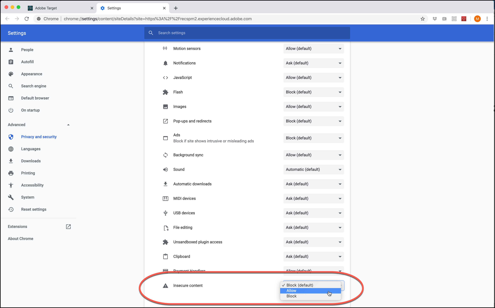
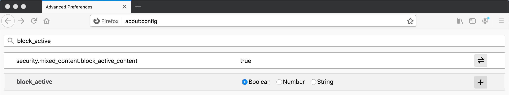

# Consentire contenuti misti nel browser {#mixed-content}

>[!BEGINSHADEBOX]

**In questa pagina:** Scopri come abilitare i contenuti misti in [!DNL Google Chrome], [!DNL Mozilla Firefox] e [!DNL Microsoft Edge], in modo che il **[!UICONTROL Compositore esperienza visivo]** possa aprire siti HTTP e siti con contenuti misti.

>[!ENDSHADEBOX]

Una pagina contiene contenuti misti quando viene richiesta in modo sicuro tramite HTTPS ma carica sia contenuti HTTPS che HTTP. Il contenuto HTTPS è sicuro, mentre il contenuto HTTP non lo è, pertanto i browser moderni potrebbero bloccare una pagina di questo tipo o visualizzare un messaggio di avviso.

Quando il **[!UICONTROL Compositore esperienza visivo]** (VEC) in [!DNL Adobe Target] tenta di aprire una pagina con contenuti misti, viene visualizzato un messaggio di avviso con le istruzioni per disattivare il blocco nel browser. La disattivazione del blocco consente di aprire un sito HTTP o un sito con contenuti misti (HTTPS e HTTP).

In precedenza, alcune azioni nel passaggio 1 del flusso di lavoro guidato in tre passaggi rimanevano disponibili quando i contenuti misti non erano consentiti. [!DNL Target] ora blocca tutte le azioni nel passaggio 1, pertanto i contenuti misti devono essere abilitati prima che la creazione dell&#39;attività possa continuare.

Le impostazioni di sicurezza del browser potrebbero bloccare il contenuto non sicuro (HTTP) caricato in una pagina o in un frame protetto (HTTPS), ad esempio nel Compositore esperienza visivo. L&#39;alternativa alla modifica di queste impostazioni è un sito Web HTTPS. Se il sito web viene eseguito su un dominio non sicuro (HTTP), il Compositore esperienza visivo deve essere autorizzato a caricare contenuti misti attivi.

>[!IMPORTANT]
>
>Consentire l’utilizzo di contenuti misti influisce solo sul Compositore esperienza visivo e non sul sito web live.

Per ulteriori informazioni, consulta la pagina sui [contenuti misti](https://developer.mozilla.org/en-US/docs/Web/Security/Mixed_content) nel sito web di *Mozilla Developer Network* (MDN).

## Abilita contenuto misto in [!DNL Google Chrome]

[!DNL Chrome] verifica che il contenuto di una pagina richiesta tramite una connessione sicura sia stato trasmesso in modo sicuro. Consulta “[Gestire avvisi sui siti non sicuri](https://support.google.com/chrome/answer/99020?hl=it)” nella guida di Google Chrome.

Per utilizzare il Compositore esperienza visivo con la versione più recente di [!DNL Chrome] (versione 79.0.3945.117 o successiva), aggiornare le impostazioni del sito come indicato di seguito. I visitatori del sito non devono completare questi passaggi.

1. Fai clic sull&#39;icona del lucchetto (avviso), quindi fai clic su **[!UICONTROL Impostazioni sito]**.

   

1. In **[!UICONTROL Contenuto non sicuro]**, modificare &quot;Blocca (predefinito)&quot; in &quot;Consenti&quot; nell&#39;elenco a discesa.

   

1. Ricarica la pagina del Compositore esperienza visivo.

## Abilita contenuto misto in [!DNL Mozilla Firefox]

Per impostazione predefinita, [!DNL Firefox] blocca le pagine che contengono un misto di contenuti protetti e non protetti, pertanto questa impostazione deve essere modificata definitivamente per utilizzare [!DNL Target]. I visitatori del sito non devono completare questi passaggi.

1. In [!DNL Firefox] immettere `about:config` nella barra degli indirizzi.
1. Confermare il messaggio di avviso visualizzato da [!DNL Firefox].

   

1. Nella barra di ricerca immettere `block_active`.

   

1. Fare doppio clic su `security.mixed_content.block_active_content`.

   Il valore cambia da &quot;True&quot; a &quot;False&quot;. Quando il valore è impostato su &quot;False&quot;, la modifica è completa.

   

1. Riavviare il computer dopo aver modificato questa impostazione.

## Abilita contenuto misto in [!DNL Microsoft Edge]

[!DNL Edge] verifica che il contenuto di una pagina richiesta tramite una connessione sicura sia stato trasmesso in modo sicuro. Per utilizzare il Compositore esperienza visivo con la versione più recente di [!DNL Edge], aggiornare le impostazioni del sito come indicato di seguito. I visitatori del sito non devono completare questi passaggi.

1. In [!DNL Edge], fai clic su **[!DNL Microsoft Edge]** nella barra dei menu, fai clic su **[!UICONTROL Impostazioni]**, quindi su **Cookie e autorizzazioni sito**.
1. Scorri fino a **[!UICONTROL Contenuto non sicuro]** e fai clic su di esso.
1. Accanto a **[!UICONTROL Consenti]**, fare clic su **[!UICONTROL Aggiungi]**, immettere il sito in cui consentire il contenuto non sicuro, quindi fare clic su **[!UICONTROL Aggiungi]**.
1. Ricarica la pagina del Compositore esperienza visivo.
