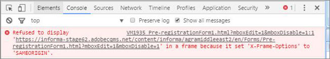

# Risoluzione dei problemi relativi al [!UICONTROL Compositore esperienza visivo] {#vec-issues}

>[!BEGINSHADEBOX]

**In questa pagina:** Scopri come risolvere i problemi che interessano solo il **[!UICONTROL Compositore esperienza visivo]**.

>[!ENDSHADEBOX]

In determinate condizioni si verificano a volte problemi di visualizzazione nel [!DNL Adobe Target] **[!UICONTROL Compositore esperienza visivo]**. Gli elementi seguenti descrivono i problemi che interessano solo il Compositore esperienza visivo e come risolverli.

+++ Le librerie [!DNL Target] non vengono caricate quando il sito web viene aperto nel Compositore esperienza visivo

Quando un sito Web viene aperto nel **[!UICONTROL Compositore esperienza visivo]**, [!DNL Target] aggiunge i parametri `mboxEdit=1` e `mboxDisable=1` all&#39;URL.

Un sito Web che taglia o rimuove questi parametri durante lo spostamento da una pagina all&#39;altra senza ricaricare la pagina, in particolare un&#39;applicazione a pagina singola, interrompe la funzionalità [!DNL Target] e le librerie [!DNL Target] non vengono caricate. Per evitare questo problema, mantieni entrambi i parametri nell’URL.

+++

+++ Una pagina non si apre nel Compositore esperienza visivo o viene caricata lentamente, oppure le attività e le esperienze vengono caricate lentamente nel Compositore esperienza visivo

Diversi problemi possono influire sulle prestazioni della pagina nei compositori esperienza [!DNL Target]. I più comuni sono i seguenti:

* La pagina non ha una mbox.
* Il sito utilizza il blocco proxy, che impedisce l’apertura della pagina in uno dei compositori esperienze.
* Il sito non si lascia aprire in un iFrame.

Quando si verifica un problema in **[!UICONTROL Compositore esperienza avanzato]**, disattivalo e utilizza il **[!UICONTROL Compositore esperienza visivo]**. A tale scopo, passare a **[!UICONTROL Amministrazione]** > **[!UICONTROL Compositore esperienza visivo]** e disattivare l&#39;opzione **[!UICONTROL Abilita Compositore esperienza avanzato]**.

Nella console può essere visualizzato il seguente messaggio di errore:

Quando nessuno dei compositori funziona, un&#39;estensione del browser che sovrascrive l&#39;intestazione X-Frame-Options del sito, ad esempio [!DNL Requestly] ([!DNL Chrome] o [!DNL Firefox]) o Modifica intestazioni di risposta ([!DNL Firefox]), consente al sito di caricarsi in iFrame e quindi abilita il Compositore esperienza visivo. Se non è possibile utilizzare le estensioni del browser, utilizzare [Compositore esperienza basato su moduli](/help/main/c-experiences/form-experience-composer.md). È inoltre possibile utilizzare l&#39;estensione [[!DNL Adobe Target] **[!UICONTROL Helper per editing video &#x200B;]**](/help/main/c-experiences/c-visual-experience-composer/r-troubleshoot-composer/visual-editing-helper-extension.md) per [!DNL Google Chrome], oltre alle procedure seguenti.

>[!NOTE]
>
>Queste estensioni sono destinate solo alla modifica nel Compositore esperienza visivo.
>
>Con [!DNL Requestly], ogni volta che è necessario rimuovere le intestazioni, eseguire una delle operazioni seguenti:
>
>* Aggiungi le regole URL per l’URL da aprire nel Compositore esperienza visivo, in modo che le intestazioni vengano rimosse solo per tali URL.
>* Abilita la regola durante la modifica nel Compositore esperienza visivo e disabilita la regola quando il Compositore esperienza visivo non è in uso.
>
>Con **[!UICONTROL Modifica intestazioni risposta]** ([!DNL Firefox]), le regole URL non sono disponibili, pertanto la regola deve essere abilitata durante la modifica nel Compositore esperienza visivo e disabilitata quando il Compositore esperienza visivo non è in uso.

Una volta configurata un&#39;estensione, le pagine vengono caricate nel **[!UICONTROL Compositore esperienza visivo]** anche quando il **[!UICONTROL Compositore esperienza avanzato]** è disabilitato.

+++

+++ Rimuovi l’intestazione X-Frame-Options con Requestly (Chrome o Firefox)

1. Disattivare **[!UICONTROL Compositore esperienza avanzato]**.
1. Installa l&#39;estensione del browser [!DNL Requestly] in [!DNL Chrome] o [!DNL Firefox].
1. Apri l&#39;estensione e seleziona **[!UICONTROL Modifica intestazioni]**.
1. Immettere un nome di regola.
1. Nelle regole di modifica, crea una regola che rimuova l’intestazione:

   * Passa da **[!UICONTROL Aggiungi]** a **[!UICONTROL Rimuovi]**.
   * Passa da **[!UICONTROL Richiesta]** a **[!UICONTROL Risposta]**.
   * Immetti “X-Frame-Options” come nome dell&#39;intestazione.

1. Ripetete il passo precedente e immettete &quot;x-frame-options&quot; come nome dell&#39;intestazione.

   >[!NOTE]
   >
   >Le intestazioni manipolate con [!DNL Requestly] fanno distinzione tra maiuscole e minuscole.

1. Cambia **[!UICONTROL Equals]** in **[!UICONTROL Contiene]** come condizione per l&#39;URL di origine e immetti l&#39;URL dell&#39;attività da caricare nel Compositore esperienza visivo.

   

1. Fai clic su **[!UICONTROL Salva]**.

   

La pagina dovrebbe ora essere caricata rapidamente nel **[!UICONTROL Compositore esperienza visivo]**.

+++

+++ Rimuovi l’intestazione X-Frame-Options con Modifica intestazioni di risposta (Firefox)

1. Installare l&#39;estensione [!DNL Modify Response Headers] in [!DNL Firefox] e riavviare il browser.
1. Dalle estensioni [!DNL Firefox], selezionare l&#39;estensione [!DNL Modify Response Headers].
1. Fai clic su **[!UICONTROL Preferenze]**.
1. Seleziona **[!UICONTROL Filtro]** dall&#39;elenco a discesa **[!UICONTROL Azione]**.
1. Nel campo **[!UICONTROL Nome intestazione]** immettere **[!UICONTROL X-Frame-Options]**.
1. Ripeti i due passaggi precedenti per aggiungere un filtro con **[!UICONTROL x-frame-options]**.
1. Fai clic su **[!UICONTROL Aggiungi]**.
1. Fai clic su **[!UICONTROL Avvia]**.

+++

+++ Una pagina non viene visualizzata nel Compositore esperienza visivo

Controllare le cause seguenti:

* **Versione estensione:** la versione più recente dell&#39;estensione [[!DNL Adobe Experience Cloud] **[!UICONTROL Helper per editing video &#x200B;]**](/help/main/c-experiences/c-visual-experience-composer/r-troubleshoot-composer/visual-editing-helper-extension.md) offre la migliore compatibilità con il Compositore esperienza visivo. Per verificare la versione installata, vai a&#x200B;**[!UICONTROL &#x200B; Estensioni &#x200B;]**>**[!UICONTROL &#x200B; Gestione estensioni &#x200B;]**, quindi fai clic su&#x200B;**[!UICONTROL &#x200B; Dettagli &#x200B;]**.
* **Creazione di librerie:** il Compositore esperienza visivo deve creare librerie per modificare la pagina web. Sono incorporate nella libreria at.js, che l&#39;estensione scarica dai server [!DNL Adobe] ogni volta che viene utilizzato il Compositore esperienza visivo, indipendentemente dal fatto che at.js o [!DNL Adobe Experience Platform Web SDK] sia già presente nella pagina. Verifica che le intestazioni at.js configurate in **[!UICONTROL Amministrazione]** > **[!UICONTROL Implementazione]** non contengano modifiche non valide.
* **Richieste bloccate:** la pagina non deve bloccare le richieste obbligatorie per il caricamento quando è incorporata in un iFrame. Tale blocco include `frame-ancestors` direttive CSP, codice JavaScript personalizzato nel sito Web, tag meta HTML e intestazione `x-frame-options`.
* **Nomi di file riservati:** il JavaScript della pagina non deve interferire con le librerie di authoring. Non utilizzare o includere file con i seguenti nomi riservati:

  * `target-vec-helper.js`
  * `target-vec.js`
  * `target.js`
  * `admin.css`
  * `sizzle.js`
  * `mixContentCheck.html`

  Anche l’esclusione accidentale delle variabili o degli eventi definiti in questi file può causare problemi con il Compositore esperienza visivo.

* **Pagina non protetta in un sito protetto:** il browser blocca la pagina. Fai clic sull&#39;icona a sinistra dell&#39;URL nella barra degli indirizzi, quindi fai clic su **[!UICONTROL Disattiva protezione in questa pagina]**.
* **URL non valido:** l&#39;URL immesso non è valido.
* **Cookie:** se il sito Web non viene caricato nel Compositore esperienza visivo o si comporta in modo imprevisto, accettare i cookie nel browser prima di caricare il sito Web in [!DNL Target] può risolvere il problema.

+++

+++ Il Compositore esperienza visivo sembra non funzionare in modalità Sfoglia

In modalità **[!UICONTROL Sfoglia]**, il Compositore esperienza visivo appare danneggiato quando viene aperto un URL privo delle [!DNL Target] librerie ([at.js](https://experienceleague.adobe.com/docs/target-dev/developer/client-side/at-js-implementation/overview.html?lang=it){target=_blank} o [Adobe Experience Platform Web SDK](https://experienceleague.adobe.com/docs/target-dev/developer/client-side/aep-web-sdk.html?lang=it){target=_blank}) o contenente un&#39;intestazione frame-buster. Per motivi di sicurezza del browser, [!DNL Target] non può accedere correttamente all&#39;URL a cui è stato effettuato l&#39;accesso oppure l&#39;URL del Compositore esperienza visivo non viene aggiornato in modo coerente al caricamento della pagina.

Il Compositore esperienza visivo carica la pagina web in un `<iframe>` e i meccanismi di sicurezza correnti dei browser impediscono all&#39;interfaccia utente [!DNL Target] di accedere agli elementi del frame in base al criterio con la stessa origine. I browser bloccano gli script che tentano di accedere a un frame con un&#39;origine diversa, incluse informazioni quali `location.href`.

Utilizza la nuova estensione [Helper per editing video](/help/main/c-experiences/c-visual-experience-composer/r-troubleshoot-composer/visual-editing-helper-extension.md) per inserire la libreria [!DNL Target] nelle pagine, in modo che le pagine possano essere visualizzate in modo ottimale.

+++

+++ I problemi sono causati da conflitti CSS nel Compositore esperienza visivo

Controlla se eventuali file CSS influiscono sulla visibilità durante il caricamento della pagina nell’editor. Ad esempio, la proprietà `overflow: hidden` nel corpo della pagina può causare problemi di scorrimento o attivare eventi di clic che interferiscono con il menu di creazione.

+++
