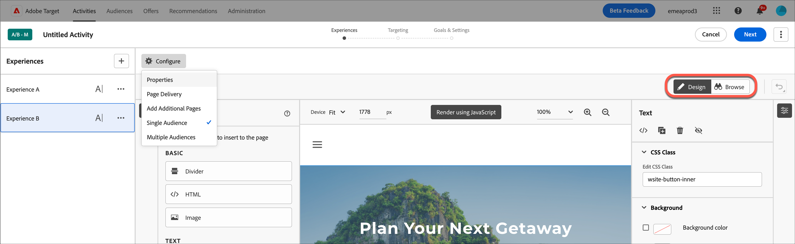

# [!UICONTROL Modifiche al Compositore esperienza visivo] {#vec-changes}

>[!BEGINSHADEBOX]

**In questa pagina:** Scopri le differenze tra il [!UICONTROL Compositore esperienza visivo] (VEC) aggiornato introdotto nella versione [!DNL Adobe Target Standard/Premium] 25.2.1 e la versione precedente.

>[!ENDSHADEBOX]

La versione di [!DNL Adobe Target Standard/Premium] 25.2.1 (17 febbraio 2025) introduce un [!UICONTROL Compositore esperienza visivo] aggiornato. Questo articolo spiega le differenze tra la versione precedente e quella aggiornata del Compositore esperienza visivo.

>[!IMPORTANT]
>
>Il [!UICONTROL Compositore esperienza visivo] aggiornato richiede l&#39;estensione [!DNL Adobe Experience Cloud] [**[!UICONTROL Helper per editing video ]**](/help/main/c-experiences/c-visual-experience-composer/r-troubleshoot-composer/visual-editing-helper-extension.md) disponibile in [!DNL Chrome Web Store].

Il Compositore esperienza visivo viene visualizzato quando viene creata un’attività o ne viene modificata una esistente.

## Modifiche principali al Compositore esperienza visivo

Nelle sezioni seguenti vengono illustrate le principali modifiche apportate al Compositore esperienza visivo aggiornato rispetto alla versione precedente.

### Barra [!UICONTROL Esperienze]

Come nella versione precedente, la barra **[!UICONTROL Esperienze]** rimane sul lato sinistro del Compositore esperienza visivo. Impossibile comprimere la barra **[!UICONTROL Esperienze]**.

Le esperienze vengono create, rinominate o rimosse utilizzando la barra **[!UICONTROL Esperienze]**.

Fai clic sull&#39;icona **[!UICONTROL Aggiungi]** (  ) per aggiungere una nuova esperienza. Fai clic sull&#39;icona **[!UICONTROL Altre azioni]** (  ) per duplicare, eliminare o reindirizzare un&#39;esperienza.

### [!UICONTROL Componenti] barra (nuova)

La nuova barra **[!UICONTROL Componenti]** aggiunge diversi componenti alla pagina Web, che possono quindi essere modificati in base alle esigenze.

Per aggiungere un nuovo componente, seleziona il componente desiderato dalla barra **[!UICONTROL Componenti]**, passa il puntatore del mouse su un elemento esistente nella pagina, quindi scegli di inserire il componente prima o dopo l&#39;elemento selezionato.

Se in quest&#39;area viene visualizzata la barra **[!UICONTROL Modifiche]** anziché la barra **[!UICONTROL Componenti]**, fare clic sull&#39;icona **[!UICONTROL Mostra componenti]** (  ). L&#39;icona **[!UICONTROL Mostra componenti]** (  ) e l&#39;icona **[!UICONTROL Mostra modifiche]** (  ) fungono da interruttori che visualizzano le opzioni appropriate.

Per comprimere la barra **[!UICONTROL Components]** e ingrandire l&#39;area di lavoro **[!UICONTROL Design]** mentre la barra **[!UICONTROL Components]** è aperta, fare clic sull&#39;icona (  ).

### [!UICONTROL Barra delle modifiche]

Per aprire la barra **[!UICONTROL Modifiche]**, fai clic sull&#39;icona **[!UICONTROL Mostra modifiche]** (  ) nella barra **[!UICONTROL Componenti]**. La barra **[!UICONTROL Modifiche]** ha cambiato posizione dal lato destro a quello sinistro dell&#39;area di modifica.

>[!NOTE]
>
>Per comprimere la barra **[!UICONTROL Modifiche]** e ingrandire l&#39;area di lavoro **[!UICONTROL Progettazione]** mentre la barra **[!UICONTROL Modifiche]** è aperta, fare clic sull&#39;icona **[!UICONTROL Mostra modifiche]** (  ).

La barra **[!UICONTROL Modifiche]** mostra tutte le modifiche apportate alla pagina nel Compositore esperienza visivo e consente ulteriori modifiche (come selettore CSS, Mbox e codice personalizzato).

Fai clic sull&#39;icona **[!UICONTROL Altre opzioni]** (  ) per aggiungere una modifica, eliminare tutte le modifiche o eliminare tutte le modifiche non valide. Fai clic su **[!UICONTROL Seleziona]** per eseguire operazioni in blocco: **[!UICONTROL Applica a tutte le pagine]** o **[!UICONTROL Elimina]**.

Per visualizzare di nuovo la barra **[!UICONTROL Modifiche]**, fai clic sull&#39;icona **[!UICONTROL Nascondi modifiche]** (  ) nella barra **[!UICONTROL Modifiche]**.

### [!UICONTROL Barra delle proprietà] (nuova)

La barra **[!UICONTROL Proprietà]** modifica le proprietà degli elementi selezionati nella pagina, sia che si tratti di elementi di HTML che di oggetti specifici di [!DNL Target], ad esempio consigli o offerte.

Fai clic sulle icone nella parte superiore della barra per modificare il codice HTML o per eliminare, duplicare o nascondere gli elementi. Le modifiche vengono visualizzate nella barra **[!UICONTROL Modifiche]**.

La barra **[!UICONTROL Proprietà]** è comprimibile nella barra a destra. Fai clic sull&#39;icona **[!UICONTROL Mostra/Nascondi proprietà]** (  ) a destra della barra per comprimere o visualizzare la barra **[!UICONTROL Proprietà]**.

### Impostazioni/configurazione delle attività

Fai clic sull&#39;icona **[!UICONTROL Configura]** (  ) visualizzata nell&#39;area di progettazione per visualizzare il menu delle proprietà dell&#39;attività.

Le diverse opzioni assegnano proprietà, modificano le regole di consegna della pagina, specificano le preferenze del sito, aggiungono ulteriori pagine e abilitano o disabilitano attività di più pagine o tipi di pubblico. Assegna **[!UICONTROL proprietà]** è una funzionalità di [[!DNL Target Premium]](/help/main/c-intro/intro.md#premium).

La posizione e le funzionalità sono simili a quelle della precedente interfaccia utente del Compositore esperienza visivo.

### Modalità [!UICONTROL Progettazione]/[!UICONTROL Sfoglia]

Utilizza le opzioni **[!UICONTROL Progettazione]**/**[!UICONTROL Sfoglia]** visualizzate sopra la barra **[!UICONTROL Proprietà]** per passare dalla modalità progettazione alla modalità Sfoglia.

Utilizza la modalità **[!UICONTROL Sfoglia]** per navigare nel sito e scegliere la visualizzazione o la pagina da aggiornare. Torna alla modalità **[!UICONTROL Progettazione]** per aggiungere o modificare le modifiche.

### [!UICONTROL Annulla]/[!UICONTROL Ripeti]

È possibile annullare le modifiche facendo clic sull&#39;icona **[!UICONTROL Annulla]** (  ).

Per ripristinare un&#39;azione, espandere il gruppo di pulsanti **[!UICONTROL Annulla]**/**[!UICONTROL Ripristina]** e scegliere **[!UICONTROL Ripristina]**.

### [!UICONTROL Progettazione] area di lavoro

L&#39;area di lavoro **[!UICONTROL Progettazione]** consente di selezionare i riquadri di visualizzazione, inclusi Adatta allo schermo, **[!UICONTROL Desktop]**, **[!UICONTROL Tablet]**, **[!UICONTROL Orizzontale mobile]** e **[!UICONTROL Verticale mobile]**.

Il Compositore esperienza visivo aggiornato consente inoltre di ingrandire o ridurre la visualizzazione facendo clic sull&#39;icona appropriata (  o  ).

## Illustrazione visiva delle modifiche apportate all’interfaccia utente

La figura seguente mostra le modifiche di alto livello apportate all’interfaccia utente del Compositore esperienza visivo aggiornato. Il lato sinistro dell’illustrazione mostra la precedente interfaccia utente del Compositore esperienza visivo e il lato destro mostra l’interfaccia utente aggiornata. I numeri corrispondenti mostrano dove i vari elementi sono stati spostati o modificati.

{width="800" zoomable="yes"}

## Ulteriori informazioni sull’interfaccia utente aggiornata

* [[!DNL Target Standard/Premium] 25.2.1 (17 febbraio 2025) - Note sulla versione](/help/main/r-release-notes/release-notes-for-previous-releases.md#ui-update-2): fornisce un riepilogo delle modifiche chiave apportate all&#39;interfaccia utente in [!DNL Target] per **[!UICONTROL Attività]**, **[!UICONTROL Consigli]** e [!UICONTROL Compositore esperienza visivo].

* [[!DNL Target Standard/Premium] 25.1.1 (9 gennaio 2025) note sulla versione](/help/main/r-release-notes/release-notes-for-previous-releases.md#ui-update-1): fornisce un riepilogo delle modifiche all&#39;interfaccia utente chiave in [!DNL Target] per la **[!UICONTROL Libreria offerte]**.

* [Comprendere l&#39;interfaccia utente [!DNL Target] UI](/help/main/c-intro/understand-the-target-ui.md): fornisce una breve panoramica di [!DNL Target], con collegamenti per informazioni più approfondite e istruzioni dettagliate.

* [[!UICONTROL Opzioni del Compositore esperienza visivo]](/help/main/c-experiences/c-visual-experience-composer/viztarget-options.md): illustra l&#39;interfaccia utente del Compositore esperienza visivo aggiornata e le relative opzioni.

* [[!DNL Target] Domande frequenti sull&#39;aggiornamento dell&#39;interfaccia utente](/help/main/c-intro/updated-ui-faq.md): risponde alle domande comuni sulla nuova interfaccia utente [!DNL Target] e sul Compositore esperienza visivo [!UICONTROL Compositore esperienza visivo], incluse le modifiche alla navigazione, le posizioni delle funzionalità e l&#39;attivazione/disattivazione della versione temporanea dell&#39;interfaccia utente.
