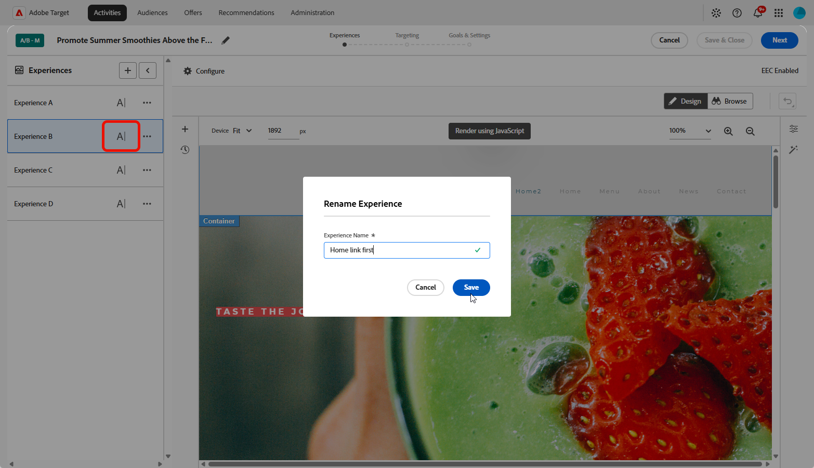
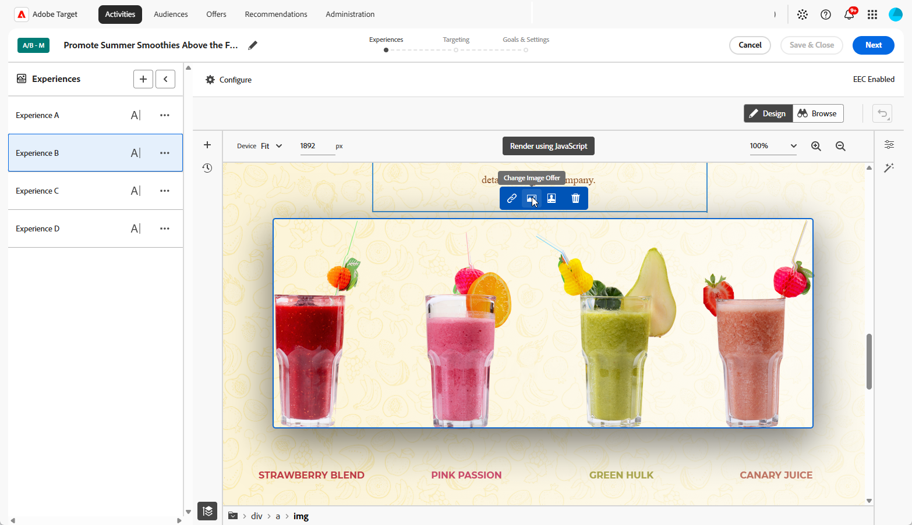

# Introduzione a [!UICONTROL Compositore esperienza visivo] {#vec-overview}

>[!BEGINSHADEBOX]

**In questa pagina:** Scopri come aprire il [!UICONTROL Compositore esperienza visivo] (VEC), modificare le esperienze e gestire il caricamento delle pagine.

>[!ENDSHADEBOX]

Il [!UICONTROL Compositore esperienza visivo] (VEC) in [!DNL Adobe Target] è un editor WYSIWYG per la creazione e il testing di esperienze personalizzate direttamente su siti Web e pagine Web mobili, senza modifica del codice.

Le esperienze e le offerte per le attività [!DNL Target] vengono create trascinando e rilasciando elementi, scambiando contenuti e modificando i layout di pagina. Il compositore fornisce anche opzioni per la modifica di HTML e JavaScript.

## Requisiti del browser {#browser-requirements}

[!DNL Safari] è supportato per l&#39;interfaccia [!DNL Adobe Target]. Le attività basate su moduli possono essere create in [!DNL Safari] con tutte le funzionalità, ad eccezione del Compositore esperienza visivo e del [!UICONTROL Compositore esperienza avanzato] (EEC). Se il Compositore esperienza visivo viene aperto in [!DNL Safari], viene richiesto di passare a [!DNL Google Chrome] per modificare le esperienze.

I browser come [!DNL Firefox] potrebbero bloccare la visualizzazione nel Compositore esperienza visivo delle pagine che contengono contenuti misti, ad esempio una pagina non protetta all&#39;interno di un sito protetto. Se una pagina non viene visualizzata, fare clic sull&#39;icona accanto all&#39;URL nella barra degli indirizzi del browser, quindi fare clic su **[!UICONTROL Disattiva protezione in questa pagina]**. Questo problema non influisce sulla modalità di visualizzazione delle pagine per i visitatori del sito.

## Aprire il Compositore esperienza visivo {#open-the-vec}

Per impostare la pagina che si apre per impostazione predefinita nel Compositore esperienza visivo, immetti un URL predefinito di [!UICONTROL Compositore esperienza visivo] nella scheda [!DNL Target] **[!UICONTROL Amministrazione]** > **[!UICONTROL Compositore esperienza visivo]**. Se non è impostato alcun URL predefinito, il Compositore esperienza visivo si apre con una pagina vuota in cui è possibile specificare un URL.

## Modificare le esperienze {#edit-experiences}

### Visualizzare e denominare le esperienze {#view-and-name-experiences}

Le schede nella barra **[!UICONTROL Esperienze]** mostrano come la pagina viene visualizzata da tipi di pubblico diversi o con esperienze diverse. Un nome descrittivo per ogni esperienza facilita l’identificazione nell’elenco. Ad esempio, quando verifichi la posizione del collegamento Home in una barra di navigazione, l’esperienza in cui appare per prima può essere denominata &quot;Collegamento Home primo&quot;.

### Selezionare e modificare gli elementi {#select-and-modify-elements}

Spostando il cursore sulla pagina, i singoli elementi vengono evidenziati con una casella sensibile al contesto. Facendo clic su un elemento evidenziato vengono visualizzate le opzioni di modifica per tale tipo di elemento. Ad esempio, se selezioni un&#39;immagine e fai clic su **[!UICONTROL Cambia offerta immagine]** la sostituisci e se selezioni un pulsante puoi modificarne il colore del testo.

Impossibile modificare il contenuto all’interno di un iframe incorporato nella pagina. Per modificare tale contenuto, accertati che il documento iframe sia abilitato per [!DNL Target], quindi carica l’URL iframe direttamente nel Compositore esperienza visivo.

Le modifiche alla struttura della pagina all’esterno del Compositore esperienza visivo possono influenzare le posizioni utilizzate da un’attività. Se tali percorsi cambiano, [!DNL Target] potrebbe non essere in grado di trovare gli elementi modificati, il che potrebbe causare problemi durante la modifica delle esperienze.

### Sfoglia e progetta {#browse-and-design}

Fai clic su **[!UICONTROL Sfoglia]** per passare a una pagina accessibile dalla pagina corrente, ad esempio una pagina di spedizione o un carrello acquisti, ed esegui il test delle modifiche.

In modalità Sfoglia è possibile accedere anche agli elementi visualizzati al passaggio del mouse, ad esempio menu a comparsa e mini-carrelli. Una volta raggiunta la pagina o l&#39;elemento da modificare, fai clic su **[!UICONTROL Progettazione]** per modificare l&#39;esperienza.

Se uno stato al passaggio del mouse dipende da JavaScript, assicurarsi che **[!UICONTROL Disabilita JavaScript]** non sia selezionato. Per modificare gli elementi che dipendono da JavaScript, è necessario abilitarlo.

Per informazioni dettagliate sulle opzioni di modifica disponibili, vedere [Opzioni del Compositore esperienza visivo](/help/main/c-experiences/c-visual-experience-composer/viztarget-options.md).

## Gestire il caricamento delle pagine {#manage-page-loading}

Alcune opzioni di modifica rimangono disponibili durante il caricamento di una pagina o dopo il suo mancato caricamento. È inoltre possibile annullare il caricamento della pagina per accedere a queste opzioni senza attendere.

### Modificare una pagina durante il suo caricamento o dopo il suo mancato caricamento {#loading}

Alcune modifiche possono essere apportate prima del termine del caricamento di una pagina nel Compositore esperienza visivo o dopo il suo mancato caricamento, ad esempio perché il codice personalizzato non funziona più.

Le opzioni di modifica disponibili consentono quanto segue:

* Apportare semplici modifiche, ad esempio aggiungere codice personalizzato o rinominare un’esperienza
* Copia il codice personalizzato esistente da una pagina non più accessibile
* Apportare semplici modifiche a una pagina che non può essere caricata nel Compositore esperienza visivo

La barra **[!UICONTROL Esperienze]**, la barra **[!UICONTROL Componenti]** e le opzioni **[!UICONTROL Configura]** rimangono accessibili durante il caricamento della pagina o dopo il suo mancato caricamento.

### Annullare il caricamento di una pagina all’interno del Compositore esperienza visivo {#cancel-loading}

L’annullamento del caricamento della pagina nel Compositore esperienza visivo consente di modificare l’attività senza attendere il completamento del caricamento della pagina. Questo è utile per:

* Apportare modifiche minori alle modifiche esistenti
* Elimina una o più modifiche esistenti
* Inserisci o modifica codice personalizzato
* Correggere un URL di pagina immesso in modo errato
* Attivare o disattivare JavaScript prima di caricare la pagina nel Compositore esperienza visivo
* Aggiungi regole di test dei modelli ai criteri **[!UICONTROL Consegna pagine]**
* Ignora l&#39;interruttore globale [!UICONTROL Compositore esperienza avanzato] durante il caricamento di una pagina tramite il Compositore esperienza avanzato o in modalità solo iframe

Dopo l’annullamento del caricamento della pagina, è possibile passare da un’esperienza all’altra nell’attività senza attendere che la pagina venga caricata. Fai clic su **[!UICONTROL Ricarica]** per visualizzare nuovamente la pagina nel Compositore esperienza visivo.

>[!IMPORTANT]
>
>Se il codice personalizzato viene modificato o vengono apportate altre modifiche dopo l’annullamento del caricamento della pagina, esegui un test di controllo qualità per verificare che le modifiche vengano consegnate come previsto.

Per interrompere il caricamento della pagina, fare clic su **[!UICONTROL Annulla caricamento]** durante il caricamento della pagina. La pagina rimane scaricata per questa attività durante la sessione di modifica corrente, a meno che non venga ricaricata.

Fai clic su **[!UICONTROL Ricarica]** per riprendere a gestire le esperienze nell&#39;attività corrente o aggiungere nuove modifiche.
