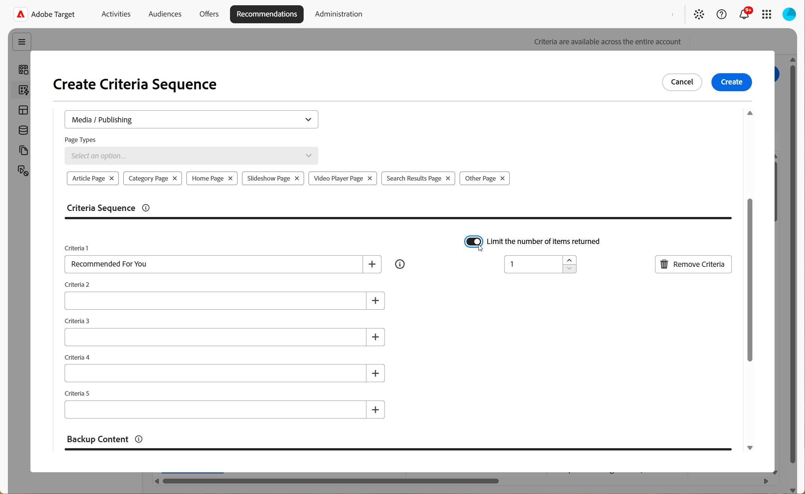

# Creare sequenze di criteri {#create-criteria-sequence}

>[!BEGINSHADEBOX]

**In questa pagina:** Scopri come creare sequenze di criteri per controllare gli elementi visualizzati nelle attività [!DNL Adobe Target Recommendations].

>[!ENDSHADEBOX]

Sequenze di criteri fino a cinque forniscono un maggiore controllo sugli elementi visualizzati nelle attività [!DNL Adobe Target] **[!UICONTROL Consigli]**. Il numero di elementi restituiti può anche essere limitato (talvolta indicato come &quot;controllo a livello di slot&quot;).

Quando un criterio non restituisce risultati sufficienti per riempire la progettazione, una sequenza di criteri fornisce consigli mirati aggiuntivi invece di consigli di backup più generici. In genere, una sequenza di criteri passa dal targeting più specifico, che potrebbe restituire un numero minore di risultati, al targeting più generale, che in genere restituisce più risultati.

>[!NOTE]
>
>Le sequenze di criteri non possono essere utilizzate con le attività **[!UICONTROL Recommendations]** create prima del rilascio di [!DNL Target Premium] in ottobre 2016.

Per creare una sequenza di criteri, creare innanzitutto i criteri da includere nella sequenza. Per ulteriori informazioni, vedere [Creare i criteri](/help/main/c-recommendations/c-algorithms/create-new-algorithm.md).

L’ordine di una sequenza di criteri può variare a seconda del tipo di pagina, come illustrato negli esempi seguenti:

| Tipo di pagina | Possibile ordine di sequenza |
| --- | --- |
| Pagina prodotto | <ol><li>In base all’articolo corrente, dello stesso marchio</li><li>In base all&#39;articolo corrente, di tutte le marche</li><li>In base a somiglianza del contenuto</li><li>In base agli articoli più venduti</li><li>In base agli articoli più visualizzati di tutto il sito</li></ol> |
| Home page | <ol><li>In base all’ultimo acquisto del visitatore </li><li>In base all’articolo preferito del visitatore</li><li>In base alla categoria preferita del visitatore</li><li>In base agli articoli più venduti</li><li>In base agli articoli più visualizzati di tutto il sito</li></ol> |

## Creare una sequenza di criteri

Le sequenze di criteri vengono create dalla schermata **[!UICONTROL Crea sequenza criteri]**. Sono disponibili diversi modi per raggiungere questa schermata. Alcune opzioni di schermo variano a seconda di come viene raggiunta la schermata.

* Su **[!UICONTROL Consigli]** > **[!UICONTROL Criteri]**, fai clic su **[!UICONTROL Crea criterio]** > **[!UICONTROL Crea sequenza criteri]**. I criteri creati vengono automaticamente resi disponibili per tutte le attività di **[!UICONTROL Consigli]**.
* Durante la creazione di un&#39;attività di **[!UICONTROL Consigli]**, dalla schermata **[!UICONTROL Seleziona criteri]**, fare clic su **[!UICONTROL Crea nuovo]** > **[!UICONTROL Crea sequenza criteri]**. La nuova sequenza di criteri può essere salvata per l&#39;utilizzo con altre attività **[!UICONTROL Consigli]**.
* Durante la modifica di un&#39;attività **[!UICONTROL Consigli]**, fai clic su una casella di tipo **[!UICONTROL Posizione consigli]** nella pagina, quindi seleziona **[!UICONTROL Cambia criteri]**. Nella schermata **[!UICONTROL Seleziona criteri]**, fai clic su **[!UICONTROL Crea nuovo]** > **[!UICONTROL Crea sequenza criteri]**. I nuovi criteri possono essere salvati per l&#39;utilizzo con altre attività di **[!UICONTROL Consigli]**.

La procedura seguente presuppone che sia possibile accedere alla schermata **[!UICONTROL Crea sequenza criteri]** dal menu **[!UICONTROL Criteri]**.

1. Fai clic su **[!UICONTROL Consigli]** > **[!UICONTROL Criteri]**.

1. Fai clic su **[!UICONTROL Crea criterio]** > **[!UICONTROL Crea sequenza criteri]**.

   

1. Immettere le informazioni nella sezione [Informazioni di base](/help/main/c-recommendations/c-algorithms/create-new-algorithm.md#info).

1. Nella sezione **[!UICONTROL Sequenza criteri]**, fai clic sul segno più ( + ) per aggiungere una o più sequenze di criteri.

   L&#39;ordine sequenziale definisce l&#39;ordine di riempimento di una progettazione. Se il criterio 1 non ha abbastanza consigli per riempire la progettazione, gli slot rimanenti vengono riempiti con il criterio 2 e così via.

   

1. Nella schermata **[!UICONTROL Seleziona criteri]**, seleziona un criterio, quindi fai clic su **[!UICONTROL Salva]**.

   Per trovare i criteri desiderati è possibile utilizzare la casella **[!UICONTROL Cerca]** e l&#39;opzione filtro.

1. (Facoltativo) Abilita **[!UICONTROL Limita il numero di elementi restituiti]**, quindi specifica il numero di elementi (tra 1 e 50).

   

   I seguenti casi d&#39;uso illustrano il valore dell&#39;opzione **[!UICONTROL Limita il numero di elementi restituiti]** (talvolta denominata &quot;controllo a livello di slot&quot;).

   +++ Casi d’uso per limitare il numero di elementi restituiti

   * **Caso d&#39;uso 1**: una combinazione di diversi tipi di elementi in un unico vassoio di consigli, ad esempio una combinazione di indumenti esterni (giacche) e top (camicie, T-shirt). A questo scopo, utilizza una raccolta per l’attività che includa tutti i tipi di prodotto che possono apparire in qualsiasi slot della progettazione. Quindi imposta il primo criterio con un filtro statico che includa solo l’outerwear, e il secondo criterio con un filtro statico che includa solo i top. Infine, aggiungi entrambi i criteri a una sequenza di criteri e limita il primo criterio a 2 slot.

     La barra dei consigli potrebbe presentarsi così su un sito:

     

   * **Caso d&#39;uso 2**: combinazione di elementi alternativi e complementari. Imposta un criterio per utilizzare un algoritmo visualizzato/visualizzato e un filtro dinamico che limiti gli elementi consigliati alla categoria dell’elemento corrente. Imposta il secondo criterio per utilizzare un algoritmo visualizzato/acquistato e un filtro dinamico che includa solo gli articoli consigliati che non corrispondono alla categoria dell’articolo corrente. Infine, aggiungi entrambi i criteri a una sequenza e limita il primo criterio a 2 slot.

   +++

1. Continua ad aggiungere criteri alla sequenza. È possibile aggiungere fino a cinque criteri a una sequenza.

1. Abilita [Opzioni di contenuto di backup](/help/main/c-recommendations/c-algorithms/create-new-algorithm.md#content).

1. Fai clic su **[!UICONTROL Crea]**.

La sequenza di criteri viene visualizzata nell&#39;elenco **[!UICONTROL Criteri]**.

Per ulteriori informazioni sulle opzioni di logica per i consigli, vedere [Introduzione ai criteri](/help/main/c-recommendations/c-algorithms/algorithms.md).
