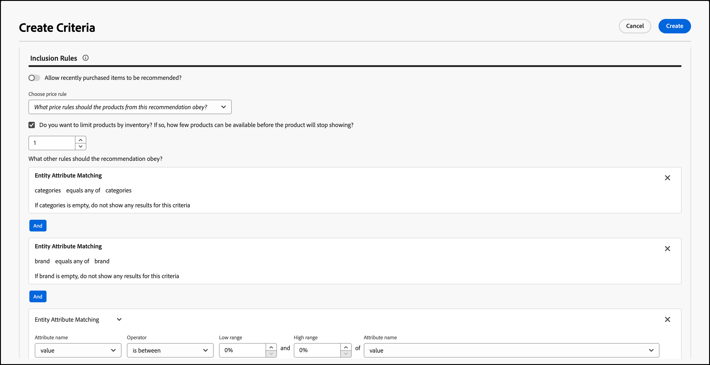

# Corrispondenza degli attributi di entità {#entity-attribute-matching}

>[!BEGINSHADEBOX]

**In questa pagina:** Scopri come filtrare dinamicamente i consigli in [!DNL Adobe Target Recommendations] confrontando un pool di potenziali elementi consigliati con un elemento specifico con cui il visitatore ha interagito.

>[!ENDSHADEBOX]

**[!UICONTROL Corrispondenza attributo entità]** consiglia solo gli elementi che corrispondono a un attributo di un elemento con cui il visitatore ha interagito. Le regole di inclusione per i criteri e le promozioni possono essere create e utilizzate con processi simili, così come sono simili i rispettivi casi ed esempi di utilizzo. Per ulteriori informazioni, vedere [Utilizzare regole di inclusione dinamiche e statiche](/help/main/c-recommendations/c-algorithms/use-dynamic-and-static-inclusion-rules.md).

## Esempi di corrispondenza degli attributi di entità

**[!UICONTROL Corrispondenza attributo entità]** può consigliare solo gli elementi corrispondenti, ad esempio:

* Attributo dell’elemento attualmente visualizzato dal visitatore
* L’ultimo elemento visualizzato dal visitatore
* L’ultimo articolo acquistato dal visitatore
* L’elemento visualizzato più di frequente dal visitatore
* Elemento memorizzato in un attributo personalizzato nel profilo del visitatore

### Articoli consigliati in base al marchio

Una volta create le regole degli attributi di entità, queste filtrano tutti i consigli con attributi che non corrispondono al valore di entità trasmesso sulla pagina. Affinché il processo funzioni, il valore `entity.brand` deve essere consegnato nella mbox nelle pagine.

Con questo tipo di regola di inclusione dinamica, è necessario specificare una sola regola di consigli per restituire risultati di brand rilevanti in tutte le pagine del brand, invece di una raccolta o di un filtro statico per ogni nome di brand.

Ad esempio, quando viene visualizzata una pagina che presenta un prodotto di Marchio A, il valore del parametro `entity.brand` viene impostato su &quot;Marchio A&quot;. In una pagina di destinazione del marchio, la mbox restituisce `entity.brand=brandA`.


I consigli sulla pagina contengono quindi solo prodotti del marchio A.


Quando viene visualizzata la pagina di un prodotto del marchio B, il valore `entity.brand` viene reimpostato su &quot;BrandB&quot; e si consigliano solo i prodotti del marchio B. Analogamente, nella pagina di destinazione del marchio per il Marchio B vengono restituiti solo i prodotti del Marchio B.


### Upselling per un prodotto più costoso

Per incoraggiare i visitatori a considerare gli articoli più costosi e, quindi, più redditizi, gli operatori &quot;è uguale a&quot; ed &quot;è tra&quot; possono promuovere articoli più costosi della stessa categoria e dello stesso marchio. Ad esempio, un retailer di scarpe può promuovere scarpe da corsa più costose per aumentare la vendita di un visitatore che cerca scarpe da corsa, come nell’esempio seguente:



```
Entity Attribute Matching
category - equals - current item's - category 
And 
Entity Attribute Matching
brand - equals - current item's - brand 
And 
Entity Attribute Matching
value - is between - 100% and 1000% of - current item's - value
```

### Promozione di prodotti con marchio privato

È possibile combinare filtri dinamici e statici per promuovere prodotti con marchio privato. Ad esempio, un&#39;azienda di fornitura di ufficio può promuovere le cartucce di toner del marchio della casa dell&#39;azienda per promuovere una vendita più redditizia per un visitatore che sta esaminando il toner e le penne del marchio della casa dell&#39;azienda per un visitatore che sta esaminando le penne, come nel seguente esempio:


```
Entity Attribute Matching
category - equals - current item's - category 
And
Static Filter
IsHouseBrand - equals - true
```
