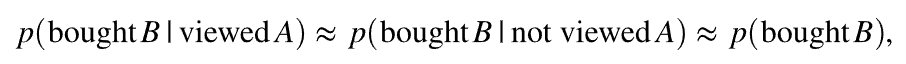

# La scienza alla base degli algoritmi della funzione Consigli di Target {#recommendations-algorithms}

>[!BEGINSHADEBOX]

**In questa pagina:** Scopri come funzionano gli algoritmi di [!DNL Adobe Target Recommendations], inclusi i dettagli logici e matematici dell&#39;apprendimento dei modelli e del model serving.

>[!ENDSHADEBOX]

L&#39;apprendimento del modello è il processo mediante il quale gli algoritmi di apprendimento [!DNL Adobe Target] generano i consigli. Il servizio modelli, noto anche come distribuzione di contenuti, è il modo in cui [!DNL Target] distribuisce tali consigli ai visitatori del sito.

[!DNL Target] offre i seguenti tipi di algoritmi in [!DNL Recommendations]:

* **Algoritmi basati sugli elementi**: segui la logica &quot;Anche le persone che hanno visualizzato/acquistato questo elemento hanno visualizzato/acquistato questi elementi.&quot; Questi algoritmi sono raggruppati sotto il termine filtro collaborativo elemento-elemento. Questo tipo include anche gli algoritmi **[!UICONTROL Items con attributi simili]**.

* **Algoritmi basati sull&#39;utente**: includere gli **[!UICONTROL elementi visualizzati di recente]** e gli **[!UICONTROL algoritmi consigliati]**.

* **Algoritmi basati sulla popolarità**: restituisce gli articoli più visualizzati o più acquistati nel sito Web, oppure per categoria o attributo di articolo.

* **Algoritmi basati sul carrello**: formula consigli con più elementi con la logica &quot;anche le persone che hanno visualizzato/acquistato questi elementi hanno visualizzato/acquistato tali elementi&quot;.

* **Criteri personalizzati**: utilizza i file personalizzati caricati in [!DNL Target] come origine dei consigli.

Per ulteriori informazioni su ciascun tipo di algoritmo e sui relativi algoritmi, vedere [Basare il consiglio su una chiave di consiglio](/help/main/c-recommendations/c-algorithms/base-the-recommendation-on-a-recommendation-key.md).

Molti di questi algoritmi si basano su una o più chiavi, che [!DNL Target] utilizza al momento della distribuzione del contenuto (quando vengono formulati i consigli) per recuperare elementi simili. Le chiavi specificate dal cliente possono essere l’articolo corrente visualizzato dal visitatore, l’ultimo articolo visualizzato o acquistato, l’articolo visualizzato più in alto, la categoria corrente o la categoria preferita del visitatore. Altri algoritmi, come gli algoritmi basati sul carrello e quelli basati sull’utente, utilizzano chiavi implicite che non possono essere configurate dal cliente. Per ulteriori informazioni, vedere [Chiavi consiglio](/help/main/c-recommendations/c-algorithms/base-the-recommendation-on-a-recommendation-key.md#keys).

Le chiavi si applicano solo al momento della distribuzione del modello (consegna dei contenuti). Non influiscono sulla logica di apprendimento dei modelli offline.

Le sezioni seguenti raggruppano gli algoritmi in base alla somiglianza della logica di apprendimento del modello, pertanto i gruppi differiscono leggermente dai tipi riportati sopra.

## Filtro collaborativo elemento-elemento

Gli algoritmi includono:

* **[!UICONTROL Chi ha visualizzato questo ha visualizzato anche quello]**
* **[!UICONTROL Chi ha visualizzato questo ha acquistato anche quello]**
* **[!UICONTROL Chi ha acquistato questo ha acquistato anche quello]**

Gli algoritmi di filtro collaborativo elemento-elemento utilizzano i pattern comportamentali di molti utenti (quindi collaborativi) per consigliare gli elementi correlati a un dato elemento, che filtra il catalogo di elementi possibili. Molti algoritmi diversi ricadono sotto l&#39;ombrello generale del filtraggio collaborativo, e tutti utilizzano dati comportamentali come input. In [!DNL Target Recommendations], questi input sono le visualizzazioni e gli acquisti univoci di elementi da parte degli utenti.

Per gli algoritmi &quot;chi ha visualizzato/acquistato questo articolo ha anche visualizzato/acquistato questi articoli&quot;, l’obiettivo è calcolare una somiglianza s(A,B) tra tutte le coppie di articoli. Per un dato articolo A, i consigli principali sono gli articoli ordinati in base alla loro similarità (A,B).

Un esempio di somiglianza è la co-occorrenza tra gli articoli: un conteggio degli utenti che hanno acquistato entrambi gli articoli. Questa metrica è intuitiva ma ingenua, perché tende a consigliare articoli popolari. Ad esempio, in un retailer alimentare in cui la maggior parte delle persone acquista il pane, il pane ha un&#39;elevata co-occorrenza con tutti gli articoli, ma non è necessariamente una buona raccomandazione. [!DNL Target] utilizza invece il rapporto di probabilità del registro (LLR). Questa quantità è grande quando la probabilità che due articoli, A e B, si verifichino contemporaneamente è molto diversa dalla probabilità che non si verifichino contemporaneamente. Ad esempio, con l&#39;algoritmo **[!UICONTROL Persone che hanno visualizzato questo, hanno acquistato quello]**, la somiglianza LLR è grande quando la probabilità che qualcuno abbia acquistato B è *non* indipendentemente dal fatto che abbia visualizzato A.

L&#39;articolo B non è consigliato con l&#39;articolo A quando i seguenti blocchi:

Per informazioni complete sul calcolo della somiglianza delle proporzioni di probabilità del registro, vedere [questo PDF](/help/main/c-recommendations/c-algorithms/assets/log-likelihood-ratios-recommendation-algorithms.pdf).

Il diagramma schematico seguente mostra il flusso logico dell’implementazione dell’algoritmo:

I passaggi sono i seguenti:

* **Dati di input**: dati comportamentali sotto forma di visualizzazioni e acquisti del visitatore, raccolti quando [implementi Target](https://experienceleague.adobe.com/docs/target-dev/developer/recommendations.html){target=_blank} o da [Adobe Analytics](/help/main/c-recommendations/c-algorithms/use-adobe-analytics-with-recommendations.md){target=_blank}.

* **Apprendimento del modello**:

  * **Pulizia e campionamento dei dati**: per gli algoritmi con un lookback di N giorni, i dati comportamentali vengono prima filtrati per includere solo tali N giorni di dati. Le regole di raccolta e le esclusioni globali vengono quindi applicate per rimuovere tutti gli elementi che non devono essere consigliati. Infine, i dati di utilizzo di qualsiasi visitatore che ha interagito con più di 1.000 elementi vengono campionati fino a 1.000 elementi.
  * **Calcolo per somiglianza elemento**: il passaggio di calcolo principale. [!DNL Target] calcola la somiglianza del rapporto di probabilità del registro tra tutte le coppie di elementi candidati e classifica le coppie in base a questo punteggio.
  * **Filtro offline**: vengono applicati altri filtri dinamici applicabili (ad esempio, esclusioni di categorie dinamiche). I consigli precalcolati vengono quindi memorizzati nella cache a livello globale, pronti per essere utilizzati.

* **Server modelli**: i consigli vengono distribuiti dalla [rete &quot;Edge&quot; globale](/help/main/c-intro/how-target-works.md#concept_0AE2ED8E9DE64288A8B30FCBF1040934) di [!DNL Target]. Quando viene effettuata una richiesta mbox a [!DNL Target] e viene determinato che il contenuto dei consigli deve essere recapitato alla pagina, la [chiave elemento](/help/main/c-recommendations/c-algorithms/base-the-recommendation-on-a-recommendation-key.md#keys) di cui l&#39;algoritmo ha bisogno viene analizzata dalla richiesta o cercata dal profilo del visitatore. [!DNL Target] utilizza questa chiave per recuperare i consigli calcolati nei passaggi precedenti, applica ulteriori filtri dinamici ed esegue il rendering del [design](/help/main/c-recommendations/c-design-overview/create-design.md) appropriato.

## Somiglianza dei contenuti

Algoritmo incluso:

* **[!UICONTROL Elementi con attributi simili]**

Con questo algoritmo, due elementi sono correlati se i loro nomi e le descrizioni testuali sono semanticamente simili. A differenza della maggior parte degli algoritmi di consigli, che richiedono dati comportamentali, gli algoritmi di somiglianza dei contenuti derivano la somiglianza tra gli elementi dai metadati del catalogo dei prodotti. [!DNL Target] può quindi fornire raccomandazioni in scenari cosiddetti &quot;cold-start&quot;, in cui non sono ancora stati raccolti dati comportamentali (ad esempio, all&#39;inizio di un&#39;attività [!DNL Target]).

La distribuzione dei modelli e dei contenuti per gli algoritmi di somiglianza dei contenuti è identica a quella degli altri algoritmi basati su elementi. L&#39;apprendimento dei modelli è molto diverso: comporta una serie di fasi di elaborazione e pre-elaborazione del linguaggio naturale, illustrate nel diagramma seguente. Il nucleo del calcolo della somiglianza è la somiglianza coseno dei vettori tf-idf modificati che rappresentano ogni elemento del catalogo.

I passaggi sono i seguenti:

* **Dati di input**: questo algoritmo utilizza solo i dati del catalogo, acquisiti in [!DNL Target] tramite un [feed del catalogo, l&#39;API delle entità o aggiornamenti su pagina](https://experienceleague.adobe.com/docs/target-dev/developer/recommendations.html){target=_blank}.

* **Apprendimento del modello**:

  * **Estrazione attributo**: dopo l&#39;applicazione di filtri statici, regole di catalogo ed esclusioni globali, l&#39;algoritmo estrae i campi testuali pertinenti dallo schema di entità. [!DNL Target] utilizza automaticamente i campi nome, messaggio e categoria degli attributi di entità. Tenta inoltre di estrarre i campi stringa dagli [attributi di entità](/help/main/c-recommendations/c-products/entity-attributes.md) personalizzati. Un campo viene trattato come un campo stringa quando la maggior parte dei suoi valori non può essere analizzata come un numero, una data o un valore booleano.
  * **Rimozione stemming e stop-word**: per rendere più precisa la corrispondenza del testo, [!DNL Target] rimuove le parole &quot;stop&quot; molto comuni che non alterano in modo significativo il significato di un elemento (ad esempio, &quot;was&quot;, &quot;is&quot; e &quot;and&quot;). Lo stemming riduce le parole con suffissi diversi alla loro parola principale, che ha un significato identico (ad esempio, &quot;connect&quot;, &quot;connection&quot; e &quot;connection&quot; hanno tutti la parola principale &quot;connect&quot;). [!DNL Target] utilizza lo stemmer Snowball. Esegue prima il rilevamento automatico della lingua, può rimuovere le parole non significative per un massimo di 50 lingue ed eseguire lo stemming per 18 lingue.
  * Creazione di **n grammi**: dopo i passaggi precedenti, ogni parola viene considerata come un token. La combinazione di sequenze contigue di token in un singolo token è chiamata creazione n-grammi. [!DNL Target] considera fino a 2 grammi.
  * **calcolo tf-idf**: nel passaggio successivo vengono creati vettori tf-idf che riflettono l&#39;importanza relativa dei token nella descrizione dell&#39;elemento. Per ogni token o termine t in un elemento i, in un catalogo D con |D| elementi, [!DNL Target] calcola prima il termine frequenza TF(t, i), che è il numero di volte che il termine appare nell&#39;elemento i, e la frequenza del documento DF(t, D), che è il numero di elementi in cui esiste il token t. La misura tf-idf è quindi:

    

    [!DNL Target] utilizza l&#39;implementazione della funzionalità *tf-idf* di Apache Spark, che esegue l&#39;hash di ogni token su uno spazio di 218 token. In questo passaggio, viene applicato anche l&#39;incremento e il seppellimento dell&#39;attributo specificati nei [criteri](/help/main/c-recommendations/c-algorithms/create-new-algorithm.md#similarity), regolando le frequenze dei termini in ciascun vettore.

  * **Calcolo per somiglianza elemento**: la somiglianza dell&#39;elemento finale viene calcolata con una somiglianza approssimativa del coseno. Per due elementi, *A* e *B*, con vettori tA e tB, la somiglianza coseno è definita come:

    

    Per evitare la notevole complessità di calcolo delle somiglianze tra tutti gli elementi N x N, il vettore *tf-idf* viene troncato alle sue 500 voci più grandi e le somiglianze coseno tra gli elementi vengono calcolate da questa rappresentazione troncata. Questo approccio è più robusto per i calcoli di somiglianza vettoriale sparsa rispetto ad altre tecniche di approssimazione più vicine (ANN), come l&#39;hashing sensibile alla località.

* **Server modelli**: questo processo è identico a quello per il filtro collaborativo elemento-elemento descritto nella sezione precedente.

## Consigli multichiave

Gli algoritmi includono:

* Consigli basati su carrello
* **[!UICONTROL Consigliato per te]**

**[!UICONTROL Consigliato per te]** e gli algoritmi basati su carrello utilizzano tecniche di filtro collaborativo per creare consigli basati su singoli elementi. Al momento della distribuzione, più elementi vengono quindi utilizzati come chiavi per recuperare questi consigli basati su elementi: gli elementi nella cronologia di navigazione del visitatore (per **[!UICONTROL Consigliato per te]**) o nel carrello corrente del visitatore (per i consigli basati su carrello). I consigli recuperati vengono uniti per formare l’elenco finale. Con un algoritmo a più chiavi, i consigli sono disponibili non appena un visitatore dispone di una cronologia di navigazione e vengono aggiornati per riflettere il comportamento del visitatore più recente.

Questi algoritmi si basano sulle tecniche di filtro collaborativo descritte nella sezione Consigli basati su elementi e utilizzano anche la regolazione hyperparameter per determinare la metrica di somiglianza ottimale tra gli elementi. L’algoritmo suddivide i dati comportamentali di ciascun utente in ordine cronologico e forma i modelli di consigli sui dati precedenti, tentando al contempo di prevedere gli elementi visualizzati o acquistati in un secondo momento. Viene quindi scelta la metrica di somiglianza con la migliore precisione media.

Il diagramma seguente mostra la logica dei passaggi di apprendimento del modello e del punteggio:

I passaggi sono i seguenti:

* **Dati di input**: identico ai metodi di filtro collaborativo elemento-elemento. Sia **[!UICONTROL Consigliato per te]** che gli algoritmi basati su carrello utilizzano dati comportamentali sotto forma di visualizzazioni utente e acquisti, raccolti quando [implementi Target](https://experienceleague.adobe.com/docs/target-dev/developer/recommendations.html){target=_blank} o da [Adobe Analytics](/help/main/c-recommendations/c-algorithms/use-adobe-analytics-with-recommendations.md){target=_blank}.

* **Apprendimento del modello**:

  * **Pulizia e campionamento dei dati**: come per i metodi di filtro collaborativo. L’intervallo di lookback filtra i dati comportamentali in un intervallo di date appropriato, quindi vengono applicate le regole di catalogo e le esclusioni globali. Per i visitatori che hanno interagito con più di 1.000 elementi, vengono considerati solo i 1.000 utilizzi più recenti.
  * **Divisione test del treno**: gli utilizzi di ogni utente sono suddivisi in ordine cronologico. Il primo 80% è assegnato ai dati di formazione e il restante 20% ai dati di prova.
  * **Apprendimento del modello per similarità degli elementi**: il calcolo della somiglianza degli elementi principali differisce tra **[!UICONTROL Consigliato per te]** e Basato sul carrello in base alla costruzione dei vettori degli elementi candidati. Per **[!UICONTROL Consigliato per te]**, i vettori dell&#39;elemento hanno dimensioni NUsers e ogni voce è la somma delle valutazioni implicite che l&#39;utente ha assegnato all&#39;elemento. Gli acquisti hanno un peso pari al doppio di quello delle visualizzazioni. Per i consigli basati su carrello, i vettori di elementi dispongono di voci binarie. Se si considera solo il comportamento all’interno della sessione, esiste una voce per ogni sessione. In caso contrario, esiste una voce per ogni visitatore.

    Il passaggio di apprendimento calcola diversi tipi di somiglianze vettoriali: somiglianza LLR ([vedi PDF](/help/main/c-recommendations/c-algorithms/assets/log-likelihood-ratios-recommendation-algorithms.pdf)), somiglianza coseno (definita in precedenza) e somiglianza L2 normalizzata, definita come:

    

  * **Valutazione modello similarità elemento**: i consigli generati nel passaggio precedente vengono valutati eseguendo previsioni sul set di dati del test. La fase di valutazione online viene imitata ordinando in ordine cronologico l’utilizzo degli articoli di ciascun utente nel set di dati del test e quindi formulando 100 consigli per sottoinsiemi di articoli ordinati al fine di prevedere visualizzazioni e acquisti successivi. La qualità di questi consigli viene valutata con la precisione media, una metrica di recupero delle informazioni. Questa metrica prende in considerazione l’ordine dei consigli e favorisce gli elementi rilevanti più in alto nell’elenco, che è una proprietà importante per i sistemi di classificazione.
  * **Selezione modello**: dopo la valutazione offline, viene selezionato il modello con la precisione media più elevata e vengono calcolati tutti i singoli elementi consigliati.
  * **Filtro non in linea**: la fase finale dell&#39;apprendimento del modello applica tutti i filtri dinamici applicabili. I consigli precalcolati vengono quindi memorizzati nella cache a livello globale, pronti per essere utilizzati.

* **Server modelli**: a differenza degli algoritmi precedenti, che specificano una singola chiave per il recupero e quindi applicano le regole business, **[!UICONTROL Consigliato per te]** e basato su carrello utilizzano un processo di runtime più complesso:

  * **Recupero e unione di più chiavi**: per i consigli basati su carrello, vengono utilizzati come chiavi per il recupero fino a dieci elementi passati nel carrello e i consigli di ciascuna chiave vengono ponderati allo stesso modo. Per **[!UICONTROL Consigliato per te]**, vengono utilizzati come chiavi fino agli ultimi cinque articoli visualizzati e gli ultimi cinque articoli acquistati univoci, e i consigli dagli articoli acquistati vengono ponderati il doppio di quelli dagli articoli visualizzati. Quando i consigli vengono uniti, vengono aggiunti i punteggi di somiglianza ponderati di un elemento visualizzato in più elenchi. Il risultato è l’elenco unito dei consigli riponderati, ordinati in ordine decrescente.
  * **Filtro**: vengono quindi applicate le regole di filtro, ad esempio la rimozione degli elementi visualizzati o acquistati in precedenza, e altre regole aziendali dinamiche.

L’immagine seguente illustra questi processi per un visitatore che ha visualizzato l’articolo A e ha acquistato l’articolo B. I singoli consigli vengono recuperati con i punteggi di somiglianza offline riportati sotto l’etichetta di ciascun articolo e quindi uniti ai punteggi di somiglianza ponderati sommati. Infine, quando il cliente ha specificato che gli articoli visualizzati e acquistati in precedenza devono essere esclusi dal filtro, il passaggio del filtro rimuove gli articoli A e B dall’elenco dei consigli.

## Basato sulla popolarità

Gli algoritmi includono:

* **[!UICONTROL Più visualizzati nel sito]**
* **[!UICONTROL Più visualizzati per categoria]**
* **[!UICONTROL Più visualizzati per attributo elemento]**
* **[!UICONTROL Più visualizzati per attributo profilo]**
* **[!UICONTROL Più venduti nel sito]**
* **[!UICONTROL Più venduti per categoria]**
* **[!UICONTROL Più venduti per attributo articolo]**
* **[!UICONTROL Più venduti per attributo profilo]**

[!DNL Target] fornisce algoritmi basati sulla popolarità per gli elementi più visualizzati e per quelli più venduti, sia nel sito Web che suddivisi per un attributo o una categoria di elementi. Questi algoritmi classificano gli elementi in base al numero di sessioni in cui l’elemento è stato visualizzato o acquistato in un determinato intervallo di tempo.

Tutti questi algoritmi combinano dati comportamentali aggregati che registrano il numero totale di sessioni in cui gli elementi sono stati visualizzati e acquistati, sia con risoluzione oraria che giornaliera. Ogni algoritmo trova quindi gli articoli più visualizzati o acquistati per l’intervallo di lookback configurato dal cliente.

Gli algoritmi differiscono come segue:

* **[!UICONTROL Articoli più visualizzati nel sito]** e **[!UICONTROL Articoli più venduti nel sito]** vengono classificati in base al numero aggregato di sessioni in cui gli articoli sono stati visualizzati o acquistati, rispettivamente. L’output è un singolo elenco (senza chiave) di elementi consigliati.
* Anche gli articoli più visualizzati e più venduti per categoria o attributo articolo ordinano gli articoli in base ai conteggi aggregati delle sessioni, ma li raggruppano per categoria di articoli o in base a un attributo di articolo specifico. L’output è costituito da elenchi di elementi consigliati, codificati in base ai valori delle categorie o agli attributi degli elementi.
* Anche i **[!UICONTROL Più visualizzati per attributo profilo]** e i **[!UICONTROL Più venduti per attributo profilo]** classificano gli articoli in base ai conteggi di visualizzazione o acquisto aggregati, ma vengono raggruppati in base a un attributo del profilo visitatore, ad esempio paese, area geografica o livello di appartenenza, anziché in base a una proprietà articolo. Il conteggio di ciascuna sessione è attribuito al valore di profilo che il visitatore deteneva al momento dell’interazione, non a qualsiasi attributo dell’elemento. Il risultato è un set di elenchi di consigli basati sui valori distinti dell’attributo di profilo.

## Visualizzato di recente

L’algoritmo &quot;visualizzato di recente&quot; fornisce la personalizzazione dei consigli durante la sessione. Non richiede l’apprendimento offline dei modelli. Al contrario, [!DNL Target] utilizza il [Profilo visitatore](/help/main/c-target/c-visitor-profile/visitor-profile.md) univoco per mantenere in esecuzione un elenco degli elementi visualizzati in una sessione e può far emergere tali elementi nelle attività di consigli. Questo consente di aggiornare in tempo reale i consigli e la personalizzazione della pagina successiva.

## Criteri personalizzati

I criteri personalizzati consentono ai clienti di [caricare i propri consigli in Target](/help/main/c-recommendations/c-algorithms/recommendations-csv.md), il che offre flessibilità e consente di &quot;introdurre il proprio modello&quot; di funzionalità. I criteri personalizzati sostituiscono la parte di formazione offline di **[!UICONTROL consigli basati su elementi]**. Durante la distribuzione dei contenuti online, si comportano come gli algoritmi basati sugli elementi: viene utilizzata un’unica chiave per recuperare i consigli e quindi vengono applicate le regole e i filtri di business.
