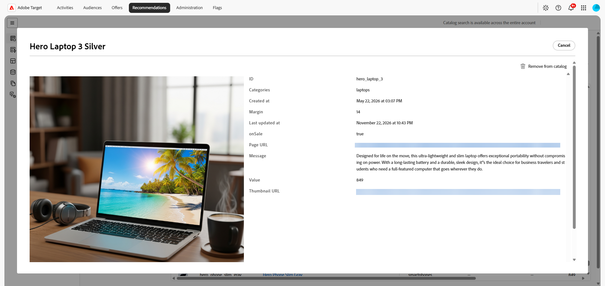
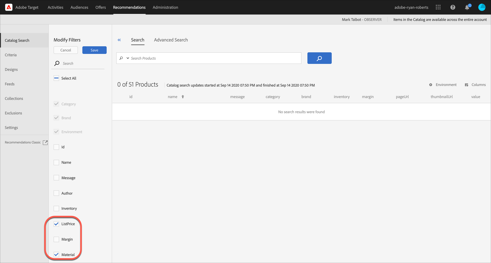

# [!UICONTROL Ricerca nel catalogo] {#catalog-search}

>[!BEGINSHADEBOX]

**In questa pagina:** Scopri come cercare nel catalogo in [!DNL Adobe Recommendations] per individuare prodotti o contenuti e come filtrare, visualizzare e rimuovere elementi.

>[!ENDSHADEBOX]

La pagina **[!UICONTROL Ricerca nel catalogo]** in [!DNL Adobe Recommendations] viene utilizzata per individuare i prodotti o il contenuto nel catalogo. L’attività di base in questa pagina è quella di cercare un elemento. La pagina consente inoltre di modificare l’ambiente, filtrare i facet, modificare le colonne della tabella e altro ancora.

Il catalogo è l’intero set di prodotti (entità). Può contenere molte raccolte, che organizzano i prodotti in gruppi logici.

L&#39;indice del catalogo viene creato automaticamente al caricamento del primo feed e aggiornato in base alla [pianificazione specificata](/help/main/c-recommendations/c-products/feeds.md#steps).

Il catalogo viene aggiornato automaticamente quando si ricevono aggiornamenti tramite file di feed, API o aggiornamenti mbox. In genere, gli aggiornamenti vengono completati entro un’ora. Se sono in corso degli aggiornamenti, viene visualizzata l’ora di inizio dell’aggiornamento più recente. Se non vi sono aggiornamenti in corso, viene visualizzata l’ora di inizio e di fine dell’aggiornamento più recente.

## Ricerca nel catalogo

Utilizzare i risultati della ricerca per esaminare gli elementi nel catalogo e, se necessario, rimuoverne gli elementi.

1. Fai clic su **[!UICONTROL Consigli]** > **[!UICONTROL Ricerca nel catalogo]**.

1. (Facoltativo) Per filtrare i risultati, fai clic sull&#39;icona **[!UICONTROL Mostra filtri]** (  ), quindi seleziona i filtri da applicare. I filtri disponibili sono **[!UICONTROL Ambiente]**, **[!UICONTROL Raccolte]**, **[!UICONTROL Categoria]**, **[!UICONTROL Marchio]**, **[!UICONTROL Inventario]** e **[!UICONTROL Valore]**.

   [Ambienti](/help/main/administrating-target/environments.md) organizzano siti e ambienti di pre-produzione per la gestione e la generazione di rapporti separati. Per modificare l&#39;ambiente, selezionare l&#39;ambiente desiderato dall&#39;elenco a discesa **[!UICONTROL Ambiente]**.

   

1. Digitare un termine di ricerca nel campo **[!UICONTROL Cerca in]**.

1. (Facoltativo) Affina la ricerca selezionando un&#39;opzione di ricerca dal menu delle opzioni, che si apre dalla freccia giù nel campo **[!UICONTROL Cerca in]**.

   Le opzioni di ricerca includono:

   * ID
   * Nome
   * Messaggio

1. Fai clic sull&#39;icona **[!UICONTROL Personalizza tabella]** (  ) per modificare le colonne attive nella pagina **[!UICONTROL Ricerca nel catalogo]**.

   

1. Scorrere gli elementi nei risultati della ricerca per visualizzare miniature e altre informazioni sul prodotto.

   >[!NOTE]
   >
   >In una ricerca nel catalogo per un attributo personalizzato con un valore numerico, l’attributo personalizzato viene considerato come di tipo stringa anziché come valore numerico.
   >
   >Il tipo di un attributo non può essere modificato. Per richiedere una modifica, [apri un problema cliente](/help/main/cmp-resources-and-contact-information.md#reference_ACA3391A00EF467B87930A450050077C) facendo riferimento agli attributi il cui tipo deve passare da stringa a numerico.

1. Fai clic su un elemento nei risultati della ricerca per visualizzarne i dettagli, tra cui ID, nome, messaggio, categoria e altro ancora.

   

1. Per rimuovere l&#39;elemento dal catalogo, fare clic su **[!UICONTROL Rimuovi dal catalogo]**.

   Tutte le informazioni sull&#39;elemento vengono quindi rimosse dall&#39;indice del catalogo. L’elemento viene incluso nuovamente nel catalogo solo se viene aggiunto nuovamente in un feed di dati. Anche un elemento eliminato deve essere eliminato separatamente dai feed.

   

<!--
### Perform an advanced search {#advanced-search}

You can use [!UICONTROL Advanced Search] to further refine your search results or to save your search results as a [collection](/help/main/c-recommendations/c-products/collections.md) or [exclusion](/help/main/c-recommendations/c-products/exclusions.md).

1. Click the **[!UICONTROL Advanced Search]** link.

   

1. Use the drop-down lists to specify the parameter, operator, and values for your search.

1. (Optional) Click **[!UICONTROL Add Rule]** to add an additional search rule.

   Each additional search rule is joined with the AND operator.

1. Click **[!UICONTROL Search]**.

1. (Optional) Click **[!UICONTROL Save As]**, then click **[!UICONTROL Collection]** or **[!UICONTROL Exclusion]**.

   

   For more information, see [Create a collection or exclusion based on Advanced Search](#save-as) below.
-->

<!--
## Modify the Catalog Search page (filters and columns)

You can temporarily modify the available filters and columns on the [!UICONTROL Catalog Search] page for the current session.

### Modify filters

You can add additional filter facets to the [!UICONTROL Catalog Search] page.

1. In the **[!UICONTROL Filters]** panel, click **[!UICONTROL Modify]**.

   

1. Select the desired search facets (ID, name, message, etc.), then click **[!UICONTROL Save]**.

   

Keep in mind that the additional filter facets are available in the current session only.
-->

<!--
## Create a collection or exclusion based on Advanced Search {#save-as}

You can create [collections](/help/main/c-recommendations/c-products/collections.md) or [exclusions](/help/main/c-recommendations/c-products/exclusions.md) using [!UICONTROL Advanced Search] on the [!UICONTROL Catalog Search] page ([!UICONTROL Recommendations] > [!UICONTROL Catalog Search] > [!UICONTROL Advanced Search]).

1. Perform an [advanced search](#advanced-search).

1. Click **[!UICONTROL Save As]**, then click **[!UICONTROL Collection]** or **[!UICONTROL Exclusion]**.

   

   >[!IMPORTANT]
   >
   >The [!UICONTROL Advanced Search] functionality is case-insensitive; however, products returned at the time of delivery are based on case-sensitive search. This mismatch might lead to confusion. Ensure that you consider case-sensitivity when you create collections or exclusions based on results using the [!UICONTROL Advanced Search] functionality. For example, if you perform a search for "Holiday," that initial search lists results containing "Holiday" and "holiday." If you then create a catalog with the intent to return products containing "holiday," only products containing "holiday" are returned. Products containing "Holiday" are not returned. Exclusions are handled in a similar fashion.
-->
