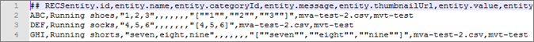

# Attributi di entità personalizzati {#custom-entity-attributes}

>[!BEGINSHADEBOX]

**In questa pagina:** Scopri come definire, inviare e utilizzare attributi di entità personalizzati a valore singolo e multiplo che descrivono gli elementi nel catalogo [!DNL Adobe Target Recommendations].

>[!ENDSHADEBOX]

Utilizzare attributi di entità personalizzati a valore singolo e multiplo in [!DNL Adobe Target Recommendations] per definire informazioni aggiuntive sugli elementi del catalogo. Queste informazioni possono quindi essere utilizzate nelle regole di inclusione degli algoritmi, di catalogo e di esclusione e possono essere visualizzate nelle progettazioni.

## Limiti {#limits}

Per definire informazioni aggiuntive sugli elementi del catalogo, puoi includere fino a 100 attributi di entità personalizzati. Ad esempio, puoi creare un attributo personalizzato denominato `entity.genre` per definire un libro o un film. In alternativa, per la vendita di biglietti si possono creare attributi per il luogo di un evento in modo da includere un artista secondario, come la squadra ospite di un evento sportivo o il gruppo spalla di un concerto.

La lunghezza massima degli attributi personalizzati delle entità con valore singolo è di 15.000 caratteri (per lingue con codifica UTF-8 a uno e due byte, come inglese e altre lingue basate su alfabeto latino) oppure 10.000 caratteri (per lingue con codifica UTF-8 a tre byte come cinese, giapponese e coreano).

Gli attributi personalizzati delle entità con più valori possono contenere un massimo di 500 valori. Ogni singolo valore è limitato a 100 caratteri. Il numero totale di caratteri su tutti i valori deve essere conforme alle limitazioni per la lunghezza massima degli attributi personalizzati delle entità a valore singolo (vedi sopra).

## Valori degli attributi di entità personalizzati {#section_313331A9F8194A89B5EDD89363018651}

Gli attributi di entità personalizzati possono contenere uno o più valori. I valori degli attributi di entità vengono mostrati nella visualizzazione del prodotto.


Un attributo di entità personalizzato con un valore singolo è formato come un attributo di entità predefinito a valore singolo:

`entity.genre=genre1`

Un attributo di entità personalizzato con più valori deve essere inviato come array JSON valido:

`entity.genre=["genre1", "genre2"]`

Esempi di array JSON validi supportati da [!DNL Recommendations]:

* `["AB","BC"]` tutti i valori sono stringhe
* `[1,2]` tutti i valori sono numerici

>[!NOTE]
>
>[!DNL Recommendations] non supporta tipi di valore misti negli attributi di entità con più valori. Ad esempio, `["AB",1,true, [1,2,3]]` è un array JSON valido, ma non è supportato in [!DNL Recommendations] perché include tipi di valori misti (stringa, numerico, booleano, oggetto).

Dopo che un attributo personalizzato viene inviato come array JSON valido, viene considerato come un attributo con più valori per tutti i prodotti del catalogo.

>[!NOTE]
>
>Per cambiare un attributo con più valori in attributo con valore singolo, devi cancellare il catalogo e caricare i dati prodotto corretti. L’eliminazione del catalogo non comporta l’eliminazione dei dati cronologici associati agli ID dei prodotti. Per ulteriori informazioni, consulta [Eliminazione di tutti gli elementi dal sistema](/help/main/assets/adobe-recommendations-classic.pdf) nella documentazione di *Adobe Recommendations Classic*.

**Limitazioni**:

* Non è possibile utilizzare nomi di attributi di entità predefiniti per attributi di entità personalizzati. (Consulta [Attributi di entità](/help/main/c-recommendations/c-products/entity-attributes.md#entity-attributes).)
* L’attributo `entity.environment` è riservato dal sistema e non può essere utilizzato per gli attributi di entità personalizzati. I tentativi di passare `entity.environment` tramite `targetPageParams`, feed o API verranno ignorati.
* Gli array devono contenere un unico tipo di valore. Gli array con valori misti (`["AB",1,true]`) non sono supportati.
* Un attributo con più valori che include un array JSON nidificato (`[10,12,[1,2,3]]`) viene considerato come un attributo a valore singolo.

## Implementazione di attributi con più valori {#section_80FEFE49E8AF415D99B739AA3CBA2A14}

Gli attributi di entità personalizzate con più valori sono supportati quando si utilizzano feed (CSV), `targetPageParams` e l’API di consegna per caricare i prodotti. I nuovi valori sostituiscono quelli correnti; non vengono aggiunti. Gli array vuoti ( [] ) vengono considerati privi di valori.

Le virgolette doppie devono essere precedute dalla sequenza di escape. Ad esempio, `"[""test"", ""value""]"` è un array JSON valido che può essere utilizzato in CSV.

### Utilizzo di targetPageParams

Nell&#39;esempio seguente viene illustrato come utilizzare `targetPageParams`:

```javascript
function targetPageParams() { 
  return { 
    'entity.id':                   '123', 
    'entity.categoryId':            '["A", "A:B", "A:B:C", "A:B:C:D"]',        
    'entity.MultiValueAttribute':   '["X", "Y", "Z"]', 
    'entity.event.detailsOnly':     'true', 
    'excludedIds':                  '[123, 3232, 2323, 4344]', 
    'orderId':                      '123456', 
    'orderTotal':                   '195.32', 
    'productPurchaseId':            '[001,002,003]' 
  }; 
}
```

### Utilizzo di CSV

Puoi gestire i file CSV in formato raw tramite un editor di testo o un foglio di calcolo.

Il CSV raw sarà simile a questo:



Lo stesso catalogo si presenterà così in un foglio di calcolo:


Durante la conversione in formato .csv, il foglio di calcolo aggiunge virgolette doppie attorno al contenuto delle celle per evitare che le virgole all’interno della cella agiscano come separatori di colonna. Vengono inoltre aggiunte virgolette doppie intorno ai valori di stringa JSON inclusi negli attributi con più valori personalizzati. Questo può rendere complicato lavorare direttamente sul file raw. Ad esempio:

* Foglio di calcolo: `["1","2","3"]`
* Raw: `"[""1"",""2"",""3""]"`

Presta attenzione quando modifichi direttamente un file di catalogo CSV raw.

### Utilizzo delle API

Puoi trasmettere attributi con più valori utilizzando l’API di consegna in un parametro mbox come valore stringa contenente un array JSON con escape.

```javascript
"execute": {
    "mboxes": [
      {
        "index": 0,
        "name": "first-mbox",
        "parameters": {
          "entity.id": "32323",
          "entity.categoryId": "My Category",
          "entity.MultiValueAttribute": "[\"X\", \"Y\", \"Z\"]"
        }
      }
    ]
  }
```

Per informazioni sull&#39;utilizzo delle API di recapito e salvataggio di entità, consulta la [documentazione delle API di Adobe Recommendations](https://experienceleague.adobe.com/docs/target-dev/developer/recommendations.html){target=_blank}.

## Utilizzo di operatori con attributi con più valori {#section_83C2288A805242D9A02EBC4F07DEE945}

Quando applichi gli operatori agli attributi personalizzati con più valori nelle regole di inclusione degli algoritmi, di catalogo e di esclusione, il risultato sarà *vero* se almeno un valore nell’elenco deve essere soddisfatto (booleano *or*).

Nell&#39;esempio seguente, la regola è `message contains abc`.

* Caso 1: `entity.genre = ["ab", "bc", "de"]`. Il risultato è falso perché nessun valore contiene `abc`.
* Caso 2: `entity.genre = ["abcde","de","ef"]`. Il risultato è vero perché un valore contiene `abc`.

Per gli operatori negativi, tutti i valori di attributo devono essere soddisfatti (booleano *and*). Ad esempio, se l&#39;operatore è `notEquals`, il risultato sarà *false* se viene trovato un valore.

Nella tabella seguente viene riepilogato il comportamento di ogni operatore e vengono indicati i casi per ogni regola di esempio.

| Operatore | Il risultato è vero quando | Esempio di regola | Valore attributo | Risultato | Motivo |
|---|---|---|---|---|---|
| È uguale a | Qualsiasi valore di attributo è uguale al valore specificato. | `genre equals abc` | `["ab", "bc", "de"]` | False | Nessun valore è uguale a `abc`. |
|  |  |  | `["abc", "de", "ef"]` | Vero | Un valore è uguale a `abc`. |
|  |  |  | `["abcde", "de", "ef"]` | False | `abc` non è uguale a nessun elemento dell&#39;elenco. |
| È diverso da | Nessun valore di attributo è uguale al valore specificato. | `genre not equals abc` | `["ab", "bc", "de"]` | Vero | Nessun valore è uguale a `abc`. |
|  |  |  | `["abc", "de", "ef"]` | False | Un valore è uguale a `abc`. |
|  |  |  | `["abcde", "de", "ef"]` | Vero | `abc` non è uguale a nessun elemento dell&#39;elenco. |
| Contiene | Qualsiasi valore di attributo contiene il valore specificato. | `genre contains abc` | `["ab", "bc", "de"]` | False | Nessun valore contiene `abc`. |
|  |  |  | `["abcde", "de", "ef"]` | Vero | Un valore contiene `abc`. |
| Non contiene | Nessun valore di attributo contiene il valore specificato. | `genre does not contain abc` | `["ab", "bc", "de"]` | Vero | Nessun valore contiene `abc`. |
|  |  |  | `["abcde", "de", "ef"]` | False | Un valore contiene `abc`. |
| Inizia con | Qualsiasi valore di attributo inizia con il valore specificato. | `genre starts with abc` | `["ab", "bc", "de"]` | False | Nessun valore inizia con `abc`. |
|  |  |  | `["abcde", "de", "ef"]` | Vero | Un valore inizia con `abc`. |
|  |  |  | `["ab", "de", "abc"]` | Vero | Un valore inizia con `abc` (non necessariamente il primo elemento dell&#39;elenco). |
| Termina con | Qualsiasi valore di attributo termina con il valore specificato. | `genre ends with abc` | `["ab", "bc", "de"]` | False | Nessun valore termina con `abc`. |
|  |  |  | `["deabc", "de", "ef"]` | Vero | Un valore termina con `abc`. |
| Maggiore o uguale a (solo valori numerici) | Qualsiasi valore di attributo è maggiore o uguale al valore specificato. Ogni valore viene convertito in doppio e i valori che non possono essere convertiti vengono ignorati durante l’esecuzione della regola. | `price greater than or equal to 100` | `["10", "20", "45", "de"]` | False | Nessun valore è maggiore o uguale a 100. Il valore `de` viene ignorato perché non può essere convertito in doppio. |
|  |  |  | `["100", "101", "90", "80"]` | Vero | Due valori sono maggiori o uguali a 100. |
| Minore o uguale a (solo valori numerici) | Qualsiasi valore di attributo è minore o uguale al valore specificato. Ogni valore viene convertito in doppio e i valori che non possono essere convertiti vengono ignorati durante l’esecuzione della regola. | `price less than or equal to 100` | `["101", "200", "141", "de"]` | False | Nessun valore è minore o uguale a 100. Il valore `de` viene ignorato perché non può essere convertito in doppio. |
|  |  |  | `["100", "101", "90", "80"]` | Vero | Due valori sono minori o uguali a 100. |
| Corrisponde dinamicamente (disponibile solo negli algoritmi basati su elementi) | Qualsiasi valore di attributo corrisponde al valore specificato. | `genre matches abc` | `["ab", "bc", "de"]` | False | Nessun valore corrisponde a `abc`. |
|  |  |  | `["abc", "de", "ef"]` | Vero | Un valore corrisponde a `abc`. |
| Non corrisponde dinamicamente (disponibile solo negli algoritmi basati su elementi) | Nessun valore di attributo corrisponde al valore specificato. Il risultato è falso se qualsiasi valore di attributo corrisponde a. | `genre does not match abc` | `["ab", "bc", "de"]` | Vero | Nessun valore corrisponde a `abc`. |
|  |  |  | `["abc", "de", "ef"]` | False | Un valore corrisponde a `abc`. |
| Rientra dinamicamente nell’intervallo (disponibile solo negli algoritmi basati su elementi, solo per valori numerici) | Qualsiasi valore di attributo numerico rientra nell&#39;intervallo specificato. | `price dynamically ranges in 80% to 120% of 100` | `["101", "200", "125", "de"]` | Vero | `101` è compreso tra l&#39;80% e il 120% di 100. Il valore `de` viene ignorato perché non può essere convertito in doppio. |
|  |  |  | `["130", "191", "60", "75"]` | False | Nessun valore è compreso tra 80% e 120% di 100. |

>[!NOTE]
>
>*Doppio* è un tipo di dati Java. Per gli operatori che richiedono valori numerici, la conversione in doppio elimina i valori non numerici dalla considerazione nei risultati.

## Attributi con più valori nelle progettazioni {#section_F672E4F6E1D44B3196B7ADE89334ED4A}

Gli attributi con più valori vengono visualizzati come elenco separato da virgole quando vi si fa riferimento in una progettazione.

Esempio:

Quando `entity.genre=["genre1","genre2"]` ha un riferimento in un progetto come `$entity<N>.genre`, il risultato è `genre1, genre2`.

## Argomenti correlati

* [Attributi di entità](/help/main/c-recommendations/c-products/entity-attributes.md#entity-attributes)
