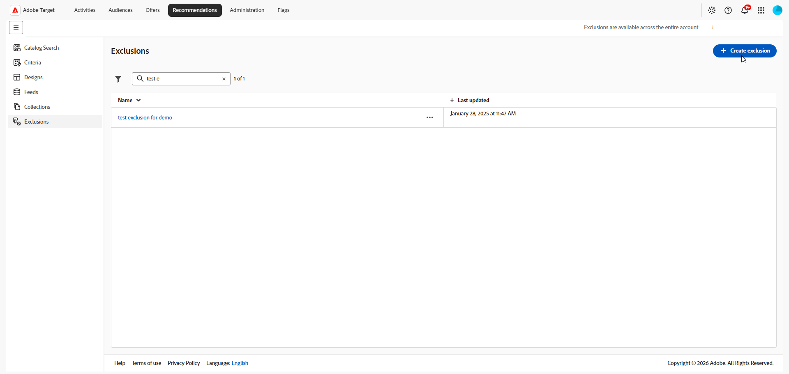

# Esclusioni {#exclusions}

>[!BEGINSHADEBOX]

**In questa pagina:** Scopri come creare e gestire esclusioni in [!DNL Adobe Target Recommendations] per impedire che prodotti o contenuti vengano consigliati ai visitatori.

>[!ENDSHADEBOX]

Un’esclusione è un sottoinsieme di prodotti o contenuti che non devono essere consigliati ai visitatori. Le esclusioni sono disponibili a livello dell&#39;intero account. A differenza delle raccolte, che vengono selezionate per ogni esperienza al momento della creazione di un&#39;attività [!DNL Recommendations], le esclusioni si applicano a tutte le attività nell&#39;account e nessun gruppo di esclusione può essere assegnato durante la creazione dell&#39;attività.

Le esclusioni vengono generalmente utilizzate per:

* Prodotti che sono stati sospesi.
* Elementi di un catalogo non più disponibile. Ad esempio, quando solo il catalogo Autunno e Inverno deve essere presente online, non è possibile acquistare alcun articolo del catalogo Estate.
* Articoli che potrebbero essere inappropriati da consigliare sulla maggior parte delle pagine o schermate (prodotti per adulti, film NC-17 e così via).
* Prodotti con campi di metadati incompleti (miniatura, prezzo o altri metadati importanti mancanti).
* Prodotti che non dovrebbero mai essere consigliati, come una SKU presente nel sistema ma non acquistabile o una SKU falsa utilizzata dal team di controllo qualità per simulare un acquisto senza ordinare nulla.

>[!IMPORTANT]
>
>Le regole di esclusione vengono applicate globalmente a tutti i [ambienti](/help/main/administrating-target/environments.md).
>
>Per informazioni dettagliate, esempi e scenari di utilizzo relativi alle regole di esclusione statiche e dinamiche, consulta [Utilizzare regole di inclusione dinamiche e statiche](/help/main/c-recommendations/c-algorithms/use-dynamic-and-static-inclusion-rules.md#inclusion-rules).

## Creare un’esclusione

Le regole di esclusione vengono definite una volta e quindi applicate a ogni attività [!DNL Recommendations] nell&#39;account.

1. Fai clic su **[!UICONTROL Consigli]** > **[!UICONTROL Esclusioni]** per visualizzare l&#39;elenco delle esclusioni esistenti.

   >[!NOTE]
   >
   >Il &quot;Numero di elementi&quot; segnalato per ogni esclusione nella visualizzazione elenco **[!UICONTROL Esclusioni]** è il numero di prodotti che corrispondono alle regole per tale esclusione all&#39;interno del gruppo predefinito di consigli [host](/help/main/administrating-target/hosts.md) (ambiente) configurato. Per informazioni su come modificare il gruppo host predefinito, vedere [Pianificare e implementare [!DNL Recommendations]](https://experienceleague.adobe.com/en/docs/target-dev/developer/recommendations){target=_blank} nella *Guida per gli sviluppatori di Adobe Target*.

1. Fai clic sull&#39;icona **[!UICONTROL Mostra filtri]** (  ), quindi scegli l&#39;[ambiente](/help/main/administrating-target/environments.md) desiderato dall&#39;elenco a discesa **[!UICONTROL Ambiente]** per visualizzare in anteprima il contenuto dell&#39;esclusione in tale ambiente. Per impostazione predefinita, sono visualizzati i risultati del gruppo di host predefinito.

   

1. Fai clic su **[!UICONTROL Crea esclusione]**.

   

1. Digitare un&#39;esclusione **[!UICONTROL Nome]**. È inoltre possibile immettere una descrizione facoltativa.

1. Utilizza il generatore di regole per definire l’esclusione.

   Selezionare un parametro nell&#39;elenco **[!UICONTROL Regole]**, selezionare un operatore, quindi immettere uno o più valori per identificare i prodotti. Separa i valori con le virgole.

1. Fai clic su **[!UICONTROL Crea]**.

1. Fai clic sull&#39;icona Altre azioni (  ) accanto all&#39;esclusione desiderata nell&#39;elenco, quindi fai clic sull&#39;opzione appropriata: **[!UICONTROL Modifica]**, **[!UICONTROL Copia]** o **[!UICONTROL Elimina]**.

   

<!--
## Create an exclusion using Advanced Search

You can also create exclusions using [!UICONTROL Advanced Search] on the [Catalog Search](/help/main/c-recommendations/c-products/catalog-search.md#save-as) page ( [!UICONTROL Recommendations] > [!UICONTROL Catalog Search] > [!UICONTROL Advanced Search]). 

After creating a search using "id > contains," for example, you can then click [!UICONTROL Save As] > [!UICONTROL Exclusion].

>[!IMPORTANT]
>
>The [!UICONTROL Advanced Search] functionality is case-insensitive; however, products returned at the time of delivery are based on case-sensitive search. This mismatch might lead to confusion. Ensure that you consider case-sensitivity when you create exclusions based on results using the Advanced Search functionality. For example, if you perform a search for "Holiday," that initial search lists results containing "Holiday" and "holiday." If you then create an exclusion with the intent to exclude products containing "holiday," only products containing "holiday" are excluded. Products containing "Holiday" are not excluded.
-->

## Video di formazione: Crea raccolte ed esclusioni in Recommendations (7:05) 

Questo video contiene le seguenti informazioni:

* Creare una raccolta
* Creare un’esclusione

>[!VIDEO](https://video.tv.adobe.com/v/27689)
